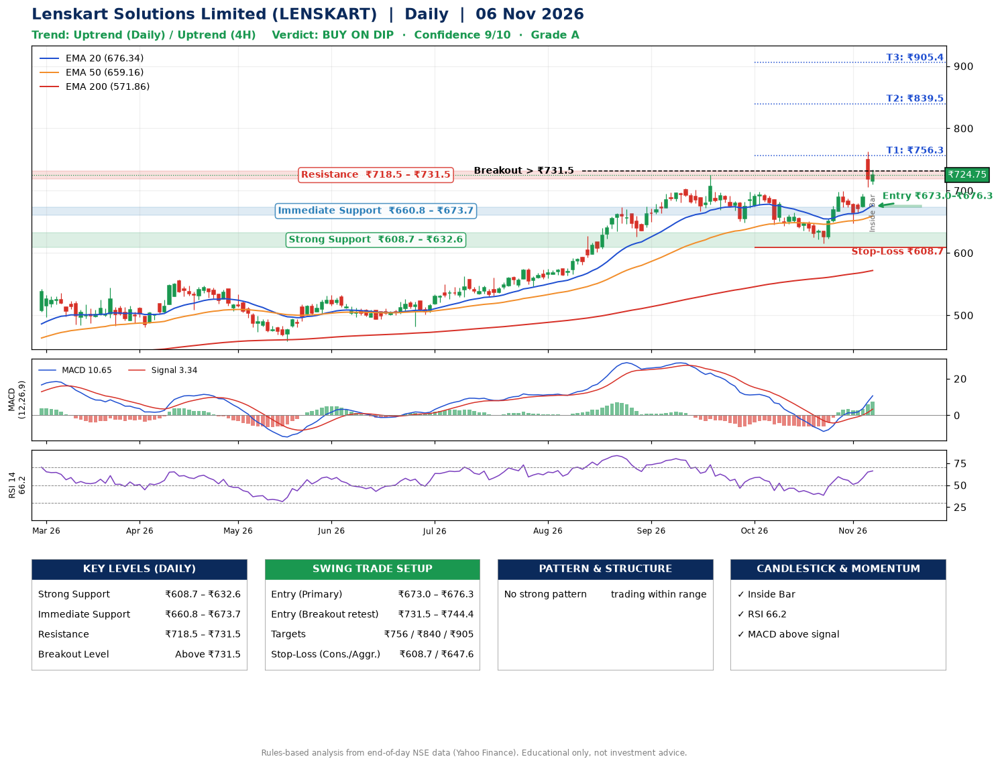

📌 **Lenskart Solutions Limited (LENSKART) – Multi-Timeframe Technical Analysis (Daily + 4H Combined)**
_Data up to 06 Nov 2026 · Close ₹724.75_

**📍 Daily Timeframe Trend**
- Trend: **Uptrend** (price above rising EMAs)
- Recent swing highs: ₹575.7, ₹725.0, ₹698.1 · swing lows: ₹667.2, ₹648.3, ₹615.2
- EMAs: EMA20 ₹676.3, EMA50 ₹659.2, EMA200 ₹571.9; bullish stack (EMA20 > EMA50 > EMA200); price above EMA20, EMA50, EMA200
- MACD 10.65 above signal 3.34 (above zero); histogram rising
- RSI(14) 66.2; no divergence on the last two swings

**📍 4-Hour Timeframe Trend**
- Structure: **Uptrend** (higher highs and higher lows)
- Pullback/support area: recent 4H swing lows ₹615.5, ₹649.3; EMA20 ₹688.4
- EMA20/50: bullish stack (EMA20 > EMA50); price above EMA20, EMA50
- MACD 16.19 above signal 10.44 (above zero); histogram rising
- RSI(14) 70.7; no divergence

**📍 Pattern Detection (Both Timeframes)**
- 4H: **Inverse Head & Shoulders** – head ₹615.5, neckline ₹698.5

**📍 Candlestick Patterns (last 3 daily candles)**
- **Inside Bar** – 06 Nov: compression inside the prior range ₹706.2–₹762.8

**📍 Price Action Key Levels (Daily Structure)**

| Zone | Price Level (₹) | Context |
|------|-----------------|---------|
| Strong Support | ₹608.7 – ₹632.6 | Cluster of earlier swing lows (demand) |
| Immediate Support | ₹660.8 – ₹673.7 | Nearest swing-low / wick area |
| Resistance | ₹718.5 – ₹731.5 | Nearest swing-high supply |
| Breakout Level | Above ₹731.5 | Swing continuation trigger (52-week high ₹762.8) |

**📍 Swing Trade Setup**

🟢 **Entry Zone**
- Primary: ₹673.0 – ₹676.3 (daily support / EMA20 area; enter on a bullish 4H candle)
- Alternate: ₹731.5 – ₹744.4 (breakout retest)

🎯 **Profit Targets**
- T1: ₹756.3
- T2: ₹839.5
- T3: ₹905.4

🛑 **Stop-Loss**
- Conservative: below daily swing low (₹608.7)
- Aggressive: below 4H structure (₹647.6)
- Risk per share ≈ ₹65.9; reward:risk to T1 ≈ 1.2

**📌 Strategy Notes**
- Higher timeframe: daily trend is uptrend; only take longs while price holds above ₹608.7.
- Entry timing: wait for a bullish 4H candle (engulfing/hammer) inside ₹673.0 – ₹676.3 rather than buying mid-range.
- EMA stacking: bullish stack (EMA20 > EMA50 > EMA200); price above EMA20, EMA50, EMA200.
- Breakout rule: a daily close above ₹731.5 with volume above its 20-day average (≈5,650,822) opens T2/T3.
- Momentum: RSI 66 – elevated, prefer dips; no divergence on the last two swings.
- Exit discipline: move the stop to entry once T1 is hit; book partial profits at each target.

**STEP 2 — Marked Up Chart**

**✅ Trade Validation Checklist**
- Trend + momentum aligned: Yes · Price at entry zone: No
- Stop defined (₹608.7) · Reward:risk ≥ 1.5 to T1: No

## 📌 Final Verdict

Recommendation: **🟡 BUY ON DIP**

Confidence: **9/10**

Trade Quality: **A**

Reason:
• Daily uptrend (price above rising EMAs)
• EMAs stacked bullishly

Next Action:
• Wait for a pullback to ₹673.0–₹676.3

_Rules-based analysis from end-of-day data. Educational only, not investment advice. Never place orders without your own confirmation._