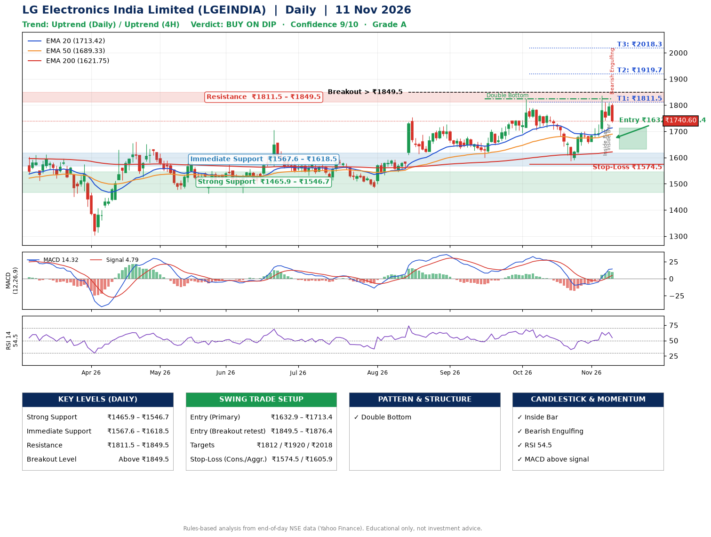

📌 **LG Electronics India Limited (LGEINDIA) – Multi-Timeframe Technical Analysis (Daily + 4H Combined)**
_Data up to 11 Nov 2026 · Close ₹1740.60_

**📍 Daily Timeframe Trend**
- Trend: **Uptrend** (price above rising EMAs)
- Recent swing highs: ₹1755.0, ₹1727.1, ₹1825.0 · swing lows: ₹1484.8, ₹1599.0, ₹1588.0
- EMAs: EMA20 ₹1713.4, EMA50 ₹1689.3, EMA200 ₹1621.8; bullish stack (EMA20 > EMA50 > EMA200); price above EMA20, EMA50, EMA200
- MACD 14.32 above signal 4.79 (above zero), fresh bullish crossover; histogram falling
- RSI(14) 54.5; no divergence on the last two swings

**📍 4-Hour Timeframe Trend**
- Structure: **Uptrend** (higher highs and higher lows)
- Pullback/support area: recent 4H swing lows ₹1589.0, ₹1659.0; EMA20 ₹1729.1
- EMA20/50: bullish stack (EMA20 > EMA50); price above EMA20, EMA50
- MACD 21.52 above signal 16.77 (above zero); histogram falling
- RSI(14) 52.2; no divergence

**📍 Pattern Detection (Both Timeframes)**
- Daily: **Double Bottom** – bottoms near ₹1599.0/₹1588.0, neckline ₹1825.0, forming
- 4H: **Inverse Head & Shoulders** – head ₹1589.0, neckline ₹1744.4

**📍 Candlestick Patterns (last 3 daily candles)**
- **Inside Bar** – 06 Nov: compression inside the prior range ₹1700.0–₹1836.0
- **Inside Bar** – 09 Nov: compression inside the prior range ₹1741.1–₹1812.5
- **Bearish Engulfing** – 11 Nov: sellers fully reversed the prior green candle

**📍 Price Action Key Levels (Daily Structure)**

| Zone | Price Level (₹) | Context |
|------|-----------------|---------|
| Strong Support | ₹1465.9 – ₹1546.7 | Cluster of earlier swing lows (demand) |
| Immediate Support | ₹1567.6 – ₹1618.5 | Nearest swing-low / wick area |
| Resistance | ₹1811.5 – ₹1849.5 | Nearest swing-high supply |
| Breakout Level | Above ₹1849.5 | Swing continuation trigger (52-week high ₹1836.0) |

**📍 Swing Trade Setup**

🟢 **Entry Zone**
- Primary: ₹1632.9 – ₹1713.4 (daily support / EMA20 area; enter on a bullish 4H candle)
- Alternate: ₹1849.5 – ₹1876.4 (breakout retest)

🎯 **Profit Targets**
- T1: ₹1811.5
- T2: ₹1919.7
- T3: ₹2018.3

🛑 **Stop-Loss**
- Conservative: below daily swing low (₹1574.5)
- Aggressive: below 4H structure (₹1605.9)
- Risk per share ≈ ₹98.6; reward:risk to T1 ≈ 1.4

**📌 Strategy Notes**
- Higher timeframe: daily trend is uptrend; only take longs while price holds above ₹1465.9.
- Entry timing: wait for a bullish 4H candle (engulfing/hammer) inside ₹1632.9 – ₹1713.4 rather than buying mid-range.
- EMA stacking: bullish stack (EMA20 > EMA50 > EMA200); price above EMA20, EMA50, EMA200.
- Breakout rule: a daily close above ₹1849.5 with volume above its 20-day average (≈477,845) opens T2/T3.
- Momentum: RSI 55 – room to run; no divergence on the last two swings.
- Exit discipline: move the stop to entry once T1 is hit; book partial profits at each target.

**STEP 2 — Marked Up Chart**

**✅ Trade Validation Checklist**
- Trend + momentum aligned: Yes · Price at entry zone: No
- Stop defined (₹1574.5) · Reward:risk ≥ 1.5 to T1: No

## 📌 Final Verdict

Recommendation: **🟡 BUY ON DIP**

Confidence: **9/10**

Trade Quality: **A**

Reason:
• Daily uptrend (price above rising EMAs)
• EMAs stacked bullishly

Next Action:
• Wait for a pullback to ₹1632.9–₹1713.4, or a breakout above ₹1849.5

_Rules-based analysis from end-of-day data. Educational only, not investment advice. Never place orders without your own confirmation._