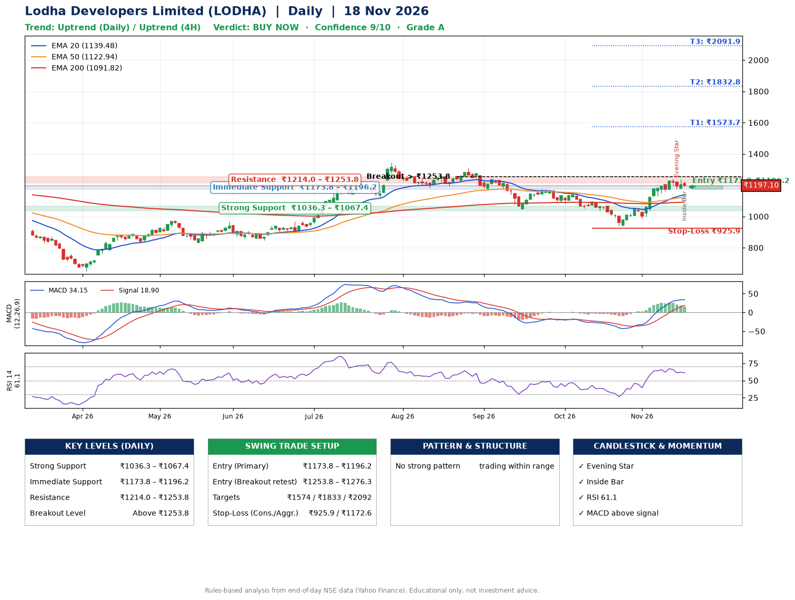

📌 **Lodha Developers Limited (LODHA) – Multi-Timeframe Technical Analysis (Daily + 4H Combined)**
_Data up to 18 Nov 2026 · Close ₹1197.10_

**📍 Daily Timeframe Trend**
- Trend: **Uptrend** (price above rising EMAs)
- Recent swing highs: ₹1344.9, ₹1306.9, ₹1177.5 · swing lows: ₹1185.0, ₹1047.5, ₹937.1
- EMAs: EMA20 ₹1139.5, EMA50 ₹1122.9, EMA200 ₹1091.8; bullish stack (EMA20 > EMA50 > EMA200); price above EMA20, EMA50, EMA200
- MACD 34.15 above signal 18.90 (above zero); histogram falling
- RSI(14) 61.1; no divergence on the last two swings

**📍 4-Hour Timeframe Trend**
- Structure: **Uptrend** (price above rising EMAs)
- Pullback/support area: recent 4H swing lows ₹988.4, ₹1175.5; EMA20 ₹1172.9
- EMA20/50: bullish stack (EMA20 > EMA50); price above EMA20, EMA50
- MACD 34.38 below signal 37.90 (above zero), fresh bearish crossover; histogram falling
- RSI(14) 59.7; no divergence

**📍 Pattern Detection (Both Timeframes)**
- 4H: **Bull Flag** – 16% pole then a tight 6% flag; trigger above ₹1242.6

**📍 Candlestick Patterns (last 3 daily candles)**
- **Evening Star** – 16 Nov: three-candle bearish reversal
- **Inside Bar** – 18 Nov: compression inside the prior range ₹1177.2–₹1237.8

**📍 Price Action Key Levels (Daily Structure)**

| Zone | Price Level (₹) | Context |
|------|-----------------|---------|
| Strong Support | ₹1036.3 – ₹1067.4 | Cluster of earlier swing lows (demand) |
| Immediate Support | ₹1173.8 – ₹1196.2 | Nearest swing-low / wick area |
| Resistance | ₹1214.0 – ₹1253.8 | Nearest swing-high supply |
| Breakout Level | Above ₹1253.8 | Swing continuation trigger (52-week high ₹1344.9) |

**📍 Swing Trade Setup**

🟢 **Entry Zone**
- Primary: ₹1173.8 – ₹1196.2 (daily support / EMA20 area; enter on a bullish 4H candle)
- Alternate: ₹1253.8 – ₹1276.3 (breakout retest)

🎯 **Profit Targets**
- T1: ₹1573.7
- T2: ₹1832.8
- T3: ₹2091.9

🛑 **Stop-Loss**
- Conservative: below daily swing low (₹925.9)
- Aggressive: below 4H structure (₹1172.6)
- Risk per share ≈ ₹259.1; reward:risk to T1 ≈ 1.5
- Time to T1: about 35 trading days (it rose this much within 60 trading days 18% of the time in the last 2 years)
- Time to T2: about 42 trading days (it rose this much within 60 trading days 1% of the time in the last 2 years)

**📌 Strategy Notes**
- Higher timeframe: daily trend is uptrend; only take longs while price holds above ₹1036.3.
- Entry timing: wait for a bullish 4H candle (engulfing/hammer) inside ₹1173.8 – ₹1196.2 rather than buying mid-range.
- EMA stacking: bullish stack (EMA20 > EMA50 > EMA200); price above EMA20, EMA50, EMA200.
- Breakout rule: a daily close above ₹1253.8 with volume above its 20-day average (≈1,480,911) opens T2/T3.
- Momentum: RSI 61 – room to run; no divergence on the last two swings.
- Exit discipline: move the stop to entry once T1 is hit; book partial profits at each target.

**STEP 2 — Marked Up Chart**

**✅ Trade Validation Checklist**
- Trend + momentum aligned: Yes · Price at entry zone: No
- Stop defined (₹925.9) · Reward:risk ≥ 1.5 to T1: Yes

## 📌 Final Verdict

Recommendation: **🟢 BUY NOW**

Confidence: **9/10**

Trade Quality: **A**

Reason:
• Daily uptrend (price above rising EMAs)
• EMAs stacked bullishly

Next Action:
• Buy now within the entry zone, with the stop-loss in place

_Rules-based analysis from end-of-day data. Educational only, not investment advice. Never place orders without your own confirmation._