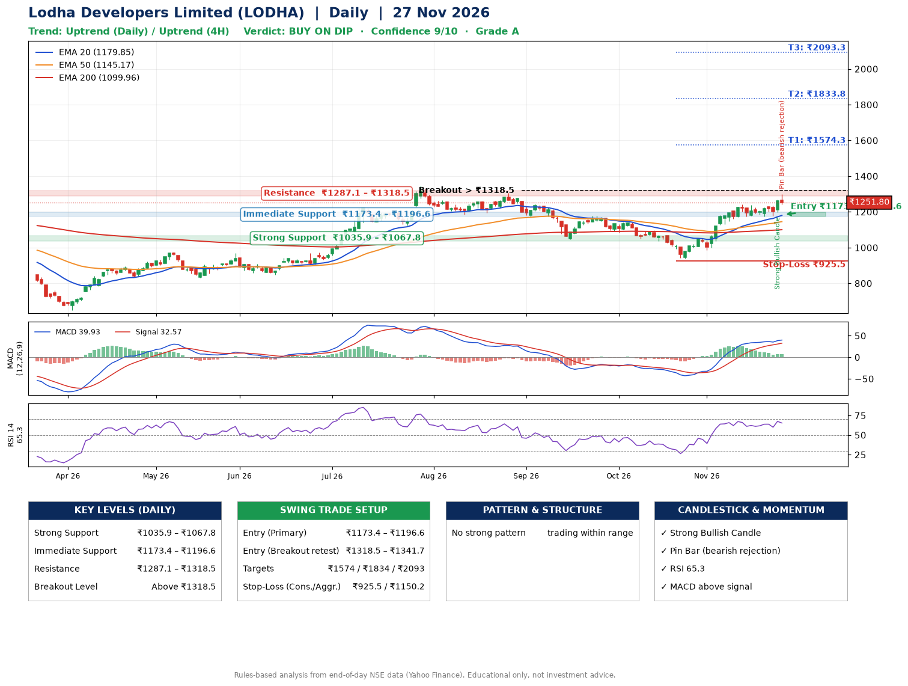

📌 **Lodha Developers Limited (LODHA) – Multi-Timeframe Technical Analysis (Daily + 4H Combined)**
_Data up to 27 Nov 2026 · Close ₹1251.80_

**📍 Daily Timeframe Trend**
- Trend: **Uptrend** (price above rising EMAs)
- Recent swing highs: ₹1306.9, ₹1177.5, ₹1242.6 · swing lows: ₹1185.0, ₹1047.5, ₹937.1
- EMAs: EMA20 ₹1179.9, EMA50 ₹1145.2, EMA200 ₹1100.0; bullish stack (EMA20 > EMA50 > EMA200); price above EMA20, EMA50, EMA200
- MACD 39.93 above signal 32.57 (above zero); histogram falling
- RSI(14) 65.3; no divergence on the last two swings

**📍 4-Hour Timeframe Trend**
- Structure: **Uptrend** (price above rising EMAs)
- Pullback/support area: recent 4H swing lows ₹1178.5, ₹1178.0; EMA20 ₹1212.3
- EMA20/50: bullish stack (EMA20 > EMA50); price above EMA20, EMA50
- MACD 27.78 above signal 27.07 (above zero), fresh bullish crossover; histogram rising
- RSI(14) 63.0; no divergence

**📍 Pattern Detection (Both Timeframes)**
- No strong pattern detected. Trading within range.

**📍 Candlestick Patterns (last 3 daily candles)**
- **Strong Bullish Candle** – 26 Nov: wide-range green candle, buyers in control
- **Pin Bar (bearish rejection)** – 27 Nov: long upper wick shows selling near ₹1298.7

**📍 Price Action Key Levels (Daily Structure)**

| Zone | Price Level (₹) | Context |
|------|-----------------|---------|
| Strong Support | ₹1035.9 – ₹1067.8 | Cluster of earlier swing lows (demand) |
| Immediate Support | ₹1173.4 – ₹1196.6 | Nearest swing-low / wick area |
| Resistance | ₹1287.1 – ₹1318.5 | Nearest swing-high supply |
| Breakout Level | Above ₹1318.5 | Swing continuation trigger (52-week high ₹1344.9) |

**📍 Swing Trade Setup**

🟢 **Entry Zone**
- Primary: ₹1173.4 – ₹1196.6 (daily support / EMA20 area; enter on a bullish 4H candle)
- Alternate: ₹1318.5 – ₹1341.7 (breakout retest)

🎯 **Profit Targets**
- T1: ₹1574.3
- T2: ₹1833.8
- T3: ₹2093.3

🛑 **Stop-Loss**
- Conservative: below daily swing low (₹925.5)
- Aggressive: below 4H structure (₹1150.2)
- Risk per share ≈ ₹259.5; reward:risk to T1 ≈ 1.5
- Time to T1: about 35 trading days (it rose this much within 60 trading days 18% of the time in the last 2 years)
- Time to T2: about 42 trading days (it rose this much within 60 trading days 1% of the time in the last 2 years)

**📌 Strategy Notes**
- Higher timeframe: daily trend is uptrend; only take longs while price holds above ₹1035.9.
- Entry timing: wait for a bullish 4H candle (engulfing/hammer) inside ₹1173.4 – ₹1196.6 rather than buying mid-range.
- EMA stacking: bullish stack (EMA20 > EMA50 > EMA200); price above EMA20, EMA50, EMA200.
- Breakout rule: a daily close above ₹1318.5 with volume above its 20-day average (≈1,657,362) opens T2/T3.
- Momentum: RSI 65 – elevated, prefer dips; no divergence on the last two swings.
- Exit discipline: move the stop to entry once T1 is hit; book partial profits at each target.

**STEP 2 — Marked Up Chart**

**✅ Trade Validation Checklist**
- Trend + momentum aligned: Yes · Price at entry zone: No
- Stop defined (₹925.5) · Reward:risk ≥ 1.5 to T1: Yes

## 📌 Final Verdict

Recommendation: **🟡 BUY ON DIP**

Confidence: **9/10**

Trade Quality: **A**

Reason:
• Daily uptrend (price above rising EMAs)
• EMAs stacked bullishly

Next Action:
• Wait for a pullback to ₹1173.4–₹1196.6

_Rules-based analysis from end-of-day data. Educational only, not investment advice. Never place orders without your own confirmation._