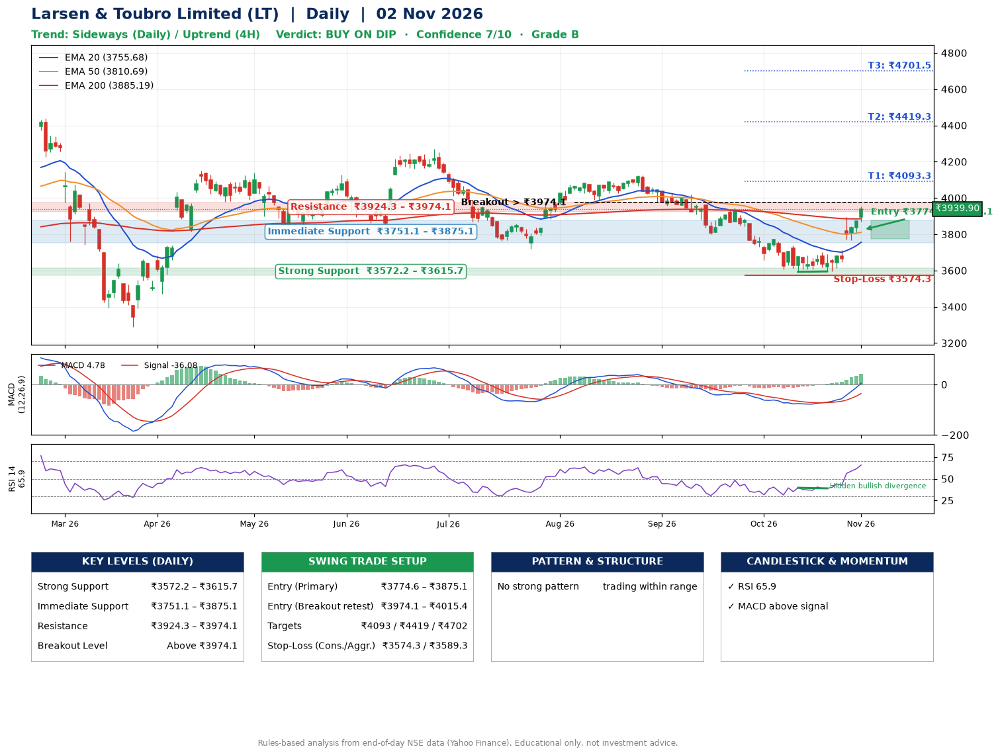

📌 **Larsen & Toubro Limited (LT) – Multi-Timeframe Technical Analysis (Daily + 4H Combined)**
_Data up to 02 Nov 2026 · Close ₹3939.90_

**📍 Daily Timeframe Trend**
- Trend: **Sideways** (mixed swing structure)
- Recent swing highs: ₹4272.3, ₹4125.3, ₹3945.0 · swing lows: ₹3799.9, ₹3592.9, ₹3595.0
- EMAs: EMA20 ₹3755.7, EMA50 ₹3810.7, EMA200 ₹3885.2; bearish stack (EMA20 < EMA50 < EMA200); price above EMA20, EMA50, EMA200
- MACD 4.78 above signal -36.08 (above zero); histogram rising
- RSI(14) 65.9; Hidden bullish divergence

**📍 4-Hour Timeframe Trend**
- Structure: **Uptrend** (higher highs and higher lows)
- Pullback/support area: recent 4H swing lows ₹3593.2, ₹3595.0; EMA20 ₹3775.7
- EMA20/50: bullish stack (EMA20 > EMA50); price above EMA20, EMA50
- MACD 56.78 above signal 28.11 (above zero); histogram rising
- RSI(14) 73.7; no divergence

**📍 Pattern Detection (Both Timeframes)**
- 4H: **Double Bottom** – bottoms near ₹3593.2/₹3595.0, neckline ₹3702.4, confirmed (closed above neckline)

**📍 Candlestick Patterns (last 3 daily candles)**
- No notable candlestick signal in the last 3 sessions.

**📍 Price Action Key Levels (Daily Structure)**

| Zone | Price Level (₹) | Context |
|------|-----------------|---------|
| Strong Support | ₹3572.2 – ₹3615.7 | Cluster of earlier swing lows (demand) |
| Immediate Support | ₹3751.1 – ₹3875.1 | Nearest swing-low / wick area |
| Resistance | ₹3924.3 – ₹3974.1 | Nearest swing-high supply |
| Breakout Level | Above ₹3974.1 | Swing continuation trigger (52-week high ₹4440.0) |

**📍 Swing Trade Setup**

🟢 **Entry Zone**
- Primary: ₹3774.6 – ₹3875.1 (daily support / EMA20 area; enter on a bullish 4H candle)
- Alternate: ₹3974.1 – ₹4015.4 (breakout retest)

🎯 **Profit Targets**
- T1: ₹4093.3
- T2: ₹4419.3
- T3: ₹4701.5

🛑 **Stop-Loss**
- Conservative: below daily swing low (₹3574.3)
- Aggressive: below 4H structure (₹3589.3)
- Risk per share ≈ ₹250.5; reward:risk to T1 ≈ 1.1

**📌 Strategy Notes**
- Higher timeframe: daily trend is sideways; only take longs while price holds above ₹3572.2.
- Entry timing: wait for a bullish 4H candle (engulfing/hammer) inside ₹3774.6 – ₹3875.1 rather than buying mid-range.
- EMA stacking: bearish stack (EMA20 < EMA50 < EMA200); price above EMA20, EMA50, EMA200.
- Breakout rule: a daily close above ₹3974.1 with volume above its 20-day average (≈2,091,701) opens T2/T3.
- Momentum: RSI 66 – elevated, prefer dips; Hidden bullish divergence.
- Exit discipline: move the stop to entry once T1 is hit; book partial profits at each target.

**STEP 2 — Marked Up Chart**

**✅ Trade Validation Checklist**
- Trend + momentum aligned: No · Price at entry zone: No
- Stop defined (₹3574.3) · Reward:risk ≥ 1.5 to T1: No

## 📌 Final Verdict

Recommendation: **🟡 BUY ON DIP**

Confidence: **7/10**

Trade Quality: **B**

Reason:
• No strong edge from trend, momentum or patterns

Next Action:
• Wait for a pullback to ₹3774.6–₹3875.1, or a breakout above ₹3974.1

_Rules-based analysis from end-of-day data. Educational only, not investment advice. Never place orders without your own confirmation._