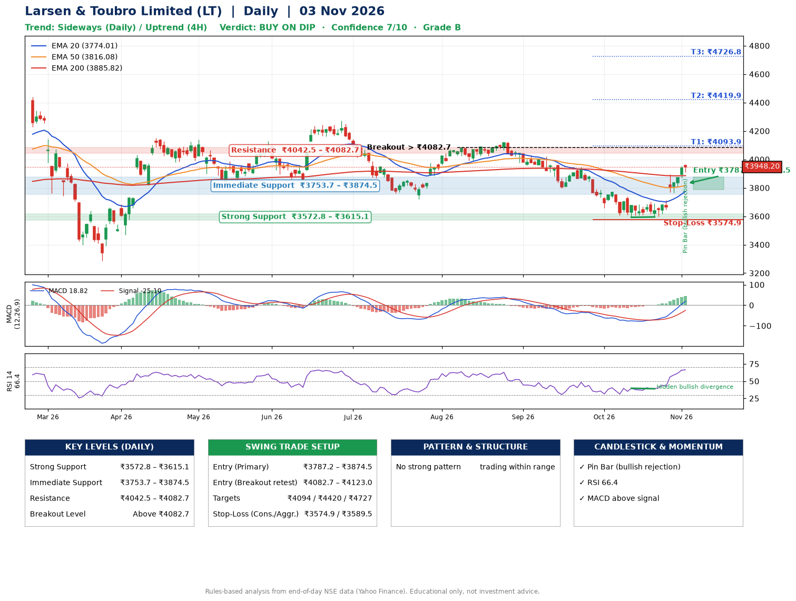

📌 **Larsen & Toubro Limited (LT) – Multi-Timeframe Technical Analysis (Daily + 4H Combined)**
_Data up to 03 Nov 2026 · Close ₹3948.20_

**📍 Daily Timeframe Trend**
- Trend: **Sideways** (mixed swing structure)
- Recent swing highs: ₹4272.3, ₹4125.3, ₹3945.0 · swing lows: ₹3799.9, ₹3592.9, ₹3595.0
- EMAs: EMA20 ₹3774.0, EMA50 ₹3816.1, EMA200 ₹3885.8; bearish stack (EMA20 < EMA50 < EMA200); price above EMA20, EMA50, EMA200
- MACD 18.82 above signal -25.10 (above zero); histogram rising
- RSI(14) 66.4; Hidden bullish divergence

**📍 4-Hour Timeframe Trend**
- Structure: **Uptrend** (higher highs and higher lows)
- Pullback/support area: recent 4H swing lows ₹3593.2, ₹3595.0; EMA20 ₹3804.2
- EMA20/50: bullish stack (EMA20 > EMA50); price above EMA20, EMA50
- MACD 65.10 above signal 40.67 (above zero); histogram falling
- RSI(14) 71.7; no divergence

**📍 Pattern Detection (Both Timeframes)**
- 4H: **Double Bottom** – bottoms near ₹3593.2/₹3595.0, neckline ₹3702.4, confirmed (closed above neckline)

**📍 Candlestick Patterns (last 3 daily candles)**
- **Pin Bar (bullish rejection)** – 03 Nov: long lower wick shows dip-buying near ₹3911.4

**📍 Price Action Key Levels (Daily Structure)**

| Zone | Price Level (₹) | Context |
|------|-----------------|---------|
| Strong Support | ₹3572.8 – ₹3615.1 | Cluster of earlier swing lows (demand) |
| Immediate Support | ₹3753.7 – ₹3874.5 | Nearest swing-low / wick area |
| Resistance | ₹4042.5 – ₹4082.7 | Nearest swing-high supply |
| Breakout Level | Above ₹4082.7 | Swing continuation trigger (52-week high ₹4440.0) |

**📍 Swing Trade Setup**

🟢 **Entry Zone**
- Primary: ₹3787.2 – ₹3874.5 (daily support / EMA20 area; enter on a bullish 4H candle)
- Alternate: ₹4082.7 – ₹4123.0 (breakout retest)

🎯 **Profit Targets**
- T1: ₹4093.9
- T2: ₹4419.9
- T3: ₹4726.8

🛑 **Stop-Loss**
- Conservative: below daily swing low (₹3574.9)
- Aggressive: below 4H structure (₹3589.5)
- Risk per share ≈ ₹256.0; reward:risk to T1 ≈ 1.0

**📌 Strategy Notes**
- Higher timeframe: daily trend is sideways; only take longs while price holds above ₹3572.8.
- Entry timing: wait for a bullish 4H candle (engulfing/hammer) inside ₹3787.2 – ₹3874.5 rather than buying mid-range.
- EMA stacking: bearish stack (EMA20 < EMA50 < EMA200); price above EMA20, EMA50, EMA200.
- Breakout rule: a daily close above ₹4082.7 with volume above its 20-day average (≈2,083,214) opens T2/T3.
- Momentum: RSI 66 – elevated, prefer dips; Hidden bullish divergence.
- Exit discipline: move the stop to entry once T1 is hit; book partial profits at each target.

**STEP 2 — Marked Up Chart**

**✅ Trade Validation Checklist**
- Trend + momentum aligned: No · Price at entry zone: No
- Stop defined (₹3574.9) · Reward:risk ≥ 1.5 to T1: No

## 📌 Final Verdict

Recommendation: **🟡 BUY ON DIP**

Confidence: **7/10**

Trade Quality: **B**

Reason:
• No strong edge from trend, momentum or patterns

Next Action:
• Wait for a pullback to ₹3787.2–₹3874.5, or a breakout above ₹4082.7

_Rules-based analysis from end-of-day data. Educational only, not investment advice. Never place orders without your own confirmation._