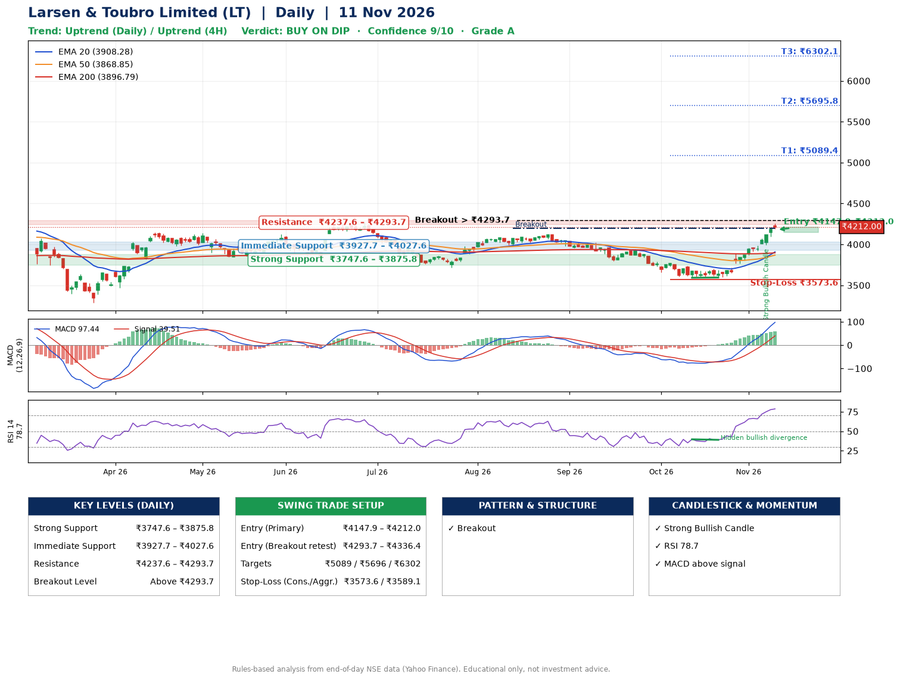

📌 **Larsen & Toubro Limited (LT) – Multi-Timeframe Technical Analysis (Daily + 4H Combined)**
_Data up to 11 Nov 2026 · Close ₹4212.00_

**📍 Daily Timeframe Trend**
- Trend: **Uptrend** (price above rising EMAs)
- Recent swing highs: ₹4272.3, ₹4125.3, ₹3945.0 · swing lows: ₹3799.9, ₹3592.9, ₹3595.0
- EMAs: EMA20 ₹3908.3, EMA50 ₹3868.9, EMA200 ₹3896.8; mixed / crossing; price above EMA20, EMA50, EMA200
- MACD 97.44 above signal 39.51 (above zero); histogram rising
- RSI(14) 78.7; Hidden bullish divergence

**📍 4-Hour Timeframe Trend**
- Structure: **Uptrend** (higher highs and higher lows)
- Pullback/support area: recent 4H swing lows ₹3593.2, ₹3595.0; EMA20 ₹4003.4
- EMA20/50: bullish stack (EMA20 > EMA50); price above EMA20, EMA50
- MACD 120.70 above signal 96.73 (above zero); histogram falling
- RSI(14) 80.7; no divergence

**📍 Pattern Detection (Both Timeframes)**
- Daily: **Breakout** – closed above the 60-session high ₹4194.1 (volume not confirming yet)
- 4H: **Double Bottom** – bottoms near ₹3593.2/₹3595.0, neckline ₹3702.4, confirmed (closed above neckline)

**📍 Candlestick Patterns (last 3 daily candles)**
- **Strong Bullish Candle** – 06 Nov: wide-range green candle, buyers in control

**📍 Price Action Key Levels (Daily Structure)**

| Zone | Price Level (₹) | Context |
|------|-----------------|---------|
| Strong Support | ₹3747.6 – ₹3875.8 | Cluster of earlier swing lows (demand) |
| Immediate Support | ₹3927.7 – ₹4027.6 | Nearest swing-low / wick area |
| Resistance | ₹4237.6 – ₹4293.7 | Nearest swing-high supply |
| Breakout Level | Above ₹4293.7 | Swing continuation trigger (52-week high ₹4440.0) |

**📍 Swing Trade Setup**

🟢 **Entry Zone**
- Primary: ₹4147.9 – ₹4212.0 (daily support / EMA20 area; enter on a bullish 4H candle)
- Alternate: ₹4293.7 – ₹4336.4 (breakout retest)

🎯 **Profit Targets**
- T1: ₹5089.4
- T2: ₹5695.8
- T3: ₹6302.1

🛑 **Stop-Loss**
- Conservative: below daily swing low (₹3573.6)
- Aggressive: below 4H structure (₹3589.1)
- Risk per share ≈ ₹606.3; reward:risk to T1 ≈ 1.5

**📌 Strategy Notes**
- Higher timeframe: daily trend is uptrend; only take longs while price holds above ₹3747.6.
- Entry timing: wait for a bullish 4H candle (engulfing/hammer) inside ₹4147.9 – ₹4212.0 rather than buying mid-range.
- EMA stacking: mixed / crossing; price above EMA20, EMA50, EMA200.
- Breakout rule: a daily close above ₹4293.7 with volume above its 20-day average (≈2,483,260) opens T2/T3.
- Momentum: RSI 79 – elevated, prefer dips; Hidden bullish divergence.
- Exit discipline: move the stop to entry once T1 is hit; book partial profits at each target.

**STEP 2 — Marked Up Chart**

**✅ Trade Validation Checklist**
- Trend + momentum aligned: Yes · Price at entry zone: Yes
- Stop defined (₹3573.6) · Reward:risk ≥ 1.5 to T1: No

## 📌 Final Verdict

Recommendation: **🟡 BUY ON DIP**

Confidence: **9/10**

Trade Quality: **A**

Reason:
• Daily uptrend (price above rising EMAs)
• RSI 79 is stretched; chasing here is risky

Next Action:
• Wait for a pullback to ₹4147.9–₹4212.0, or a breakout above ₹4293.7

_Rules-based analysis from end-of-day data. Educational only, not investment advice. Never place orders without your own confirmation._