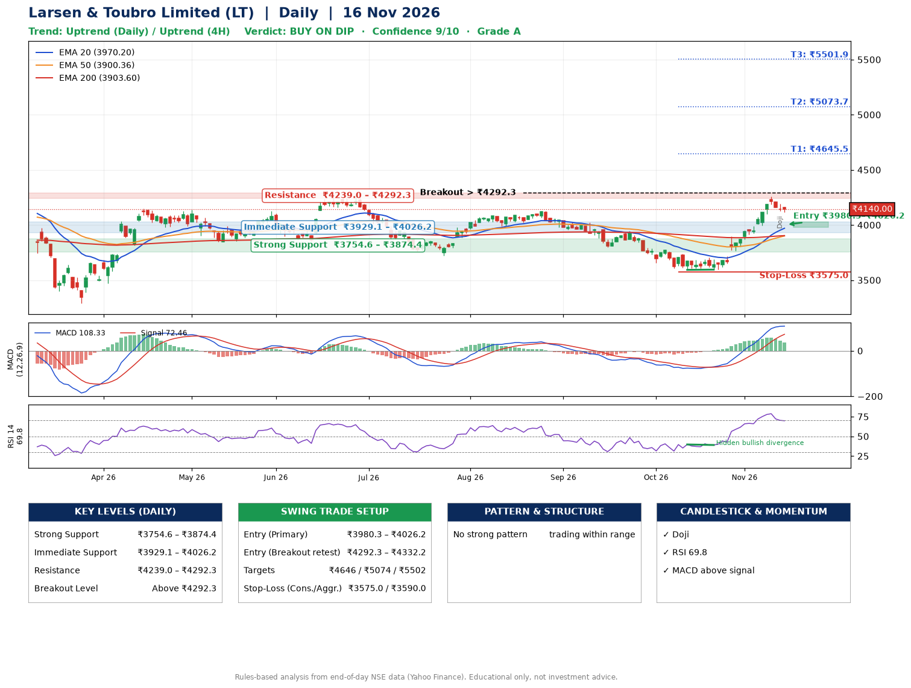

📌 **Larsen & Toubro Limited (LT) – Multi-Timeframe Technical Analysis (Daily + 4H Combined)**
_Data up to 16 Nov 2026 · Close ₹4140.00_

**📍 Daily Timeframe Trend**
- Trend: **Uptrend** (price above rising EMAs)
- Recent swing highs: ₹4272.3, ₹4125.3, ₹3945.0 · swing lows: ₹3799.9, ₹3592.9, ₹3595.0
- EMAs: EMA20 ₹3970.2, EMA50 ₹3900.4, EMA200 ₹3903.6; mixed / crossing; price above EMA20, EMA50, EMA200
- MACD 108.33 above signal 72.46 (above zero); histogram falling
- RSI(14) 69.8; Hidden bullish divergence

**📍 4-Hour Timeframe Trend**
- Structure: **Uptrend** (higher highs and higher lows)
- Pullback/support area: recent 4H swing lows ₹3593.2, ₹3595.0; EMA20 ₹4067.9
- EMA20/50: bullish stack (EMA20 > EMA50); price above EMA20, EMA50
- MACD 92.10 below signal 101.13 (above zero), fresh bearish crossover; histogram falling
- RSI(14) 67.5; no divergence

**📍 Pattern Detection (Both Timeframes)**
- 4H: **Double Bottom** – bottoms near ₹3593.2/₹3595.0, neckline ₹3702.4, confirmed (closed above neckline)
- 4H: **Bull Flag** – 16% pole then a tight 3% flag; trigger above ₹4259.0

**📍 Candlestick Patterns (last 3 daily candles)**
- **Doji** – 13 Nov: indecision; wait for the next candle to confirm direction

**📍 Price Action Key Levels (Daily Structure)**

| Zone | Price Level (₹) | Context |
|------|-----------------|---------|
| Strong Support | ₹3754.6 – ₹3874.4 | Cluster of earlier swing lows (demand) |
| Immediate Support | ₹3929.1 – ₹4026.2 | Nearest swing-low / wick area |
| Resistance | ₹4239.0 – ₹4292.3 | Nearest swing-high supply |
| Breakout Level | Above ₹4292.3 | Swing continuation trigger (52-week high ₹4440.0) |

**📍 Swing Trade Setup**

🟢 **Entry Zone**
- Primary: ₹3980.3 – ₹4026.2 (daily support / EMA20 area; enter on a bullish 4H candle)
- Alternate: ₹4292.3 – ₹4332.2 (breakout retest)

🎯 **Profit Targets**
- T1: ₹4645.5
- T2: ₹5073.7
- T3: ₹5501.9

🛑 **Stop-Loss**
- Conservative: below daily swing low (₹3575.0)
- Aggressive: below 4H structure (₹3590.0)
- Risk per share ≈ ₹428.2; reward:risk to T1 ≈ 1.5
- Time to T1: about 23 trading days (it rose this much within 60 trading days 8% of the time in the last 2 years)
- Time to T2: about 57 trading days (it rose this much within 60 trading days 0% of the time in the last 2 years)

**📌 Strategy Notes**
- Higher timeframe: daily trend is uptrend; only take longs while price holds above ₹3754.6.
- Entry timing: wait for a bullish 4H candle (engulfing/hammer) inside ₹3980.3 – ₹4026.2 rather than buying mid-range.
- EMA stacking: mixed / crossing; price above EMA20, EMA50, EMA200.
- Breakout rule: a daily close above ₹4292.3 with volume above its 20-day average (≈2,415,180) opens T2/T3.
- Momentum: RSI 70 – elevated, prefer dips; Hidden bullish divergence.
- Exit discipline: move the stop to entry once T1 is hit; book partial profits at each target.

**STEP 2 — Marked Up Chart**

**✅ Trade Validation Checklist**
- Trend + momentum aligned: Yes · Price at entry zone: No
- Stop defined (₹3575.0) · Reward:risk ≥ 1.5 to T1: No

## 📌 Final Verdict

Recommendation: **🟡 BUY ON DIP**

Confidence: **9/10**

Trade Quality: **A**

Reason:
• Daily uptrend (price above rising EMAs)

Next Action:
• Wait for a pullback to ₹3980.3–₹4026.2, or a breakout above ₹4292.3

_Rules-based analysis from end-of-day data. Educational only, not investment advice. Never place orders without your own confirmation._