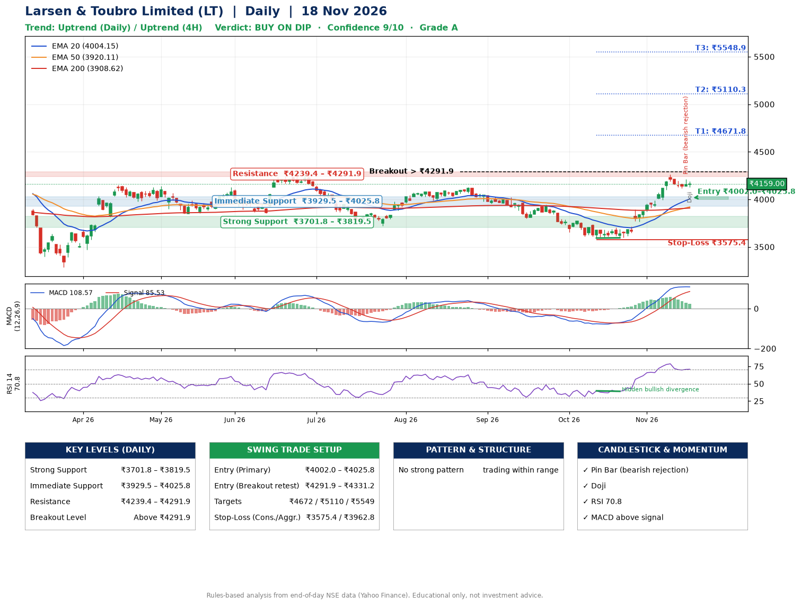

📌 **Larsen & Toubro Limited (LT) – Multi-Timeframe Technical Analysis (Daily + 4H Combined)**
_Data up to 18 Nov 2026 · Close ₹4159.00_

**📍 Daily Timeframe Trend**
- Trend: **Uptrend** (higher highs and higher lows)
- Recent swing highs: ₹4125.3, ₹3945.0, ₹4259.0 · swing lows: ₹3799.9, ₹3592.9, ₹3595.0
- EMAs: EMA20 ₹4004.1, EMA50 ₹3920.1, EMA200 ₹3908.6; bullish stack (EMA20 > EMA50 > EMA200); price above EMA20, EMA50, EMA200
- MACD 108.57 above signal 85.53 (above zero); histogram falling
- RSI(14) 70.8; Hidden bullish divergence

**📍 4-Hour Timeframe Trend**
- Structure: **Uptrend** (price above rising EMAs)
- Pullback/support area: recent 4H swing lows ₹3595.0, ₹4117.0; EMA20 ₹4097.8
- EMA20/50: bullish stack (EMA20 > EMA50); price above EMA20, EMA50
- MACD 75.30 below signal 89.52 (above zero); histogram falling
- RSI(14) 63.7; no divergence

**📍 Pattern Detection (Both Timeframes)**
- No strong pattern detected. Trading within range.

**📍 Candlestick Patterns (last 3 daily candles)**
- **Pin Bar (bearish rejection)** – 17 Nov: long upper wick shows selling near ₹4213.8
- **Doji** – 18 Nov: indecision; wait for the next candle to confirm direction

**📍 Price Action Key Levels (Daily Structure)**

| Zone | Price Level (₹) | Context |
|------|-----------------|---------|
| Strong Support | ₹3701.8 – ₹3819.5 | Cluster of earlier swing lows (demand) |
| Immediate Support | ₹3929.5 – ₹4025.8 | Nearest swing-low / wick area |
| Resistance | ₹4239.4 – ₹4291.9 | Nearest swing-high supply |
| Breakout Level | Above ₹4291.9 | Swing continuation trigger (52-week high ₹4440.0) |

**📍 Swing Trade Setup**

🟢 **Entry Zone**
- Primary: ₹4002.0 – ₹4025.8 (daily support / EMA20 area; enter on a bullish 4H candle)
- Alternate: ₹4291.9 – ₹4331.2 (breakout retest)

🎯 **Profit Targets**
- T1: ₹4671.8
- T2: ₹5110.3
- T3: ₹5548.9

🛑 **Stop-Loss**
- Conservative: below daily swing low (₹3575.4)
- Aggressive: below 4H structure (₹3962.8)
- Risk per share ≈ ₹438.5; reward:risk to T1 ≈ 1.5
- Time to T1: about 21 trading days (it rose this much within 60 trading days 7% of the time in the last 2 years)
- Time to T2: it never rose this much within 60 trading days in the price history

**📌 Strategy Notes**
- Higher timeframe: daily trend is uptrend; only take longs while price holds above ₹3701.8.
- Entry timing: wait for a bullish 4H candle (engulfing/hammer) inside ₹4002.0 – ₹4025.8 rather than buying mid-range.
- EMA stacking: bullish stack (EMA20 > EMA50 > EMA200); price above EMA20, EMA50, EMA200.
- Breakout rule: a daily close above ₹4291.9 with volume above its 20-day average (≈2,359,326) opens T2/T3.
- Momentum: RSI 71 – elevated, prefer dips; Hidden bullish divergence.
- Exit discipline: move the stop to entry once T1 is hit; book partial profits at each target.

**STEP 2 — Marked Up Chart**

**✅ Trade Validation Checklist**
- Trend + momentum aligned: Yes · Price at entry zone: No
- Stop defined (₹3575.4) · Reward:risk ≥ 1.5 to T1: Yes

## 📌 Final Verdict

Recommendation: **🟡 BUY ON DIP**

Confidence: **9/10**

Trade Quality: **A**

Reason:
• Daily uptrend (higher highs and higher lows)
• EMAs stacked bullishly

Next Action:
• Wait for a pullback to ₹4002.0–₹4025.8

_Rules-based analysis from end-of-day data. Educational only, not investment advice. Never place orders without your own confirmation._