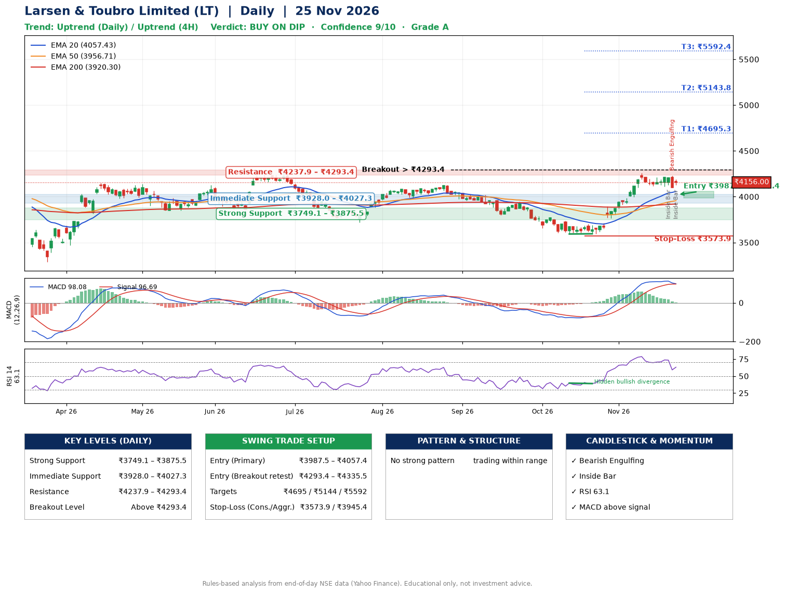

📌 **Larsen & Toubro Limited (LT) – Multi-Timeframe Technical Analysis (Daily + 4H Combined)**
_Data up to 25 Nov 2026 · Close ₹4156.00_

**📍 Daily Timeframe Trend**
- Trend: **Uptrend** (higher highs and higher lows)
- Recent swing highs: ₹4125.3, ₹3945.0, ₹4259.0 · swing lows: ₹3799.9, ₹3592.9, ₹3595.0
- EMAs: EMA20 ₹4057.4, EMA50 ₹3956.7, EMA200 ₹3920.3; bullish stack (EMA20 > EMA50 > EMA200); price above EMA20, EMA50, EMA200
- MACD 98.08 above signal 96.69 (above zero); histogram falling
- RSI(14) 63.1; Hidden bullish divergence

**📍 4-Hour Timeframe Trend**
- Structure: **Uptrend** (price above rising EMAs)
- Pullback/support area: recent 4H swing lows ₹4117.0, ₹4112.0; EMA20 ₹4132.9
- EMA20/50: bullish stack (EMA20 > EMA50); price above EMA20, EMA50
- MACD 43.75 below signal 61.59 (above zero); histogram rising
- RSI(14) 56.7; Regular bearish divergence

**📍 Pattern Detection (Both Timeframes)**
- 4H: **Symmetrical Triangle** – converging swing highs and lows over the last ~60 sessions

**📍 Candlestick Patterns (last 3 daily candles)**
- **Inside Bar** – 20 Nov: compression inside the prior range ₹4112.0–₹4212.0
- **Bearish Engulfing** – 23 Nov: sellers fully reversed the prior green candle
- **Inside Bar** – 25 Nov: compression inside the prior range ₹4099.9–₹4232.0

**📍 Price Action Key Levels (Daily Structure)**

| Zone | Price Level (₹) | Context |
|------|-----------------|---------|
| Strong Support | ₹3749.1 – ₹3875.5 | Cluster of earlier swing lows (demand) |
| Immediate Support | ₹3928.0 – ₹4027.3 | Nearest swing-low / wick area |
| Resistance | ₹4237.9 – ₹4293.4 | Nearest swing-high supply |
| Breakout Level | Above ₹4293.4 | Swing continuation trigger (52-week high ₹4440.0) |

**📍 Swing Trade Setup**

🟢 **Entry Zone**
- Primary: ₹3987.5 – ₹4057.4 (daily support / EMA20 area; enter on a bullish 4H candle)
- Alternate: ₹4293.4 – ₹4335.5 (breakout retest)

🎯 **Profit Targets**
- T1: ₹4695.3
- T2: ₹5143.8
- T3: ₹5592.4

🛑 **Stop-Loss**
- Conservative: below daily swing low (₹3573.9)
- Aggressive: below 4H structure (₹3945.4)
- Risk per share ≈ ₹448.5; reward:risk to T1 ≈ 1.5
- Time to T1: about 21 trading days (it rose this much within 60 trading days 6% of the time in the last 2 years)
- Time to T2: it never rose this much within 60 trading days in the price history

**📌 Strategy Notes**
- Higher timeframe: daily trend is uptrend; only take longs while price holds above ₹3749.1.
- Entry timing: wait for a bullish 4H candle (engulfing/hammer) inside ₹3987.5 – ₹4057.4 rather than buying mid-range.
- EMA stacking: bullish stack (EMA20 > EMA50 > EMA200); price above EMA20, EMA50, EMA200.
- Breakout rule: a daily close above ₹4293.4 with volume above its 20-day average (≈2,312,400) opens T2/T3.
- Momentum: RSI 63 – room to run; Hidden bullish divergence.
- Exit discipline: move the stop to entry once T1 is hit; book partial profits at each target.

**STEP 2 — Marked Up Chart**

**✅ Trade Validation Checklist**
- Trend + momentum aligned: Yes · Price at entry zone: No
- Stop defined (₹3573.9) · Reward:risk ≥ 1.5 to T1: Yes

## 📌 Final Verdict

Recommendation: **🟡 BUY ON DIP**

Confidence: **9/10**

Trade Quality: **A**

Reason:
• Daily uptrend (higher highs and higher lows)
• EMAs stacked bullishly

Next Action:
• Wait for a pullback to ₹3987.5–₹4057.4, or a breakout above ₹4293.4

_Rules-based analysis from end-of-day data. Educational only, not investment advice. Never place orders without your own confirmation._