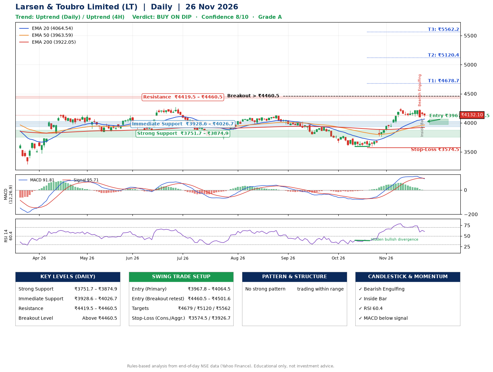

📌 **Larsen & Toubro Limited (LT) – Multi-Timeframe Technical Analysis (Daily + 4H Combined)**
_Data up to 26 Nov 2026 · Close ₹4132.10_

**📍 Daily Timeframe Trend**
- Trend: **Uptrend** (higher highs and higher lows)
- Recent swing highs: ₹4125.3, ₹3945.0, ₹4259.0 · swing lows: ₹3799.9, ₹3592.9, ₹3595.0
- EMAs: EMA20 ₹4064.5, EMA50 ₹3963.6, EMA200 ₹3922.1; bullish stack (EMA20 > EMA50 > EMA200); price above EMA20, EMA50, EMA200
- MACD 91.81 below signal 95.71 (above zero), fresh bearish crossover; histogram falling
- RSI(14) 60.4; Hidden bullish divergence

**📍 4-Hour Timeframe Trend**
- Structure: **Uptrend** (price above rising EMAs)
- Pullback/support area: recent 4H swing lows ₹4112.0, ₹4099.9; EMA20 ₹4131.2
- EMA20/50: bullish stack (EMA20 > EMA50); price above EMA20, EMA50
- MACD 33.39 below signal 52.07 (above zero); histogram rising
- RSI(14) 53.2; Regular bearish divergence

**📍 Pattern Detection (Both Timeframes)**
- 4H: **Descending Triangle** – converging swing highs and lows over the last ~60 sessions

**📍 Candlestick Patterns (last 3 daily candles)**
- **Bearish Engulfing** – 23 Nov: sellers fully reversed the prior green candle
- **Inside Bar** – 25 Nov: compression inside the prior range ₹4099.9–₹4232.0

**📍 Price Action Key Levels (Daily Structure)**

| Zone | Price Level (₹) | Context |
|------|-----------------|---------|
| Strong Support | ₹3751.7 – ₹3874.9 | Cluster of earlier swing lows (demand) |
| Immediate Support | ₹3928.6 – ₹4026.7 | Nearest swing-low / wick area |
| Resistance | ₹4419.5 – ₹4460.5 | Nearest swing-high supply |
| Breakout Level | Above ₹4460.5 | Swing continuation trigger (52-week high ₹4440.0) |

**📍 Swing Trade Setup**

🟢 **Entry Zone**
- Primary: ₹3967.8 – ₹4064.5 (daily support / EMA20 area; enter on a bullish 4H candle)
- Alternate: ₹4460.5 – ₹4501.6 (breakout retest)

🎯 **Profit Targets**
- T1: ₹4678.7
- T2: ₹5120.4
- T3: ₹5562.2

🛑 **Stop-Loss**
- Conservative: below daily swing low (₹3574.5)
- Aggressive: below 4H structure (₹3926.7)
- Risk per share ≈ ₹441.7; reward:risk to T1 ≈ 1.5
- Time to T1: about 22 trading days (it rose this much within 60 trading days 7% of the time in the last 2 years)
- Time to T2: it never rose this much within 60 trading days in the price history

**📌 Strategy Notes**
- Higher timeframe: daily trend is uptrend; only take longs while price holds above ₹3751.7.
- Entry timing: wait for a bullish 4H candle (engulfing/hammer) inside ₹3967.8 – ₹4064.5 rather than buying mid-range.
- EMA stacking: bullish stack (EMA20 > EMA50 > EMA200); price above EMA20, EMA50, EMA200.
- Breakout rule: a daily close above ₹4460.5 with volume above its 20-day average (≈2,298,962) opens T2/T3.
- Momentum: RSI 60 – room to run; Hidden bullish divergence.
- Exit discipline: move the stop to entry once T1 is hit; book partial profits at each target.

**STEP 2 — Marked Up Chart**

**✅ Trade Validation Checklist**
- Trend + momentum aligned: No · Price at entry zone: No
- Stop defined (₹3574.5) · Reward:risk ≥ 1.5 to T1: No

## 📌 Final Verdict

Recommendation: **🟡 BUY ON DIP**

Confidence: **8/10**

Trade Quality: **A**

Reason:
• Daily uptrend (higher highs and higher lows)
• EMAs stacked bullishly

Next Action:
• Wait for a pullback to ₹3967.8–₹4064.5, or a breakout above ₹4460.5

_Rules-based analysis from end-of-day data. Educational only, not investment advice. Never place orders without your own confirmation._