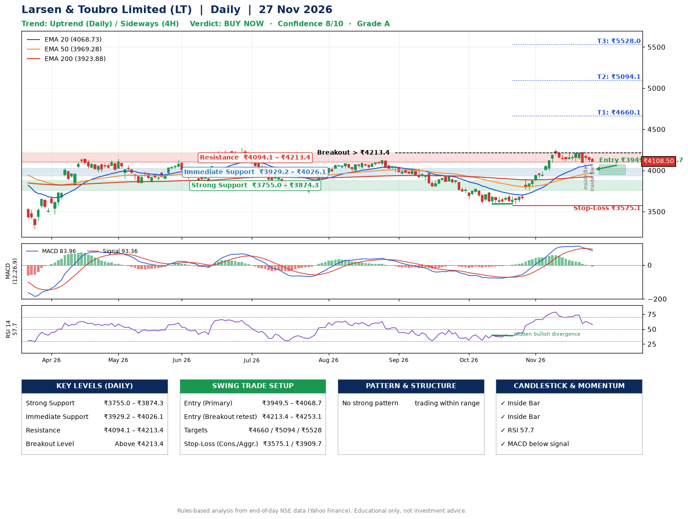

📌 **Larsen & Toubro Limited (LT) – Multi-Timeframe Technical Analysis (Daily + 4H Combined)**
_Data up to 27 Nov 2026 · Close ₹4108.50_

**📍 Daily Timeframe Trend**
- Trend: **Uptrend** (higher highs and higher lows)
- Recent swing highs: ₹4125.3, ₹3945.0, ₹4259.0 · swing lows: ₹3799.9, ₹3592.9, ₹3595.0
- EMAs: EMA20 ₹4068.7, EMA50 ₹3969.3, EMA200 ₹3923.9; bullish stack (EMA20 > EMA50 > EMA200); price above EMA20, EMA50, EMA200
- MACD 83.96 below signal 93.36 (above zero), fresh bearish crossover; histogram falling
- RSI(14) 57.7; Hidden bullish divergence

**📍 4-Hour Timeframe Trend**
- Structure: **Sideways** (mixed swing structure)
- Pullback/support area: recent 4H swing lows ₹4112.0, ₹4099.9; EMA20 ₹4127.8
- EMA20/50: bullish stack (EMA20 > EMA50); price above EMA50
- MACD 24.02 below signal 42.73 (above zero); histogram falling
- RSI(14) 50.0; Regular bearish divergence

**📍 Pattern Detection (Both Timeframes)**
- No strong pattern detected. Trading within range.

**📍 Candlestick Patterns (last 3 daily candles)**
- **Inside Bar** – 25 Nov: compression inside the prior range ₹4099.9–₹4232.0
- **Inside Bar** – 27 Nov: compression inside the prior range ₹4105.0–₹4160.0

**📍 Price Action Key Levels (Daily Structure)**

| Zone | Price Level (₹) | Context |
|------|-----------------|---------|
| Strong Support | ₹3755.0 – ₹3874.3 | Cluster of earlier swing lows (demand) |
| Immediate Support | ₹3929.2 – ₹4026.1 | Nearest swing-low / wick area |
| Resistance | ₹4094.1 – ₹4213.4 | Nearest swing-high supply |
| Breakout Level | Above ₹4213.4 | Swing continuation trigger (52-week high ₹4440.0) |

**📍 Swing Trade Setup**

🟢 **Entry Zone**
- Primary: ₹3949.5 – ₹4068.7 (daily support / EMA20 area; enter on a bullish 4H candle)
- Alternate: ₹4213.4 – ₹4253.1 (breakout retest)

🎯 **Profit Targets**
- T1: ₹4660.1
- T2: ₹5094.1
- T3: ₹5528.0

🛑 **Stop-Loss**
- Conservative: below daily swing low (₹3575.1)
- Aggressive: below 4H structure (₹3909.7)
- Risk per share ≈ ₹434.0; reward:risk to T1 ≈ 1.5
- Time to T1: about 21 trading days (it rose this much within 60 trading days 8% of the time in the last 2 years)
- Time to T2: it never rose this much within 60 trading days in the price history

**📌 Strategy Notes**
- Higher timeframe: daily trend is uptrend; only take longs while price holds above ₹3755.0.
- Entry timing: wait for a bullish 4H candle (engulfing/hammer) inside ₹3949.5 – ₹4068.7 rather than buying mid-range.
- EMA stacking: bullish stack (EMA20 > EMA50 > EMA200); price above EMA20, EMA50, EMA200.
- Breakout rule: a daily close above ₹4213.4 with volume above its 20-day average (≈2,032,265) opens T2/T3.
- Momentum: RSI 58 – room to run; Hidden bullish divergence.
- Exit discipline: move the stop to entry once T1 is hit; book partial profits at each target.

**STEP 2 — Marked Up Chart**

**✅ Trade Validation Checklist**
- Trend + momentum aligned: No · Price at entry zone: No
- Stop defined (₹3575.1) · Reward:risk ≥ 1.5 to T1: Yes

## 📌 Final Verdict

Recommendation: **🟢 BUY NOW**

Confidence: **8/10**

Trade Quality: **A**

Reason:
• Daily uptrend (higher highs and higher lows)
• EMAs stacked bullishly

Next Action:
• Buy now within the entry zone, with the stop-loss in place

_Rules-based analysis from end-of-day data. Educational only, not investment advice. Never place orders without your own confirmation._