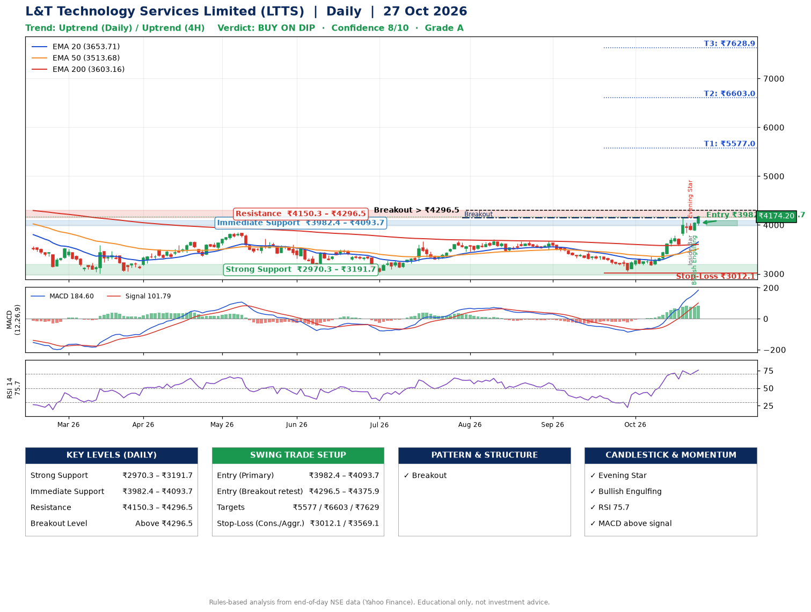

📌 **L&T Technology Services Limited (LTTS) – Multi-Timeframe Technical Analysis (Daily + 4H Combined)**
_Data up to 27 Oct 2026 · Close ₹4174.20_

**📍 Daily Timeframe Trend**
- Trend: **Uptrend** (price above rising EMAs)
- Recent swing highs: ₹3680.0, ₹3708.0, ₹3675.0 · swing lows: ₹3030.0, ₹3460.0, ₹3051.8
- EMAs: EMA20 ₹3653.7, EMA50 ₹3513.7, EMA200 ₹3603.2; mixed / crossing; price above EMA20, EMA50, EMA200
- MACD 184.60 above signal 101.79 (above zero); histogram rising
- RSI(14) 75.7; no divergence on the last two swings

**📍 4-Hour Timeframe Trend**
- Structure: **Uptrend** (higher highs and higher lows)
- Pullback/support area: recent 4H swing lows ₹3168.8, ₹3580.0; EMA20 ₹3825.8
- EMA20/50: bullish stack (EMA20 > EMA50); price above EMA20, EMA50
- MACD 193.81 above signal 168.19 (above zero); histogram rising
- RSI(14) 79.9; Regular bearish divergence

**📍 Pattern Detection (Both Timeframes)**
- Daily: **Breakout** – closed above the 60-session high ₹4143.0 (volume not confirming yet)

**📍 Candlestick Patterns (last 3 daily candles)**
- **Inside Bar** – 23 Oct: compression inside the prior range ₹3841.0–₹4050.0
- **Evening Star** – 23 Oct: three-candle bearish reversal
- **Bullish Engulfing** – 26 Oct: buyers fully reversed the prior red candle

**📍 Price Action Key Levels (Daily Structure)**

| Zone | Price Level (₹) | Context |
|------|-----------------|---------|
| Strong Support | ₹2970.3 – ₹3191.7 | Cluster of earlier swing lows (demand) |
| Immediate Support | ₹3982.4 – ₹4093.7 | Nearest swing-low / wick area |
| Resistance | ₹4150.3 – ₹4296.5 | Nearest swing-high supply |
| Breakout Level | Above ₹4296.5 | Swing continuation trigger (52-week high ₹4726.0) |

**📍 Swing Trade Setup**

🟢 **Entry Zone**
- Primary: ₹3982.4 – ₹4093.7 (daily support / EMA20 area; enter on a bullish 4H candle)
- Alternate: ₹4296.5 – ₹4375.9 (breakout retest)

🎯 **Profit Targets**
- T1: ₹5577.0
- T2: ₹6603.0
- T3: ₹7628.9

🛑 **Stop-Loss**
- Conservative: below daily swing low (₹3012.1)
- Aggressive: below 4H structure (₹3569.1)
- Risk per share ≈ ₹1026.0; reward:risk to T1 ≈ 1.5

**📌 Strategy Notes**
- Higher timeframe: daily trend is uptrend; only take longs while price holds above ₹2970.3.
- Entry timing: wait for a bullish 4H candle (engulfing/hammer) inside ₹3982.4 – ₹4093.7 rather than buying mid-range.
- EMA stacking: mixed / crossing; price above EMA20, EMA50, EMA200.
- Breakout rule: a daily close above ₹4296.5 with volume above its 20-day average (≈619,923) opens T2/T3.
- Momentum: RSI 76 – elevated, prefer dips; no divergence on the last two swings.
- Exit discipline: move the stop to entry once T1 is hit; book partial profits at each target.

**STEP 2 — Marked Up Chart**

**✅ Trade Validation Checklist**
- Trend + momentum aligned: Yes · Price at entry zone: No
- Stop defined (₹3012.1) · Reward:risk ≥ 1.5 to T1: Yes

## 📌 Final Verdict

Recommendation: **🟡 BUY ON DIP**

Confidence: **8/10**

Trade Quality: **A**

Reason:
• Daily uptrend (price above rising EMAs)
• RSI 76 is stretched; chasing here is risky

Next Action:
• Wait for a pullback to ₹3982.4–₹4093.7, or a breakout above ₹4296.5

_Rules-based analysis from end-of-day data. Educational only, not investment advice. Never place orders without your own confirmation._