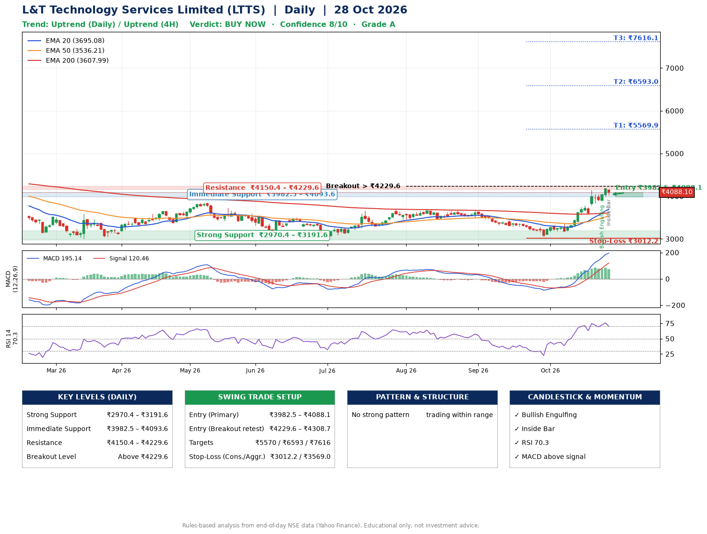

📌 **L&T Technology Services Limited (LTTS) – Multi-Timeframe Technical Analysis (Daily + 4H Combined)**
_Data up to 28 Oct 2026 · Close ₹4088.10_

**📍 Daily Timeframe Trend**
- Trend: **Uptrend** (price above rising EMAs)
- Recent swing highs: ₹3680.0, ₹3708.0, ₹3675.0 · swing lows: ₹3030.0, ₹3460.0, ₹3051.8
- EMAs: EMA20 ₹3695.1, EMA50 ₹3536.2, EMA200 ₹3608.0; mixed / crossing; price above EMA20, EMA50, EMA200
- MACD 195.14 above signal 120.46 (above zero); histogram falling
- RSI(14) 70.3; no divergence on the last two swings

**📍 4-Hour Timeframe Trend**
- Structure: **Uptrend** (higher highs and higher lows)
- Pullback/support area: recent 4H swing lows ₹3168.8, ₹3580.0; EMA20 ₹3870.3
- EMA20/50: bullish stack (EMA20 > EMA50); price above EMA20, EMA50
- MACD 183.61 above signal 174.39 (above zero); histogram falling
- RSI(14) 69.6; Regular bearish divergence

**📍 Pattern Detection (Both Timeframes)**
- 4H: **Bull Flag** – 16% pole then a tight 7% flag; trigger above ₹4188.0

**📍 Candlestick Patterns (last 3 daily candles)**
- **Bullish Engulfing** – 26 Oct: buyers fully reversed the prior red candle
- **Inside Bar** – 28 Oct: compression inside the prior range ₹3995.1–₹4190.0

**📍 Price Action Key Levels (Daily Structure)**

| Zone | Price Level (₹) | Context |
|------|-----------------|---------|
| Strong Support | ₹2970.4 – ₹3191.6 | Cluster of earlier swing lows (demand) |
| Immediate Support | ₹3982.5 – ₹4093.6 | Nearest swing-low / wick area |
| Resistance | ₹4150.4 – ₹4229.6 | Nearest swing-high supply |
| Breakout Level | Above ₹4229.6 | Swing continuation trigger (52-week high ₹4726.0) |

**📍 Swing Trade Setup**

🟢 **Entry Zone**
- Primary: ₹3982.5 – ₹4088.1 (daily support / EMA20 area; enter on a bullish 4H candle)
- Alternate: ₹4229.6 – ₹4308.7 (breakout retest)

🎯 **Profit Targets**
- T1: ₹5569.9
- T2: ₹6593.0
- T3: ₹7616.1

🛑 **Stop-Loss**
- Conservative: below daily swing low (₹3012.2)
- Aggressive: below 4H structure (₹3569.0)
- Risk per share ≈ ₹1023.1; reward:risk to T1 ≈ 1.5

**📌 Strategy Notes**
- Higher timeframe: daily trend is uptrend; only take longs while price holds above ₹2970.4.
- Entry timing: wait for a bullish 4H candle (engulfing/hammer) inside ₹3982.5 – ₹4088.1 rather than buying mid-range.
- EMA stacking: mixed / crossing; price above EMA20, EMA50, EMA200.
- Breakout rule: a daily close above ₹4229.6 with volume above its 20-day average (≈628,887) opens T2/T3.
- Momentum: RSI 70 – elevated, prefer dips; no divergence on the last two swings.
- Exit discipline: move the stop to entry once T1 is hit; book partial profits at each target.

**STEP 2 — Marked Up Chart**

**✅ Trade Validation Checklist**
- Trend + momentum aligned: Yes · Price at entry zone: Yes
- Stop defined (₹3012.2) · Reward:risk ≥ 1.5 to T1: No

## 📌 Final Verdict

Recommendation: **🟢 BUY NOW**

Confidence: **8/10**

Trade Quality: **A**

Reason:
• Daily uptrend (price above rising EMAs)

Next Action:
• Buy now within the entry zone, with the stop-loss in place

_Rules-based analysis from end-of-day data. Educational only, not investment advice. Never place orders without your own confirmation._