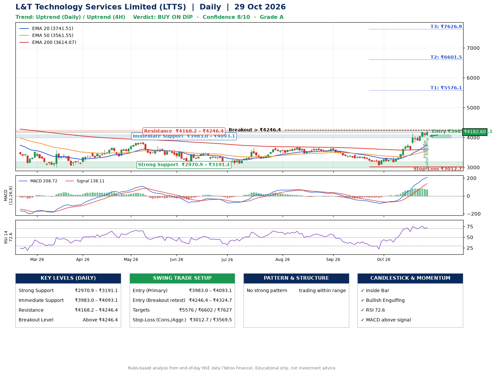

📌 **L&T Technology Services Limited (LTTS) – Multi-Timeframe Technical Analysis (Daily + 4H Combined)**
_Data up to 29 Oct 2026 · Close ₹4182.60_

**📍 Daily Timeframe Trend**
- Trend: **Uptrend** (price above rising EMAs)
- Recent swing highs: ₹3680.0, ₹3708.0, ₹3675.0 · swing lows: ₹3030.0, ₹3460.0, ₹3051.8
- EMAs: EMA20 ₹3741.5, EMA50 ₹3561.6, EMA200 ₹3614.1; mixed / crossing; price above EMA20, EMA50, EMA200
- MACD 208.72 above signal 138.11 (above zero); histogram falling
- RSI(14) 72.6; no divergence on the last two swings

**📍 4-Hour Timeframe Trend**
- Structure: **Uptrend** (higher highs and higher lows)
- Pullback/support area: recent 4H swing lows ₹3168.8, ₹3580.0; EMA20 ₹3927.6
- EMA20/50: bullish stack (EMA20 > EMA50); price above EMA20, EMA50
- MACD 186.05 above signal 178.67 (above zero); histogram falling
- RSI(14) 72.5; Regular bearish divergence

**📍 Pattern Detection (Both Timeframes)**
- 4H: **Bull Flag** – 18% pole then a tight 7% flag; trigger above ₹4207.2

**📍 Candlestick Patterns (last 3 daily candles)**
- **Inside Bar** – 28 Oct: compression inside the prior range ₹3995.1–₹4190.0
- **Bullish Engulfing** – 29 Oct: buyers fully reversed the prior red candle

**📍 Price Action Key Levels (Daily Structure)**

| Zone | Price Level (₹) | Context |
|------|-----------------|---------|
| Strong Support | ₹2970.9 – ₹3191.1 | Cluster of earlier swing lows (demand) |
| Immediate Support | ₹3983.0 – ₹4093.1 | Nearest swing-low / wick area |
| Resistance | ₹4168.2 – ₹4246.4 | Nearest swing-high supply |
| Breakout Level | Above ₹4246.4 | Swing continuation trigger (52-week high ₹4726.0) |

**📍 Swing Trade Setup**

🟢 **Entry Zone**
- Primary: ₹3983.0 – ₹4093.1 (daily support / EMA20 area; enter on a bullish 4H candle)
- Alternate: ₹4246.4 – ₹4324.7 (breakout retest)

🎯 **Profit Targets**
- T1: ₹5576.1
- T2: ₹6601.5
- T3: ₹7626.9

🛑 **Stop-Loss**
- Conservative: below daily swing low (₹3012.7)
- Aggressive: below 4H structure (₹3569.5)
- Risk per share ≈ ₹1025.4; reward:risk to T1 ≈ 1.5

**📌 Strategy Notes**
- Higher timeframe: daily trend is uptrend; only take longs while price holds above ₹2970.9.
- Entry timing: wait for a bullish 4H candle (engulfing/hammer) inside ₹3983.0 – ₹4093.1 rather than buying mid-range.
- EMA stacking: mixed / crossing; price above EMA20, EMA50, EMA200.
- Breakout rule: a daily close above ₹4246.4 with volume above its 20-day average (≈637,548) opens T2/T3.
- Momentum: RSI 73 – elevated, prefer dips; no divergence on the last two swings.
- Exit discipline: move the stop to entry once T1 is hit; book partial profits at each target.

**STEP 2 — Marked Up Chart**

**✅ Trade Validation Checklist**
- Trend + momentum aligned: Yes · Price at entry zone: No
- Stop defined (₹3012.7) · Reward:risk ≥ 1.5 to T1: No

## 📌 Final Verdict

Recommendation: **🟡 BUY ON DIP**

Confidence: **8/10**

Trade Quality: **A**

Reason:
• Daily uptrend (price above rising EMAs)

Next Action:
• Wait for a pullback to ₹3983.0–₹4093.1, or a breakout above ₹4246.4

_Rules-based analysis from end-of-day data. Educational only, not investment advice. Never place orders without your own confirmation._