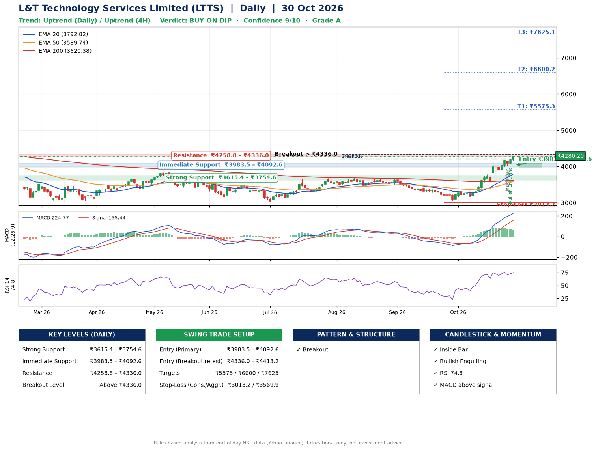

📌 **L&T Technology Services Limited (LTTS) – Multi-Timeframe Technical Analysis (Daily + 4H Combined)**
_Data up to 30 Oct 2026 · Close ₹4280.20_

**📍 Daily Timeframe Trend**
- Trend: **Uptrend** (price above rising EMAs)
- Recent swing highs: ₹3680.0, ₹3708.0, ₹3675.0 · swing lows: ₹3030.0, ₹3460.0, ₹3051.8
- EMAs: EMA20 ₹3792.8, EMA50 ₹3589.7, EMA200 ₹3620.4; mixed / crossing; price above EMA20, EMA50, EMA200
- MACD 224.77 above signal 155.44 (above zero); histogram falling
- RSI(14) 74.8; no divergence on the last two swings

**📍 4-Hour Timeframe Trend**
- Structure: **Uptrend** (higher highs and higher lows)
- Pullback/support area: recent 4H swing lows ₹3168.8, ₹3580.0; EMA20 ₹3991.0
- EMA20/50: bullish stack (EMA20 > EMA50); price above EMA20, EMA50
- MACD 192.89 above signal 183.45 (above zero); histogram falling
- RSI(14) 75.7; Regular bearish divergence

**📍 Pattern Detection (Both Timeframes)**
- Daily: **Breakout** – closed above the 60-session high ₹4207.3 (volume not confirming yet)
- 4H: **Bull Flag** – 18% pole then a tight 7% flag; trigger above ₹4297.4

**📍 Candlestick Patterns (last 3 daily candles)**
- **Inside Bar** – 28 Oct: compression inside the prior range ₹3995.1–₹4190.0
- **Bullish Engulfing** – 29 Oct: buyers fully reversed the prior red candle

**📍 Price Action Key Levels (Daily Structure)**

| Zone | Price Level (₹) | Context |
|------|-----------------|---------|
| Strong Support | ₹3615.4 – ₹3754.6 | Cluster of earlier swing lows (demand) |
| Immediate Support | ₹3983.5 – ₹4092.6 | Nearest swing-low / wick area |
| Resistance | ₹4258.8 – ₹4336.0 | Nearest swing-high supply |
| Breakout Level | Above ₹4336.0 | Swing continuation trigger (52-week high ₹4726.0) |

**📍 Swing Trade Setup**

🟢 **Entry Zone**
- Primary: ₹3983.5 – ₹4092.6 (daily support / EMA20 area; enter on a bullish 4H candle)
- Alternate: ₹4336.0 – ₹4413.2 (breakout retest)

🎯 **Profit Targets**
- T1: ₹5575.3
- T2: ₹6600.2
- T3: ₹7625.1

🛑 **Stop-Loss**
- Conservative: below daily swing low (₹3013.2)
- Aggressive: below 4H structure (₹3569.9)
- Risk per share ≈ ₹1024.9; reward:risk to T1 ≈ 1.5

**📌 Strategy Notes**
- Higher timeframe: daily trend is uptrend; only take longs while price holds above ₹3615.4.
- Entry timing: wait for a bullish 4H candle (engulfing/hammer) inside ₹3983.5 – ₹4092.6 rather than buying mid-range.
- EMA stacking: mixed / crossing; price above EMA20, EMA50, EMA200.
- Breakout rule: a daily close above ₹4336.0 with volume above its 20-day average (≈643,261) opens T2/T3.
- Momentum: RSI 75 – elevated, prefer dips; no divergence on the last two swings.
- Exit discipline: move the stop to entry once T1 is hit; book partial profits at each target.

**STEP 2 — Marked Up Chart**

**✅ Trade Validation Checklist**
- Trend + momentum aligned: Yes · Price at entry zone: No
- Stop defined (₹3013.2) · Reward:risk ≥ 1.5 to T1: No

## 📌 Final Verdict

Recommendation: **🟡 BUY ON DIP**

Confidence: **9/10**

Trade Quality: **A**

Reason:
• Daily uptrend (price above rising EMAs)
• Breakout: closed above the 60-session high ₹4207.3 (volume not confirming yet)

Next Action:
• Wait for a pullback to ₹3983.5–₹4092.6

_Rules-based analysis from end-of-day data. Educational only, not investment advice. Never place orders without your own confirmation._