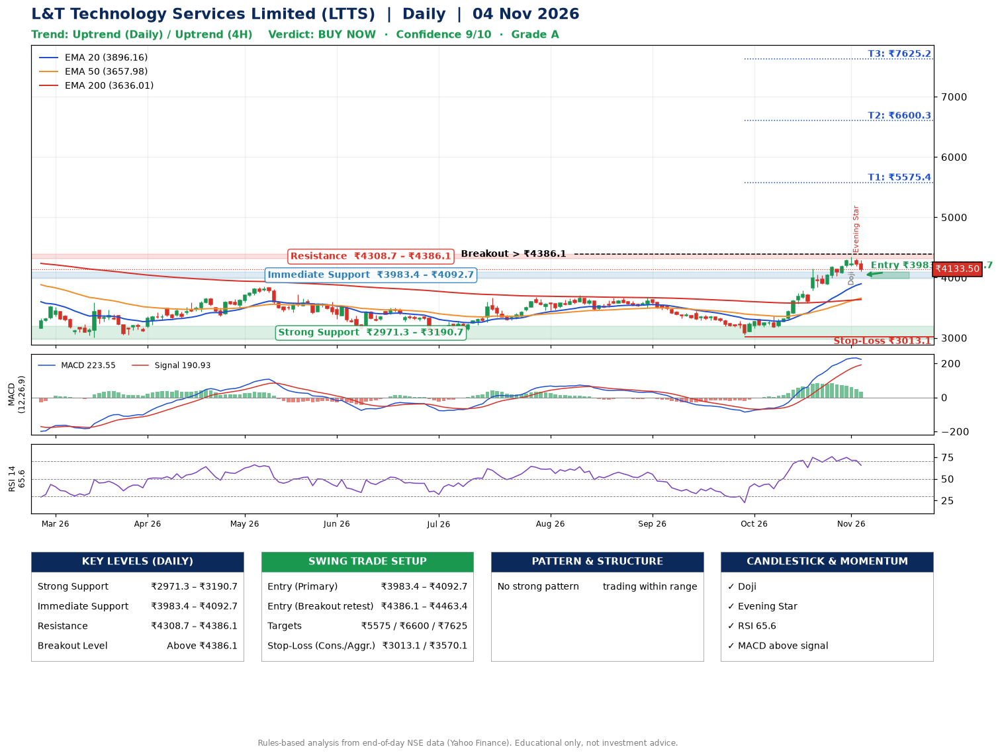

📌 **L&T Technology Services Limited (LTTS) – Multi-Timeframe Technical Analysis (Daily + 4H Combined)**
_Data up to 04 Nov 2026 · Close ₹4133.50_

**📍 Daily Timeframe Trend**
- Trend: **Uptrend** (price above rising EMAs)
- Recent swing highs: ₹3680.0, ₹3708.0, ₹3675.0 · swing lows: ₹3030.0, ₹3460.0, ₹3051.8
- EMAs: EMA20 ₹3896.2, EMA50 ₹3658.0, EMA200 ₹3636.0; bullish stack (EMA20 > EMA50 > EMA200); price above EMA20, EMA50, EMA200
- MACD 223.55 above signal 190.93 (above zero); histogram falling
- RSI(14) 65.6; no divergence on the last two swings

**📍 4-Hour Timeframe Trend**
- Structure: **Uptrend** (higher highs and higher lows)
- Pullback/support area: recent 4H swing lows ₹3168.8, ₹3580.0; EMA20 ₹4083.7
- EMA20/50: bullish stack (EMA20 > EMA50); price above EMA20, EMA50
- MACD 141.17 below signal 168.35 (above zero), fresh bearish crossover; histogram falling
- RSI(14) 60.0; Regular bearish divergence

**📍 Pattern Detection (Both Timeframes)**
- 4H: **Bull Flag** – 16% pole then a tight 6% flag; trigger above ₹4346.9

**📍 Candlestick Patterns (last 3 daily candles)**
- **Doji** – 02 Nov: indecision; wait for the next candle to confirm direction
- **Evening Star** – 03 Nov: three-candle bearish reversal

**📍 Price Action Key Levels (Daily Structure)**

| Zone | Price Level (₹) | Context |
|------|-----------------|---------|
| Strong Support | ₹2971.3 – ₹3190.7 | Cluster of earlier swing lows (demand) |
| Immediate Support | ₹3983.4 – ₹4092.7 | Nearest swing-low / wick area |
| Resistance | ₹4308.7 – ₹4386.1 | Nearest swing-high supply |
| Breakout Level | Above ₹4386.1 | Swing continuation trigger (52-week high ₹4726.0) |

**📍 Swing Trade Setup**

🟢 **Entry Zone**
- Primary: ₹3983.4 – ₹4092.7 (daily support / EMA20 area; enter on a bullish 4H candle)
- Alternate: ₹4386.1 – ₹4463.4 (breakout retest)

🎯 **Profit Targets**
- T1: ₹5575.4
- T2: ₹6600.3
- T3: ₹7625.2

🛑 **Stop-Loss**
- Conservative: below daily swing low (₹3013.1)
- Aggressive: below 4H structure (₹3570.1)
- Risk per share ≈ ₹1024.9; reward:risk to T1 ≈ 1.5

**📌 Strategy Notes**
- Higher timeframe: daily trend is uptrend; only take longs while price holds above ₹2971.3.
- Entry timing: wait for a bullish 4H candle (engulfing/hammer) inside ₹3983.4 – ₹4092.7 rather than buying mid-range.
- EMA stacking: bullish stack (EMA20 > EMA50 > EMA200); price above EMA20, EMA50, EMA200.
- Breakout rule: a daily close above ₹4386.1 with volume above its 20-day average (≈657,039) opens T2/T3.
- Momentum: RSI 66 – elevated, prefer dips; no divergence on the last two swings.
- Exit discipline: move the stop to entry once T1 is hit; book partial profits at each target.

**STEP 2 — Marked Up Chart**

**✅ Trade Validation Checklist**
- Trend + momentum aligned: Yes · Price at entry zone: No
- Stop defined (₹3013.1) · Reward:risk ≥ 1.5 to T1: No

## 📌 Final Verdict

Recommendation: **🟢 BUY NOW**

Confidence: **9/10**

Trade Quality: **A**

Reason:
• Daily uptrend (price above rising EMAs)
• EMAs stacked bullishly

Next Action:
• Buy now within the entry zone, with the stop-loss in place

_Rules-based analysis from end-of-day data. Educational only, not investment advice. Never place orders without your own confirmation._