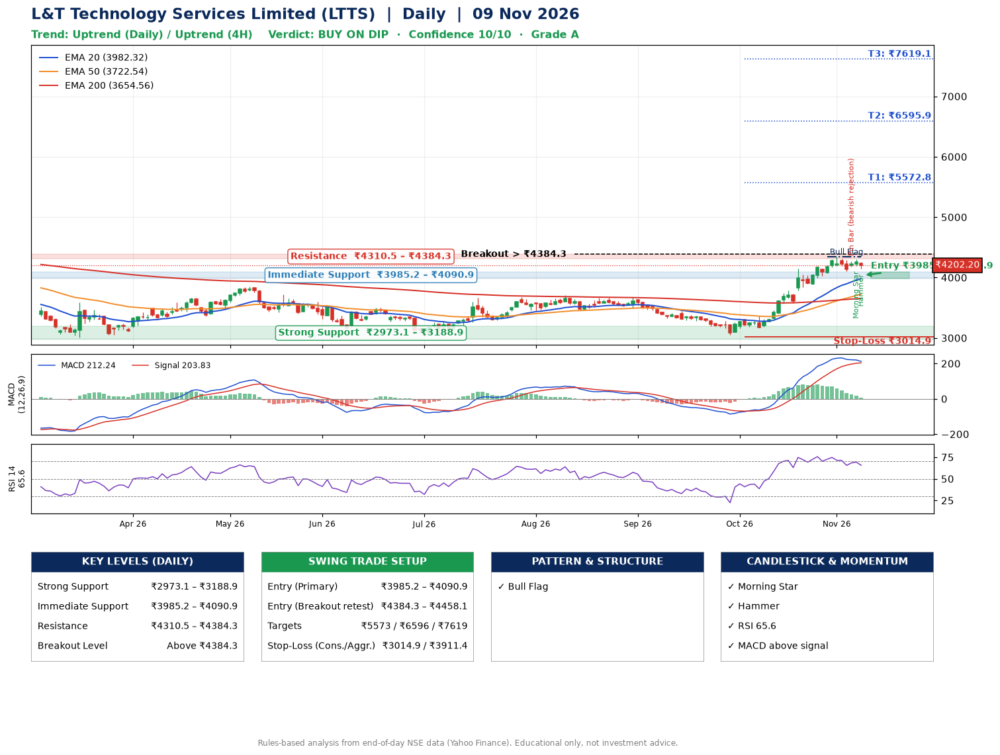

📌 **L&T Technology Services Limited (LTTS) – Multi-Timeframe Technical Analysis (Daily + 4H Combined)**
_Data up to 09 Nov 2026 · Close ₹4202.20_

**📍 Daily Timeframe Trend**
- Trend: **Uptrend** (price above rising EMAs)
- Recent swing highs: ₹3708.0, ₹3675.0, ₹4347.4 · swing lows: ₹3030.0, ₹3460.0, ₹3051.8
- EMAs: EMA20 ₹3982.3, EMA50 ₹3722.5, EMA200 ₹3654.6; bullish stack (EMA20 > EMA50 > EMA200); price above EMA20, EMA50, EMA200
- MACD 212.24 above signal 203.83 (above zero); histogram falling
- RSI(14) 65.6; no divergence on the last two swings

**📍 4-Hour Timeframe Trend**
- Structure: **Uptrend** (price above rising EMAs)
- Pullback/support area: recent 4H swing lows ₹3580.0, ₹4105.0; EMA20 ₹4147.0
- EMA20/50: bullish stack (EMA20 > EMA50); price above EMA20, EMA50
- MACD 104.43 below signal 131.10 (above zero); histogram falling
- RSI(14) 60.4; Hidden bullish divergence

**📍 Pattern Detection (Both Timeframes)**
- Daily: **Bull Flag** – 19% pole then a tight 7% flag; trigger above ₹4347.4
- 4H: **Bull Flag** – 16% pole then a tight 5% flag; trigger above ₹4297.5

**📍 Candlestick Patterns (last 3 daily candles)**
- **Pin Bar (bearish rejection)** – 05 Nov: long upper wick shows selling near ₹4267.9
- **Morning Star** – 06 Nov: three-candle bullish reversal
- **Hammer** – 09 Nov: long lower wick shows dip-buying near ₹4142.5

**📍 Price Action Key Levels (Daily Structure)**

| Zone | Price Level (₹) | Context |
|------|-----------------|---------|
| Strong Support | ₹2973.1 – ₹3188.9 | Cluster of earlier swing lows (demand) |
| Immediate Support | ₹3985.2 – ₹4090.9 | Nearest swing-low / wick area |
| Resistance | ₹4310.5 – ₹4384.3 | Nearest swing-high supply |
| Breakout Level | Above ₹4384.3 | Swing continuation trigger (52-week high ₹4726.0) |

**📍 Swing Trade Setup**

🟢 **Entry Zone**
- Primary: ₹3985.2 – ₹4090.9 (daily support / EMA20 area; enter on a bullish 4H candle)
- Alternate: ₹4384.3 – ₹4458.1 (breakout retest)

🎯 **Profit Targets**
- T1: ₹5572.8
- T2: ₹6595.9
- T3: ₹7619.1

🛑 **Stop-Loss**
- Conservative: below daily swing low (₹3014.9)
- Aggressive: below 4H structure (₹3911.4)
- Risk per share ≈ ₹1023.2; reward:risk to T1 ≈ 1.5

**📌 Strategy Notes**
- Higher timeframe: daily trend is uptrend; only take longs while price holds above ₹2973.1.
- Entry timing: wait for a bullish 4H candle (engulfing/hammer) inside ₹3985.2 – ₹4090.9 rather than buying mid-range.
- EMA stacking: bullish stack (EMA20 > EMA50 > EMA200); price above EMA20, EMA50, EMA200.
- Breakout rule: a daily close above ₹4384.3 with volume above its 20-day average (≈667,492) opens T2/T3.
- Momentum: RSI 66 – elevated, prefer dips; no divergence on the last two swings.
- Exit discipline: move the stop to entry once T1 is hit; book partial profits at each target.

**STEP 2 — Marked Up Chart**

**✅ Trade Validation Checklist**
- Trend + momentum aligned: Yes · Price at entry zone: No
- Stop defined (₹3014.9) · Reward:risk ≥ 1.5 to T1: Yes

## 📌 Final Verdict

Recommendation: **🟡 BUY ON DIP**

Confidence: **10/10**

Trade Quality: **A**

Reason:
• Daily uptrend (price above rising EMAs)
• EMAs stacked bullishly

Next Action:
• Wait for a pullback to ₹3985.2–₹4090.9, or a breakout above ₹4384.3

_Rules-based analysis from end-of-day data. Educational only, not investment advice. Never place orders without your own confirmation._