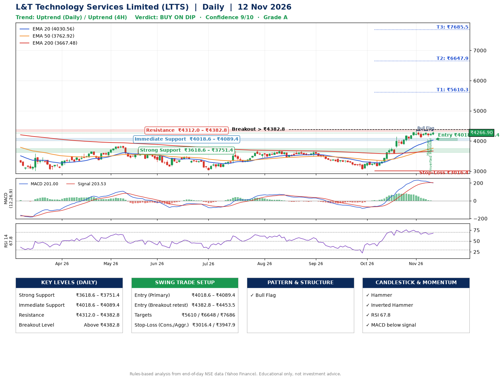

📌 **L&T Technology Services Limited (LTTS) – Multi-Timeframe Technical Analysis (Daily + 4H Combined)**
_Data up to 12 Nov 2026 · Close ₹4266.90_

**📍 Daily Timeframe Trend**
- Trend: **Uptrend** (price above rising EMAs)
- Recent swing highs: ₹3708.0, ₹3675.0, ₹4347.4 · swing lows: ₹3030.0, ₹3460.0, ₹3051.8
- EMAs: EMA20 ₹4030.6, EMA50 ₹3762.9, EMA200 ₹3667.5; bullish stack (EMA20 > EMA50 > EMA200); price above EMA20, EMA50, EMA200
- MACD 201.00 below signal 203.53 (above zero), fresh bearish crossover; histogram falling
- RSI(14) 67.8; no divergence on the last two swings

**📍 4-Hour Timeframe Trend**
- Structure: **Uptrend** (price above rising EMAs)
- Pullback/support area: recent 4H swing lows ₹4105.0, ₹4148.2; EMA20 ₹4183.4
- EMA20/50: bullish stack (EMA20 > EMA50); price above EMA20, EMA50
- MACD 90.39 below signal 108.93 (above zero); histogram rising
- RSI(14) 62.3; no divergence

**📍 Pattern Detection (Both Timeframes)**
- Daily: **Bull Flag** – 15% pole then a tight 6% flag; trigger above ₹4347.4
- 4H: **Bull Flag** – 17% pole then a tight 4% flag; trigger above ₹4316.6

**📍 Candlestick Patterns (last 3 daily candles)**
- **Hammer** – 09 Nov: long lower wick shows dip-buying near ₹4142.5
- **Inverted Hammer** – 11 Nov: long upper wick shows selling near ₹4279.9

**📍 Price Action Key Levels (Daily Structure)**

| Zone | Price Level (₹) | Context |
|------|-----------------|---------|
| Strong Support | ₹3618.6 – ₹3751.4 | Cluster of earlier swing lows (demand) |
| Immediate Support | ₹4018.6 – ₹4089.4 | Nearest swing-low / wick area |
| Resistance | ₹4312.0 – ₹4382.8 | Nearest swing-high supply |
| Breakout Level | Above ₹4382.8 | Swing continuation trigger (52-week high ₹4726.0) |

**📍 Swing Trade Setup**

🟢 **Entry Zone**
- Primary: ₹4018.6 – ₹4089.4 (daily support / EMA20 area; enter on a bullish 4H candle)
- Alternate: ₹4382.8 – ₹4453.5 (breakout retest)

🎯 **Profit Targets**
- T1: ₹5610.3
- T2: ₹6647.9
- T3: ₹7685.5

🛑 **Stop-Loss**
- Conservative: below daily swing low (₹3016.4)
- Aggressive: below 4H structure (₹3947.9)
- Risk per share ≈ ₹1037.6; reward:risk to T1 ≈ 1.5
- Time to T1: it never rose this much within 60 trading days in the price history
- Time to T2: it never rose this much within 60 trading days in the price history

**📌 Strategy Notes**
- Higher timeframe: daily trend is uptrend; only take longs while price holds above ₹3618.6.
- Entry timing: wait for a bullish 4H candle (engulfing/hammer) inside ₹4018.6 – ₹4089.4 rather than buying mid-range.
- EMA stacking: bullish stack (EMA20 > EMA50 > EMA200); price above EMA20, EMA50, EMA200.
- Breakout rule: a daily close above ₹4382.8 with volume above its 20-day average (≈669,920) opens T2/T3.
- Momentum: RSI 68 – elevated, prefer dips; no divergence on the last two swings.
- Exit discipline: move the stop to entry once T1 is hit; book partial profits at each target.

**STEP 2 — Marked Up Chart**

**✅ Trade Validation Checklist**
- Trend + momentum aligned: No · Price at entry zone: No
- Stop defined (₹3016.4) · Reward:risk ≥ 1.5 to T1: No

## 📌 Final Verdict

Recommendation: **🟡 BUY ON DIP**

Confidence: **9/10**

Trade Quality: **A**

Reason:
• Daily uptrend (price above rising EMAs)
• EMAs stacked bullishly

Next Action:
• Wait for a pullback to ₹4018.6–₹4089.4

_Rules-based analysis from end-of-day data. Educational only, not investment advice. Never place orders without your own confirmation._