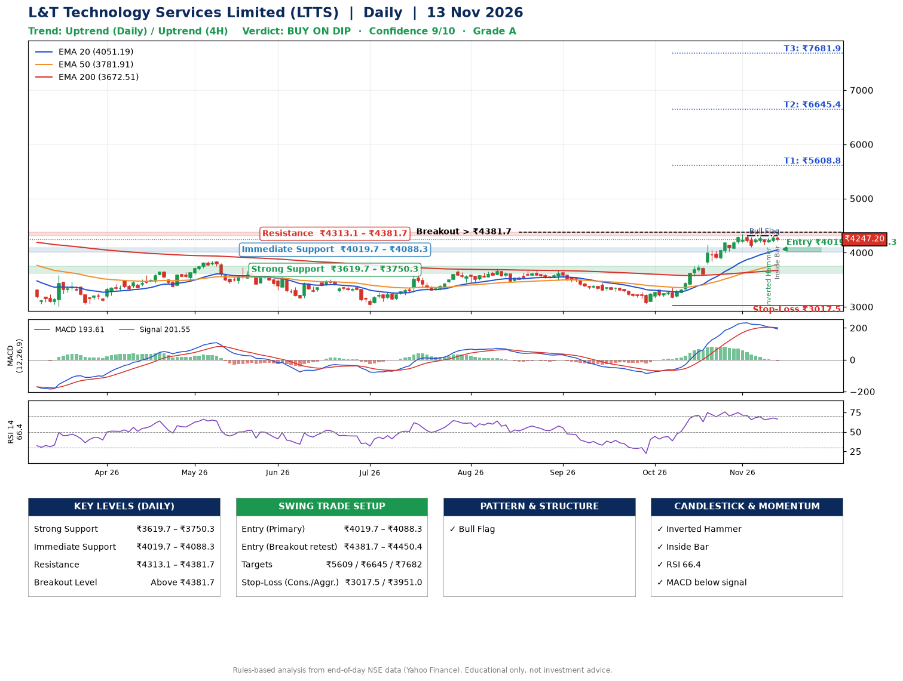

📌 **L&T Technology Services Limited (LTTS) – Multi-Timeframe Technical Analysis (Daily + 4H Combined)**
_Data up to 13 Nov 2026 · Close ₹4247.20_

**📍 Daily Timeframe Trend**
- Trend: **Uptrend** (price above rising EMAs)
- Recent swing highs: ₹3708.0, ₹3675.0, ₹4347.4 · swing lows: ₹3030.0, ₹3460.0, ₹3051.8
- EMAs: EMA20 ₹4051.2, EMA50 ₹3781.9, EMA200 ₹3672.5; bullish stack (EMA20 > EMA50 > EMA200); price above EMA20, EMA50, EMA200
- MACD 193.61 below signal 201.55 (above zero), fresh bearish crossover; histogram falling
- RSI(14) 66.4; no divergence on the last two swings

**📍 4-Hour Timeframe Trend**
- Structure: **Uptrend** (higher highs and higher lows)
- Pullback/support area: recent 4H swing lows ₹4105.0, ₹4148.2; EMA20 ₹4196.2
- EMA20/50: bullish stack (EMA20 > EMA50); price above EMA20, EMA50
- MACD 81.00 below signal 99.73 (above zero); histogram falling
- RSI(14) 60.5; no divergence

**📍 Pattern Detection (Both Timeframes)**
- Daily: **Bull Flag** – 17% pole then a tight 5% flag; trigger above ₹4316.9
- 4H: **Ascending Triangle** – converging swing highs and lows over the last ~60 sessions

**📍 Candlestick Patterns (last 3 daily candles)**
- **Inverted Hammer** – 11 Nov: long upper wick shows selling near ₹4279.9
- **Inside Bar** – 13 Nov: compression inside the prior range ₹4206.4–₹4316.9

**📍 Price Action Key Levels (Daily Structure)**

| Zone | Price Level (₹) | Context |
|------|-----------------|---------|
| Strong Support | ₹3619.7 – ₹3750.3 | Cluster of earlier swing lows (demand) |
| Immediate Support | ₹4019.7 – ₹4088.3 | Nearest swing-low / wick area |
| Resistance | ₹4313.1 – ₹4381.7 | Nearest swing-high supply |
| Breakout Level | Above ₹4381.7 | Swing continuation trigger (52-week high ₹4726.0) |

**📍 Swing Trade Setup**

🟢 **Entry Zone**
- Primary: ₹4019.7 – ₹4088.3 (daily support / EMA20 area; enter on a bullish 4H candle)
- Alternate: ₹4381.7 – ₹4450.4 (breakout retest)

🎯 **Profit Targets**
- T1: ₹5608.8
- T2: ₹6645.4
- T3: ₹7681.9

🛑 **Stop-Loss**
- Conservative: below daily swing low (₹3017.5)
- Aggressive: below 4H structure (₹3951.0)
- Risk per share ≈ ₹1036.5; reward:risk to T1 ≈ 1.5
- Time to T1: it never rose this much within 60 trading days in the price history
- Time to T2: it never rose this much within 60 trading days in the price history

**📌 Strategy Notes**
- Higher timeframe: daily trend is uptrend; only take longs while price holds above ₹3619.7.
- Entry timing: wait for a bullish 4H candle (engulfing/hammer) inside ₹4019.7 – ₹4088.3 rather than buying mid-range.
- EMA stacking: bullish stack (EMA20 > EMA50 > EMA200); price above EMA20, EMA50, EMA200.
- Breakout rule: a daily close above ₹4381.7 with volume above its 20-day average (≈664,822) opens T2/T3.
- Momentum: RSI 66 – elevated, prefer dips; no divergence on the last two swings.
- Exit discipline: move the stop to entry once T1 is hit; book partial profits at each target.

**STEP 2 — Marked Up Chart**

**✅ Trade Validation Checklist**
- Trend + momentum aligned: No · Price at entry zone: No
- Stop defined (₹3017.5) · Reward:risk ≥ 1.5 to T1: No

## 📌 Final Verdict

Recommendation: **🟡 BUY ON DIP**

Confidence: **9/10**

Trade Quality: **A**

Reason:
• Daily uptrend (price above rising EMAs)
• EMAs stacked bullishly

Next Action:
• Wait for a pullback to ₹4019.7–₹4088.3

_Rules-based analysis from end-of-day data. Educational only, not investment advice. Never place orders without your own confirmation._