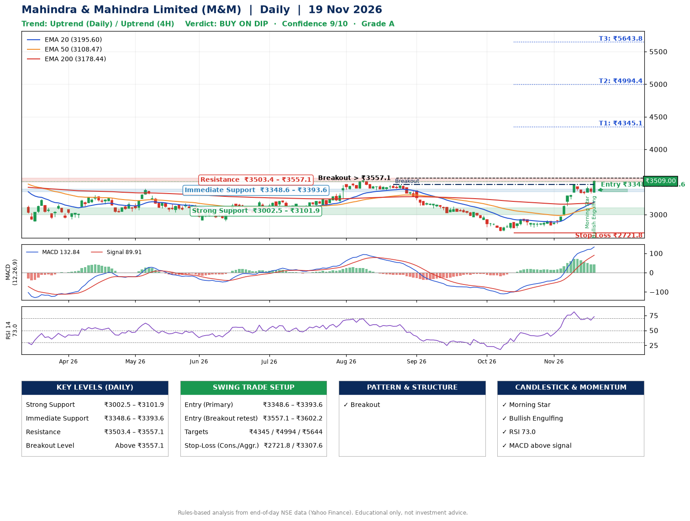

📌 **Mahindra & Mahindra Limited (M&M) – Multi-Timeframe Technical Analysis (Daily + 4H Combined)**
_Data up to 19 Nov 2026 · Close ₹3509.00_

**📍 Daily Timeframe Trend**
- Trend: **Uptrend** (price above rising EMAs)
- Recent swing highs: ₹3456.4, ₹2938.6, ₹3465.0 · swing lows: ₹3371.1, ₹3029.5, ₹2744.3
- EMAs: EMA20 ₹3195.6, EMA50 ₹3108.5, EMA200 ₹3178.4; mixed / crossing; price above EMA20, EMA50, EMA200
- MACD 132.84 above signal 89.91 (above zero); histogram rising
- RSI(14) 73.0; no divergence on the last two swings

**📍 4-Hour Timeframe Trend**
- Structure: **Uptrend** (higher highs and higher lows)
- Pullback/support area: recent 4H swing lows ₹2839.0, ₹3314.0; EMA20 ₹3312.3
- EMA20/50: bullish stack (EMA20 > EMA50); price above EMA20, EMA50
- MACD 112.21 below signal 112.50 (above zero), fresh bearish crossover; histogram rising
- RSI(14) 72.1; no divergence

**📍 Pattern Detection (Both Timeframes)**
- Daily: **Breakout** – closed above the 60-session high ₹3465.0 (volume not confirming yet)
- 4H: **Bull Flag** – 16% pole then a tight 6% flag; trigger above ₹3525.9

**📍 Candlestick Patterns (last 3 daily candles)**
- **Morning Star** – 17 Nov: three-candle bullish reversal
- **Bullish Engulfing** – 19 Nov: buyers fully reversed the prior red candle

**📍 Price Action Key Levels (Daily Structure)**

| Zone | Price Level (₹) | Context |
|------|-----------------|---------|
| Strong Support | ₹3002.5 – ₹3101.9 | Cluster of earlier swing lows (demand) |
| Immediate Support | ₹3348.6 – ₹3393.6 | Nearest swing-low / wick area |
| Resistance | ₹3503.4 – ₹3557.1 | Nearest swing-high supply |
| Breakout Level | Above ₹3557.1 | Swing continuation trigger (52-week high ₹3839.9) |

**📍 Swing Trade Setup**

🟢 **Entry Zone**
- Primary: ₹3348.6 – ₹3393.6 (daily support / EMA20 area; enter on a bullish 4H candle)
- Alternate: ₹3557.1 – ₹3602.2 (breakout retest)

🎯 **Profit Targets**
- T1: ₹4345.1
- T2: ₹4994.4
- T3: ₹5643.8

🛑 **Stop-Loss**
- Conservative: below daily swing low (₹2721.8)
- Aggressive: below 4H structure (₹3307.6)
- Risk per share ≈ ₹649.3; reward:risk to T1 ≈ 1.5
- Time to T1: about 52 trading days (it rose this much within 60 trading days 0% of the time in the last 2 years)
- Time to T2: it never rose this much within 60 trading days in the price history

**📌 Strategy Notes**
- Higher timeframe: daily trend is uptrend; only take longs while price holds above ₹3002.5.
- Entry timing: wait for a bullish 4H candle (engulfing/hammer) inside ₹3348.6 – ₹3393.6 rather than buying mid-range.
- EMA stacking: mixed / crossing; price above EMA20, EMA50, EMA200.
- Breakout rule: a daily close above ₹3557.1 with volume above its 20-day average (≈3,026,590) opens T2/T3.
- Momentum: RSI 73 – elevated, prefer dips; no divergence on the last two swings.
- Exit discipline: move the stop to entry once T1 is hit; book partial profits at each target.

**STEP 2 — Marked Up Chart**

**✅ Trade Validation Checklist**
- Trend + momentum aligned: Yes · Price at entry zone: No
- Stop defined (₹2721.8) · Reward:risk ≥ 1.5 to T1: No

## 📌 Final Verdict

Recommendation: **🟡 BUY ON DIP**

Confidence: **9/10**

Trade Quality: **A**

Reason:
• Daily uptrend (price above rising EMAs)
• Breakout: closed above the 60-session high ₹3465.0 (volume not confirming yet)

Next Action:
• Wait for a pullback to ₹3348.6–₹3393.6

_Rules-based analysis from end-of-day data. Educational only, not investment advice. Never place orders without your own confirmation._