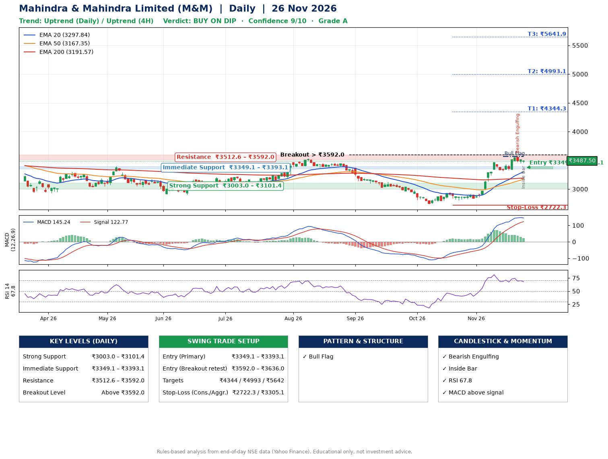

📌 **Mahindra & Mahindra Limited (M&M) – Multi-Timeframe Technical Analysis (Daily + 4H Combined)**
_Data up to 26 Nov 2026 · Close ₹3487.50_

**📍 Daily Timeframe Trend**
- Trend: **Uptrend** (price above rising EMAs)
- Recent swing highs: ₹3456.4, ₹2938.6, ₹3465.0 · swing lows: ₹3371.1, ₹3029.5, ₹2744.3
- EMAs: EMA20 ₹3297.8, EMA50 ₹3167.3, EMA200 ₹3191.6; mixed / crossing; price above EMA20, EMA50, EMA200
- MACD 145.24 above signal 122.77 (above zero); histogram falling
- RSI(14) 67.8; no divergence on the last two swings

**📍 4-Hour Timeframe Trend**
- Structure: **Uptrend** (higher highs and higher lows)
- Pullback/support area: recent 4H swing lows ₹3314.0, ₹3449.1; EMA20 ₹3412.9
- EMA20/50: bullish stack (EMA20 > EMA50); price above EMA20, EMA50
- MACD 90.92 below signal 103.80 (above zero), fresh bearish crossover; histogram falling
- RSI(14) 62.9; Hidden bullish divergence; Regular bearish divergence

**📍 Pattern Detection (Both Timeframes)**
- Daily: **Bull Flag** – 17% pole then a tight 7% flag; trigger above ₹3570.0
- 4H: **Bull Flag** – 18% pole then a tight 3% flag; trigger above ₹3569.4

**📍 Candlestick Patterns (last 3 daily candles)**
- **Bearish Engulfing** – 23 Nov: sellers fully reversed the prior green candle
- **Inside Bar** – 26 Nov: compression inside the prior range ₹3444.8–₹3526.0

**📍 Price Action Key Levels (Daily Structure)**

| Zone | Price Level (₹) | Context |
|------|-----------------|---------|
| Strong Support | ₹3003.0 – ₹3101.4 | Cluster of earlier swing lows (demand) |
| Immediate Support | ₹3349.1 – ₹3393.1 | Nearest swing-low / wick area |
| Resistance | ₹3512.6 – ₹3592.0 | Nearest swing-high supply |
| Breakout Level | Above ₹3592.0 | Swing continuation trigger (52-week high ₹3839.9) |

**📍 Swing Trade Setup**

🟢 **Entry Zone**
- Primary: ₹3349.1 – ₹3393.1 (daily support / EMA20 area; enter on a bullish 4H candle)
- Alternate: ₹3592.0 – ₹3636.0 (breakout retest)

🎯 **Profit Targets**
- T1: ₹4344.3
- T2: ₹4993.1
- T3: ₹5641.9

🛑 **Stop-Loss**
- Conservative: below daily swing low (₹2722.3)
- Aggressive: below 4H structure (₹3305.1)
- Risk per share ≈ ₹648.8; reward:risk to T1 ≈ 1.5
- Time to T1: about 52 trading days (it rose this much within 60 trading days 0% of the time in the last 2 years)
- Time to T2: it never rose this much within 60 trading days in the price history

**📌 Strategy Notes**
- Higher timeframe: daily trend is uptrend; only take longs while price holds above ₹3003.0.
- Entry timing: wait for a bullish 4H candle (engulfing/hammer) inside ₹3349.1 – ₹3393.1 rather than buying mid-range.
- EMA stacking: mixed / crossing; price above EMA20, EMA50, EMA200.
- Breakout rule: a daily close above ₹3592.0 with volume above its 20-day average (≈3,242,011) opens T2/T3.
- Momentum: RSI 68 – elevated, prefer dips; no divergence on the last two swings.
- Exit discipline: move the stop to entry once T1 is hit; book partial profits at each target.

**STEP 2 — Marked Up Chart**

**✅ Trade Validation Checklist**
- Trend + momentum aligned: Yes · Price at entry zone: No
- Stop defined (₹2722.3) · Reward:risk ≥ 1.5 to T1: Yes

## 📌 Final Verdict

Recommendation: **🟡 BUY ON DIP**

Confidence: **9/10**

Trade Quality: **A**

Reason:
• Daily uptrend (price above rising EMAs)
• Bull Flag: 17% pole then a tight 7% flag; trigger above ₹3570.0

Next Action:
• Wait for a pullback to ₹3349.1–₹3393.1, or a breakout above ₹3592.0

_Rules-based analysis from end-of-day data. Educational only, not investment advice. Never place orders without your own confirmation._