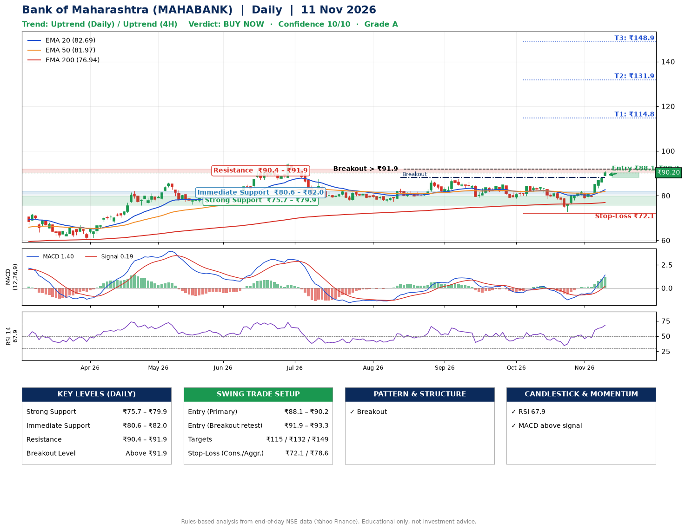

📌 **Bank of Maharashtra (MAHABANK) – Multi-Timeframe Technical Analysis (Daily + 4H Combined)**
_Data up to 11 Nov 2026 · Close ₹90.20_

**📍 Daily Timeframe Trend**
- Trend: **Uptrend** (price above rising EMAs)
- Recent swing highs: ₹84.9, ₹84.5, ₹84.5 · swing lows: ₹79.2, ₹78.9, ₹72.8
- EMAs: EMA20 ₹82.7, EMA50 ₹82.0, EMA200 ₹76.9; bullish stack (EMA20 > EMA50 > EMA200); price above EMA20, EMA50, EMA200
- MACD 1.40 above signal 0.19 (above zero); histogram rising
- RSI(14) 67.9; no divergence on the last two swings

**📍 4-Hour Timeframe Trend**
- Structure: **Uptrend** (higher highs and higher lows)
- Pullback/support area: recent 4H swing lows ₹72.9, ₹78.8; EMA20 ₹85.4
- EMA20/50: bullish stack (EMA20 > EMA50); price above EMA20, EMA50
- MACD 2.91 above signal 1.91 (above zero); histogram falling
- RSI(14) 79.6; no divergence

**📍 Pattern Detection (Both Timeframes)**
- Daily: **Breakout** – closed above the 60-session high ₹88.1 on strong volume
- 4H: **Inverse Head & Shoulders** – head ₹72.9, neckline ₹82.9

**📍 Candlestick Patterns (last 3 daily candles)**
- No notable candlestick signal in the last 3 sessions.

**📍 Price Action Key Levels (Daily Structure)**

| Zone | Price Level (₹) | Context |
|------|-----------------|---------|
| Strong Support | ₹75.7 – ₹79.9 | Cluster of earlier swing lows (demand) |
| Immediate Support | ₹80.6 – ₹82.0 | Nearest swing-low / wick area |
| Resistance | ₹90.4 – ₹91.9 | Nearest swing-high supply |
| Breakout Level | Above ₹91.9 | Swing continuation trigger (52-week high ₹94.5) |

**📍 Swing Trade Setup**

🟢 **Entry Zone**
- Primary: ₹88.1 – ₹90.2 (daily support / EMA20 area; enter on a bullish 4H candle)
- Alternate: ₹91.9 – ₹93.3 (breakout retest)

🎯 **Profit Targets**
- T1: ₹114.8
- T2: ₹131.9
- T3: ₹148.9

🛑 **Stop-Loss**
- Conservative: below daily swing low (₹72.1)
- Aggressive: below 4H structure (₹78.6)
- Risk per share ≈ ₹17.1; reward:risk to T1 ≈ 1.5
- Time to T1: about 48 trading days (it rose this much within 60 trading days 14% of the time in the last 2 years)
- Time to T2: about 50 trading days (it rose this much within 60 trading days 0% of the time in the last 2 years)

**📌 Strategy Notes**
- Higher timeframe: daily trend is uptrend; only take longs while price holds above ₹75.7.
- Entry timing: wait for a bullish 4H candle (engulfing/hammer) inside ₹88.1 – ₹90.2 rather than buying mid-range.
- EMA stacking: bullish stack (EMA20 > EMA50 > EMA200); price above EMA20, EMA50, EMA200.
- Breakout rule: a daily close above ₹91.9 with volume above its 20-day average (≈17,605,019) opens T2/T3.
- Momentum: RSI 68 – elevated, prefer dips; no divergence on the last two swings.
- Exit discipline: move the stop to entry once T1 is hit; book partial profits at each target.

**STEP 2 — Marked Up Chart**

**✅ Trade Validation Checklist**
- Trend + momentum aligned: Yes · Price at entry zone: Yes
- Stop defined (₹72.1) · Reward:risk ≥ 1.5 to T1: Yes

## 📌 Final Verdict

Recommendation: **🟢 BUY NOW**

Confidence: **10/10**

Trade Quality: **A**

Reason:
• Daily uptrend (price above rising EMAs)
• EMAs stacked bullishly

Next Action:
• Buy now within the entry zone, with the stop-loss in place

_Rules-based analysis from end-of-day data. Educational only, not investment advice. Never place orders without your own confirmation._