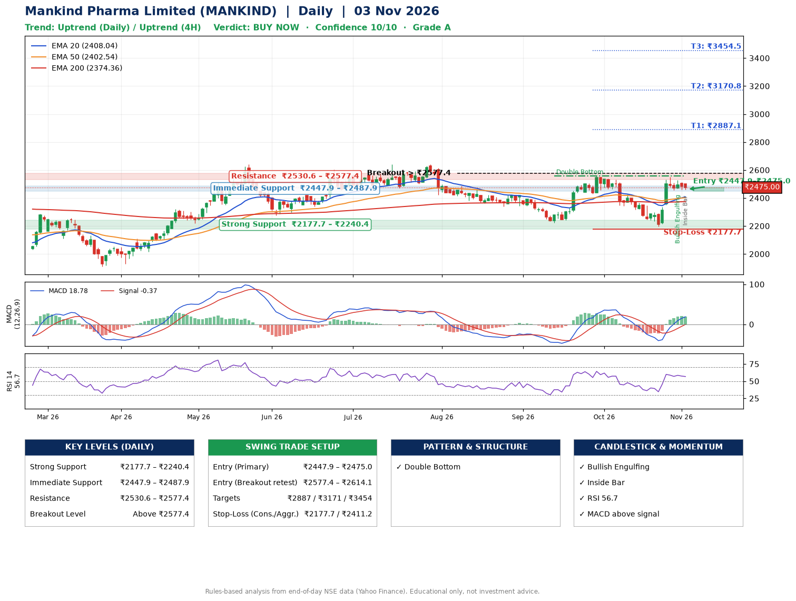

📌 **Mankind Pharma Limited (MANKIND) – Multi-Timeframe Technical Analysis (Daily + 4H Combined)**
_Data up to 03 Nov 2026 · Close ₹2475.00_

**📍 Daily Timeframe Trend**
- Trend: **Uptrend** (price above rising EMAs)
- Recent swing highs: ₹2642.0, ₹2423.9, ₹2559.0 · swing lows: ₹2337.6, ₹2222.0, ₹2196.1
- EMAs: EMA20 ₹2408.0, EMA50 ₹2402.5, EMA200 ₹2374.4; bullish stack (EMA20 > EMA50 > EMA200); price above EMA20, EMA50, EMA200
- MACD 18.78 above signal -0.37 (above zero); histogram falling
- RSI(14) 56.7; no divergence on the last two swings

**📍 4-Hour Timeframe Trend**
- Structure: **Uptrend** (price above rising EMAs)
- Pullback/support area: recent 4H swing lows ₹2198.6, ₹2458.0; EMA20 ₹2430.7
- EMA20/50: bullish stack (EMA20 > EMA50); price above EMA20, EMA50
- MACD 35.65 above signal 27.10 (above zero); histogram falling
- RSI(14) 58.3; no divergence

**📍 Pattern Detection (Both Timeframes)**
- Daily: **Double Bottom** – bottoms near ₹2222.0/₹2196.1, neckline ₹2559.0, forming

**📍 Candlestick Patterns (last 3 daily candles)**
- **Bullish Engulfing** – 30 Oct: buyers fully reversed the prior red candle
- **Inside Bar** – 03 Nov: compression inside the prior range ₹2457.9–₹2512.3

**📍 Price Action Key Levels (Daily Structure)**

| Zone | Price Level (₹) | Context |
|------|-----------------|---------|
| Strong Support | ₹2177.7 – ₹2240.4 | Cluster of earlier swing lows (demand) |
| Immediate Support | ₹2447.9 – ₹2487.9 | Nearest swing-low / wick area |
| Resistance | ₹2530.6 – ₹2577.4 | Nearest swing-high supply |
| Breakout Level | Above ₹2577.4 | Swing continuation trigger (52-week high ₹2642.0) |

**📍 Swing Trade Setup**

🟢 **Entry Zone**
- Primary: ₹2447.9 – ₹2475.0 (daily support / EMA20 area; enter on a bullish 4H candle)
- Alternate: ₹2577.4 – ₹2614.1 (breakout retest)

🎯 **Profit Targets**
- T1: ₹2887.1
- T2: ₹3170.8
- T3: ₹3454.5

🛑 **Stop-Loss**
- Conservative: below daily swing low (₹2177.7)
- Aggressive: below 4H structure (₹2411.2)
- Risk per share ≈ ₹283.7; reward:risk to T1 ≈ 1.5

**📌 Strategy Notes**
- Higher timeframe: daily trend is uptrend; only take longs while price holds above ₹2177.7.
- Entry timing: wait for a bullish 4H candle (engulfing/hammer) inside ₹2447.9 – ₹2475.0 rather than buying mid-range.
- EMA stacking: bullish stack (EMA20 > EMA50 > EMA200); price above EMA20, EMA50, EMA200.
- Breakout rule: a daily close above ₹2577.4 with volume above its 20-day average (≈738,710) opens T2/T3.
- Momentum: RSI 57 – room to run; no divergence on the last two swings.
- Exit discipline: move the stop to entry once T1 is hit; book partial profits at each target.

**STEP 2 — Marked Up Chart**

**✅ Trade Validation Checklist**
- Trend + momentum aligned: Yes · Price at entry zone: Yes
- Stop defined (₹2177.7) · Reward:risk ≥ 1.5 to T1: Yes

## 📌 Final Verdict

Recommendation: **🟢 BUY NOW**

Confidence: **10/10**

Trade Quality: **A**

Reason:
• Daily uptrend (price above rising EMAs)
• EMAs stacked bullishly

Next Action:
• Buy now within the entry zone, with the stop-loss in place

_Rules-based analysis from end-of-day data. Educational only, not investment advice. Never place orders without your own confirmation._