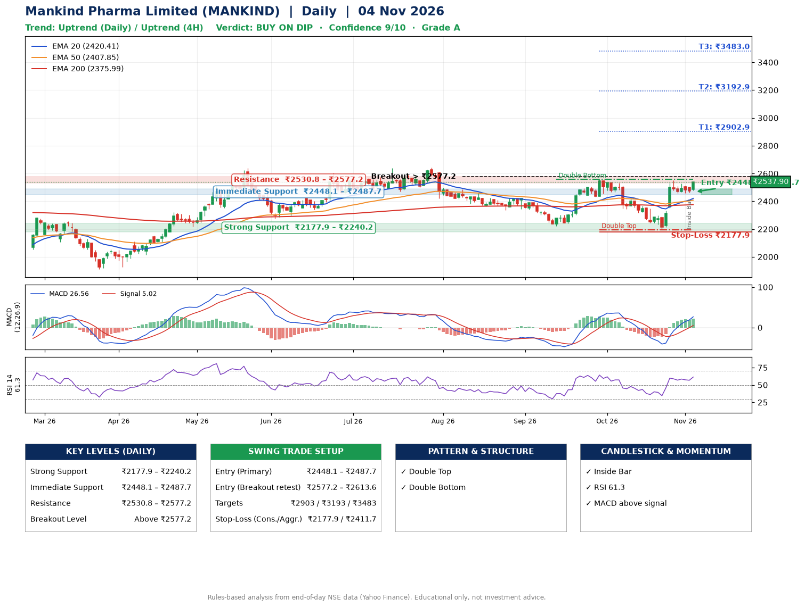

📌 **Mankind Pharma Limited (MANKIND) – Multi-Timeframe Technical Analysis (Daily + 4H Combined)**
_Data up to 04 Nov 2026 · Close ₹2537.90_

**📍 Daily Timeframe Trend**
- Trend: **Uptrend** (price above rising EMAs)
- Recent swing highs: ₹2423.9, ₹2559.0, ₹2549.0 · swing lows: ₹2337.6, ₹2222.0, ₹2196.1
- EMAs: EMA20 ₹2420.4, EMA50 ₹2407.8, EMA200 ₹2376.0; bullish stack (EMA20 > EMA50 > EMA200); price above EMA20, EMA50, EMA200
- MACD 26.56 above signal 5.02 (above zero); histogram rising
- RSI(14) 61.3; no divergence on the last two swings

**📍 4-Hour Timeframe Trend**
- Structure: **Uptrend** (price above rising EMAs)
- Pullback/support area: recent 4H swing lows ₹2198.6, ₹2458.0; EMA20 ₹2446.2
- EMA20/50: bullish stack (EMA20 > EMA50); price above EMA20, EMA50
- MACD 39.39 above signal 30.97 (above zero); histogram rising
- RSI(14) 65.1; no divergence

**📍 Pattern Detection (Both Timeframes)**
- Daily: **Double Top** – tops near ₹2559.0/₹2549.0, neckline ₹2196.1, forming
- Daily: **Double Bottom** – bottoms near ₹2222.0/₹2196.1, neckline ₹2559.0, forming

**📍 Candlestick Patterns (last 3 daily candles)**
- **Inside Bar** – 03 Nov: compression inside the prior range ₹2457.9–₹2512.3

**📍 Price Action Key Levels (Daily Structure)**

| Zone | Price Level (₹) | Context |
|------|-----------------|---------|
| Strong Support | ₹2177.9 – ₹2240.2 | Cluster of earlier swing lows (demand) |
| Immediate Support | ₹2448.1 – ₹2487.7 | Nearest swing-low / wick area |
| Resistance | ₹2530.8 – ₹2577.2 | Nearest swing-high supply |
| Breakout Level | Above ₹2577.2 | Swing continuation trigger (52-week high ₹2642.0) |

**📍 Swing Trade Setup**

🟢 **Entry Zone**
- Primary: ₹2448.1 – ₹2487.7 (daily support / EMA20 area; enter on a bullish 4H candle)
- Alternate: ₹2577.2 – ₹2613.6 (breakout retest)

🎯 **Profit Targets**
- T1: ₹2902.9
- T2: ₹3192.9
- T3: ₹3483.0

🛑 **Stop-Loss**
- Conservative: below daily swing low (₹2177.9)
- Aggressive: below 4H structure (₹2411.7)
- Risk per share ≈ ₹290.0; reward:risk to T1 ≈ 1.5

**📌 Strategy Notes**
- Higher timeframe: daily trend is uptrend; only take longs while price holds above ₹2177.9.
- Entry timing: wait for a bullish 4H candle (engulfing/hammer) inside ₹2448.1 – ₹2487.7 rather than buying mid-range.
- EMA stacking: bullish stack (EMA20 > EMA50 > EMA200); price above EMA20, EMA50, EMA200.
- Breakout rule: a daily close above ₹2577.2 with volume above its 20-day average (≈756,604) opens T2/T3.
- Momentum: RSI 61 – room to run; no divergence on the last two swings.
- Exit discipline: move the stop to entry once T1 is hit; book partial profits at each target.

**STEP 2 — Marked Up Chart**

**✅ Trade Validation Checklist**
- Trend + momentum aligned: Yes · Price at entry zone: No
- Stop defined (₹2177.9) · Reward:risk ≥ 1.5 to T1: No

## 📌 Final Verdict

Recommendation: **🟡 BUY ON DIP**

Confidence: **9/10**

Trade Quality: **A**

Reason:
• Daily uptrend (price above rising EMAs)
• EMAs stacked bullishly

Next Action:
• Wait for a pullback to ₹2448.1–₹2487.7, or a breakout above ₹2577.2

_Rules-based analysis from end-of-day data. Educational only, not investment advice. Never place orders without your own confirmation._