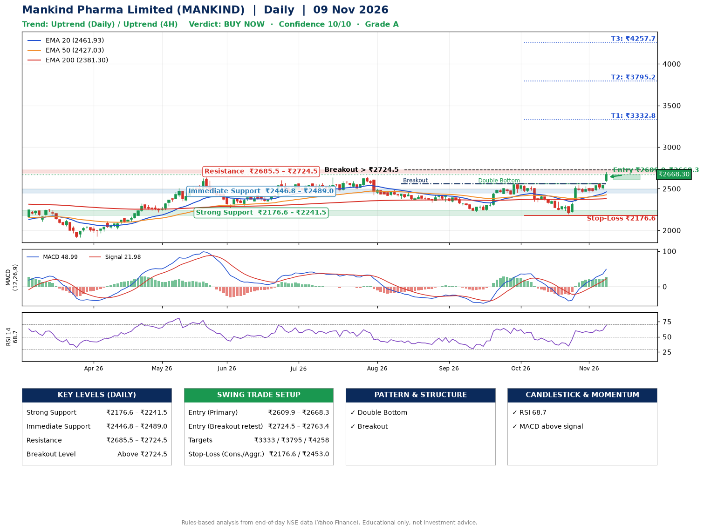

📌 **Mankind Pharma Limited (MANKIND) – Multi-Timeframe Technical Analysis (Daily + 4H Combined)**
_Data up to 09 Nov 2026 · Close ₹2668.30_

**📍 Daily Timeframe Trend**
- Trend: **Uptrend** (price above rising EMAs)
- Recent swing highs: ₹2423.9, ₹2559.0, ₹2549.0 · swing lows: ₹2337.6, ₹2222.0, ₹2196.1
- EMAs: EMA20 ₹2461.9, EMA50 ₹2427.0, EMA200 ₹2381.3; bullish stack (EMA20 > EMA50 > EMA200); price above EMA20, EMA50, EMA200
- MACD 48.99 above signal 21.98 (above zero); histogram rising
- RSI(14) 68.7; no divergence on the last two swings

**📍 4-Hour Timeframe Trend**
- Structure: **Uptrend** (higher highs and higher lows)
- Pullback/support area: recent 4H swing lows ₹2198.6, ₹2458.0; EMA20 ₹2505.3
- EMA20/50: bullish stack (EMA20 > EMA50); price above EMA20, EMA50
- MACD 57.49 above signal 42.62 (above zero); histogram rising
- RSI(14) 74.1; Regular bearish divergence

**📍 Pattern Detection (Both Timeframes)**
- Daily: **Double Bottom** – bottoms near ₹2222.0/₹2196.1, neckline ₹2559.0, confirmed (closed above neckline)
- Daily: **Breakout** – closed above the 60-session high ₹2561.2 on strong volume
- 4H: **Ascending Triangle** – converging swing highs and lows over the last ~60 sessions

**📍 Candlestick Patterns (last 3 daily candles)**
- No notable candlestick signal in the last 3 sessions.

**📍 Price Action Key Levels (Daily Structure)**

| Zone | Price Level (₹) | Context |
|------|-----------------|---------|
| Strong Support | ₹2176.6 – ₹2241.5 | Cluster of earlier swing lows (demand) |
| Immediate Support | ₹2446.8 – ₹2489.0 | Nearest swing-low / wick area |
| Resistance | ₹2685.5 – ₹2724.5 | Nearest swing-high supply |
| Breakout Level | Above ₹2724.5 | Swing continuation trigger (52-week high ₹2705.0) |

**📍 Swing Trade Setup**

🟢 **Entry Zone**
- Primary: ₹2609.9 – ₹2668.3 (daily support / EMA20 area; enter on a bullish 4H candle)
- Alternate: ₹2724.5 – ₹2763.4 (breakout retest)

🎯 **Profit Targets**
- T1: ₹3332.8
- T2: ₹3795.2
- T3: ₹4257.7

🛑 **Stop-Loss**
- Conservative: below daily swing low (₹2176.6)
- Aggressive: below 4H structure (₹2453.0)
- Risk per share ≈ ₹462.5; reward:risk to T1 ≈ 1.5

**📌 Strategy Notes**
- Higher timeframe: daily trend is uptrend; only take longs while price holds above ₹2176.6.
- Entry timing: wait for a bullish 4H candle (engulfing/hammer) inside ₹2609.9 – ₹2668.3 rather than buying mid-range.
- EMA stacking: bullish stack (EMA20 > EMA50 > EMA200); price above EMA20, EMA50, EMA200.
- Breakout rule: a daily close above ₹2724.5 with volume above its 20-day average (≈798,354) opens T2/T3.
- Momentum: RSI 69 – elevated, prefer dips; no divergence on the last two swings.
- Exit discipline: move the stop to entry once T1 is hit; book partial profits at each target.

**STEP 2 — Marked Up Chart**

**✅ Trade Validation Checklist**
- Trend + momentum aligned: Yes · Price at entry zone: Yes
- Stop defined (₹2176.6) · Reward:risk ≥ 1.5 to T1: Yes

## 📌 Final Verdict

Recommendation: **🟢 BUY NOW**

Confidence: **10/10**

Trade Quality: **A**

Reason:
• Daily uptrend (price above rising EMAs)
• EMAs stacked bullishly

Next Action:
• Buy now within the entry zone, with the stop-loss in place

_Rules-based analysis from end-of-day data. Educational only, not investment advice. Never place orders without your own confirmation._