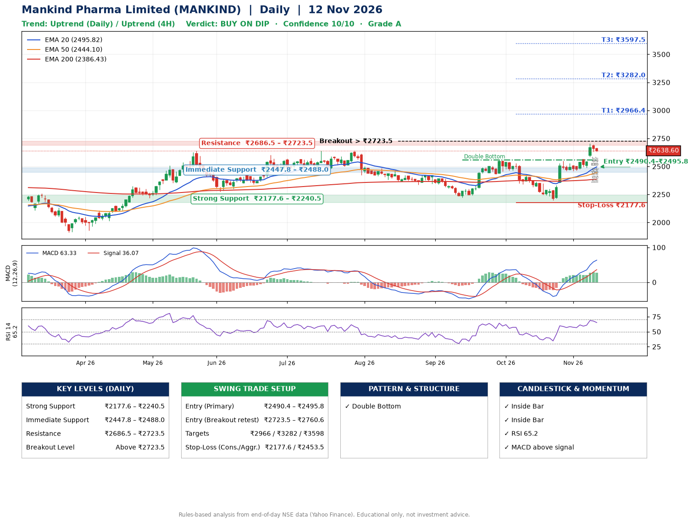

📌 **Mankind Pharma Limited (MANKIND) – Multi-Timeframe Technical Analysis (Daily + 4H Combined)**
_Data up to 12 Nov 2026 · Close ₹2638.60_

**📍 Daily Timeframe Trend**
- Trend: **Uptrend** (price above rising EMAs)
- Recent swing highs: ₹2423.9, ₹2559.0, ₹2549.0 · swing lows: ₹2337.6, ₹2222.0, ₹2196.1
- EMAs: EMA20 ₹2495.8, EMA50 ₹2444.1, EMA200 ₹2386.4; bullish stack (EMA20 > EMA50 > EMA200); price above EMA20, EMA50, EMA200
- MACD 63.33 above signal 36.07 (above zero); histogram falling
- RSI(14) 65.2; no divergence on the last two swings

**📍 4-Hour Timeframe Trend**
- Structure: **Uptrend** (higher highs and higher lows)
- Pullback/support area: recent 4H swing lows ₹2198.6, ₹2458.0; EMA20 ₹2552.0
- EMA20/50: bullish stack (EMA20 > EMA50); price above EMA20, EMA50
- MACD 65.01 above signal 55.61 (above zero); histogram falling
- RSI(14) 67.3; no divergence

**📍 Pattern Detection (Both Timeframes)**
- Daily: **Double Bottom** – bottoms near ₹2222.0/₹2196.1, neckline ₹2559.0, confirmed (closed above neckline)

**📍 Candlestick Patterns (last 3 daily candles)**
- **Inside Bar** – 11 Nov: compression inside the prior range ₹2585.2–₹2705.0
- **Inside Bar** – 12 Nov: compression inside the prior range ₹2630.8–₹2695.6

**📍 Price Action Key Levels (Daily Structure)**

| Zone | Price Level (₹) | Context |
|------|-----------------|---------|
| Strong Support | ₹2177.6 – ₹2240.5 | Cluster of earlier swing lows (demand) |
| Immediate Support | ₹2447.8 – ₹2488.0 | Nearest swing-low / wick area |
| Resistance | ₹2686.5 – ₹2723.5 | Nearest swing-high supply |
| Breakout Level | Above ₹2723.5 | Swing continuation trigger (52-week high ₹2705.0) |

**📍 Swing Trade Setup**

🟢 **Entry Zone**
- Primary: ₹2490.4 – ₹2495.8 (daily support / EMA20 area; enter on a bullish 4H candle)
- Alternate: ₹2723.5 – ₹2760.6 (breakout retest)

🎯 **Profit Targets**
- T1: ₹2966.4
- T2: ₹3282.0
- T3: ₹3597.5

🛑 **Stop-Loss**
- Conservative: below daily swing low (₹2177.6)
- Aggressive: below 4H structure (₹2453.5)
- Risk per share ≈ ₹315.5; reward:risk to T1 ≈ 1.5
- Time to T1: about 26 trading days (it rose this much within 60 trading days 13% of the time in the last 2 years)
- Time to T2: about 36 trading days (it rose this much within 60 trading days 1% of the time in the last 2 years)

**📌 Strategy Notes**
- Higher timeframe: daily trend is uptrend; only take longs while price holds above ₹2177.6.
- Entry timing: wait for a bullish 4H candle (engulfing/hammer) inside ₹2490.4 – ₹2495.8 rather than buying mid-range.
- EMA stacking: bullish stack (EMA20 > EMA50 > EMA200); price above EMA20, EMA50, EMA200.
- Breakout rule: a daily close above ₹2723.5 with volume above its 20-day average (≈835,057) opens T2/T3.
- Momentum: RSI 65 – elevated, prefer dips; no divergence on the last two swings.
- Exit discipline: move the stop to entry once T1 is hit; book partial profits at each target.

**STEP 2 — Marked Up Chart**

**✅ Trade Validation Checklist**
- Trend + momentum aligned: Yes · Price at entry zone: No
- Stop defined (₹2177.6) · Reward:risk ≥ 1.5 to T1: No

## 📌 Final Verdict

Recommendation: **🟡 BUY ON DIP**

Confidence: **10/10**

Trade Quality: **A**

Reason:
• Daily uptrend (price above rising EMAs)
• EMAs stacked bullishly

Next Action:
• Wait for a pullback to ₹2490.4–₹2495.8

_Rules-based analysis from end-of-day data. Educational only, not investment advice. Never place orders without your own confirmation._