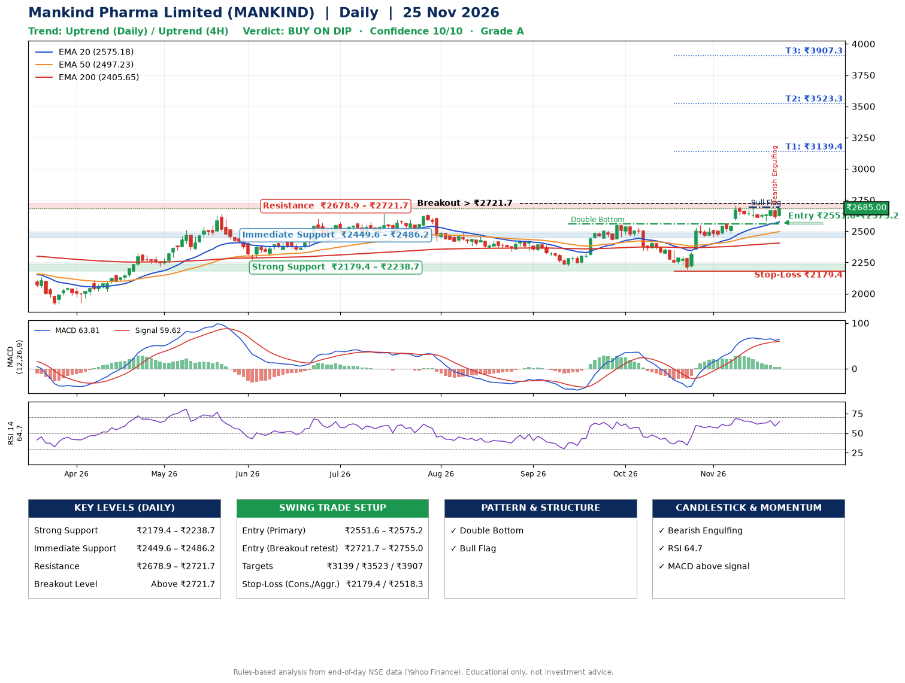

📌 **Mankind Pharma Limited (MANKIND) – Multi-Timeframe Technical Analysis (Daily + 4H Combined)**
_Data up to 25 Nov 2026 · Close ₹2685.00_

**📍 Daily Timeframe Trend**
- Trend: **Uptrend** (price above rising EMAs)
- Recent swing highs: ₹2559.0, ₹2549.0, ₹2705.0 · swing lows: ₹2337.6, ₹2222.0, ₹2196.1
- EMAs: EMA20 ₹2575.2, EMA50 ₹2497.2, EMA200 ₹2405.6; bullish stack (EMA20 > EMA50 > EMA200); price above EMA20, EMA50, EMA200
- MACD 63.81 above signal 59.62 (above zero); histogram rising
- RSI(14) 64.7; no divergence on the last two swings

**📍 4-Hour Timeframe Trend**
- Structure: **Uptrend** (higher highs and higher lows)
- Pullback/support area: recent 4H swing lows ₹2458.0, ₹2585.4; EMA20 ₹2625.5
- EMA20/50: bullish stack (EMA20 > EMA50); price above EMA20, EMA50
- MACD 34.84 below signal 38.40 (above zero); histogram rising
- RSI(14) 65.1; no divergence

**📍 Pattern Detection (Both Timeframes)**
- Daily: **Double Bottom** – bottoms near ₹2222.0/₹2196.1, neckline ₹2559.0, confirmed (closed above neckline)
- Daily: **Bull Flag** – 19% pole then a tight 4% flag; trigger above ₹2694.0
- 4H: **Symmetrical Triangle** – converging swing highs and lows over the last ~60 sessions

**📍 Candlestick Patterns (last 3 daily candles)**
- **Bearish Engulfing** – 23 Nov: sellers fully reversed the prior green candle

**📍 Price Action Key Levels (Daily Structure)**

| Zone | Price Level (₹) | Context |
|------|-----------------|---------|
| Strong Support | ₹2179.4 – ₹2238.7 | Cluster of earlier swing lows (demand) |
| Immediate Support | ₹2449.6 – ₹2486.2 | Nearest swing-low / wick area |
| Resistance | ₹2678.9 – ₹2721.7 | Nearest swing-high supply |
| Breakout Level | Above ₹2721.7 | Swing continuation trigger (52-week high ₹2705.0) |

**📍 Swing Trade Setup**

🟢 **Entry Zone**
- Primary: ₹2551.6 – ₹2575.2 (daily support / EMA20 area; enter on a bullish 4H candle)
- Alternate: ₹2721.7 – ₹2755.0 (breakout retest)

🎯 **Profit Targets**
- T1: ₹3139.4
- T2: ₹3523.3
- T3: ₹3907.3

🛑 **Stop-Loss**
- Conservative: below daily swing low (₹2179.4)
- Aggressive: below 4H structure (₹2518.3)
- Risk per share ≈ ₹384.0; reward:risk to T1 ≈ 1.5
- Time to T1: about 27 trading days (it rose this much within 60 trading days 7% of the time in the last 2 years)
- Time to T2: it never rose this much within 60 trading days in the price history

**📌 Strategy Notes**
- Higher timeframe: daily trend is uptrend; only take longs while price holds above ₹2179.4.
- Entry timing: wait for a bullish 4H candle (engulfing/hammer) inside ₹2551.6 – ₹2575.2 rather than buying mid-range.
- EMA stacking: bullish stack (EMA20 > EMA50 > EMA200); price above EMA20, EMA50, EMA200.
- Breakout rule: a daily close above ₹2721.7 with volume above its 20-day average (≈681,424) opens T2/T3.
- Momentum: RSI 65 – room to run; no divergence on the last two swings.
- Exit discipline: move the stop to entry once T1 is hit; book partial profits at each target.

**STEP 2 — Marked Up Chart**

**✅ Trade Validation Checklist**
- Trend + momentum aligned: Yes · Price at entry zone: No
- Stop defined (₹2179.4) · Reward:risk ≥ 1.5 to T1: Yes

## 📌 Final Verdict

Recommendation: **🟡 BUY ON DIP**

Confidence: **10/10**

Trade Quality: **A**

Reason:
• Daily uptrend (price above rising EMAs)
• EMAs stacked bullishly

Next Action:
• Wait for a pullback to ₹2551.6–₹2575.2

_Rules-based analysis from end-of-day data. Educational only, not investment advice. Never place orders without your own confirmation._