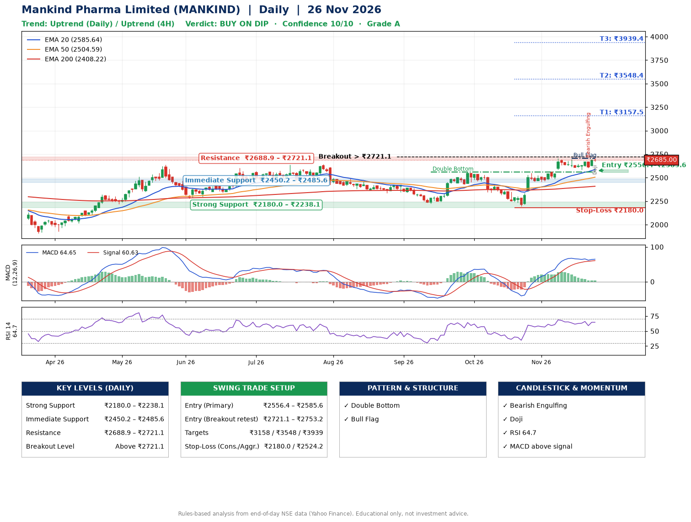

📌 **Mankind Pharma Limited (MANKIND) – Multi-Timeframe Technical Analysis (Daily + 4H Combined)**
_Data up to 26 Nov 2026 · Close ₹2685.00_

**📍 Daily Timeframe Trend**
- Trend: **Uptrend** (price above rising EMAs)
- Recent swing highs: ₹2559.0, ₹2549.0, ₹2705.0 · swing lows: ₹2337.6, ₹2222.0, ₹2196.1
- EMAs: EMA20 ₹2585.6, EMA50 ₹2504.6, EMA200 ₹2408.2; bullish stack (EMA20 > EMA50 > EMA200); price above EMA20, EMA50, EMA200
- MACD 64.65 above signal 60.63 (above zero); histogram falling
- RSI(14) 64.7; no divergence on the last two swings

**📍 4-Hour Timeframe Trend**
- Structure: **Uptrend** (higher highs and higher lows)
- Pullback/support area: recent 4H swing lows ₹2585.4, ₹2604.0; EMA20 ₹2636.4
- EMA20/50: bullish stack (EMA20 > EMA50); price above EMA20, EMA50
- MACD 35.69 below signal 37.41 (above zero); histogram rising
- RSI(14) 65.0; Hidden bullish divergence

**📍 Pattern Detection (Both Timeframes)**
- Daily: **Double Bottom** – bottoms near ₹2222.0/₹2196.1, neckline ₹2559.0, confirmed (closed above neckline)
- Daily: **Bull Flag** – 19% pole then a tight 5% flag; trigger above ₹2705.0
- 4H: **Symmetrical Triangle** – converging swing highs and lows over the last ~60 sessions

**📍 Candlestick Patterns (last 3 daily candles)**
- **Bearish Engulfing** – 23 Nov: sellers fully reversed the prior green candle
- **Doji** – 26 Nov: indecision; wait for the next candle to confirm direction

**📍 Price Action Key Levels (Daily Structure)**

| Zone | Price Level (₹) | Context |
|------|-----------------|---------|
| Strong Support | ₹2180.0 – ₹2238.1 | Cluster of earlier swing lows (demand) |
| Immediate Support | ₹2450.2 – ₹2485.6 | Nearest swing-low / wick area |
| Resistance | ₹2688.9 – ₹2721.1 | Nearest swing-high supply |
| Breakout Level | Above ₹2721.1 | Swing continuation trigger (52-week high ₹2705.0) |

**📍 Swing Trade Setup**

🟢 **Entry Zone**
- Primary: ₹2556.4 – ₹2585.6 (daily support / EMA20 area; enter on a bullish 4H candle)
- Alternate: ₹2721.1 – ₹2753.2 (breakout retest)

🎯 **Profit Targets**
- T1: ₹3157.5
- T2: ₹3548.4
- T3: ₹3939.4

🛑 **Stop-Loss**
- Conservative: below daily swing low (₹2180.0)
- Aggressive: below 4H structure (₹2524.2)
- Risk per share ≈ ₹391.0; reward:risk to T1 ≈ 1.5
- Time to T1: about 27 trading days (it rose this much within 60 trading days 7% of the time in the last 2 years)
- Time to T2: it never rose this much within 60 trading days in the price history

**📌 Strategy Notes**
- Higher timeframe: daily trend is uptrend; only take longs while price holds above ₹2180.0.
- Entry timing: wait for a bullish 4H candle (engulfing/hammer) inside ₹2556.4 – ₹2585.6 rather than buying mid-range.
- EMA stacking: bullish stack (EMA20 > EMA50 > EMA200); price above EMA20, EMA50, EMA200.
- Breakout rule: a daily close above ₹2721.1 with volume above its 20-day average (≈543,731) opens T2/T3.
- Momentum: RSI 65 – room to run; no divergence on the last two swings.
- Exit discipline: move the stop to entry once T1 is hit; book partial profits at each target.

**STEP 2 — Marked Up Chart**

**✅ Trade Validation Checklist**
- Trend + momentum aligned: Yes · Price at entry zone: No
- Stop defined (₹2180.0) · Reward:risk ≥ 1.5 to T1: Yes

## 📌 Final Verdict

Recommendation: **🟡 BUY ON DIP**

Confidence: **10/10**

Trade Quality: **A**

Reason:
• Daily uptrend (price above rising EMAs)
• EMAs stacked bullishly

Next Action:
• Wait for a pullback to ₹2556.4–₹2585.6

_Rules-based analysis from end-of-day data. Educational only, not investment advice. Never place orders without your own confirmation._