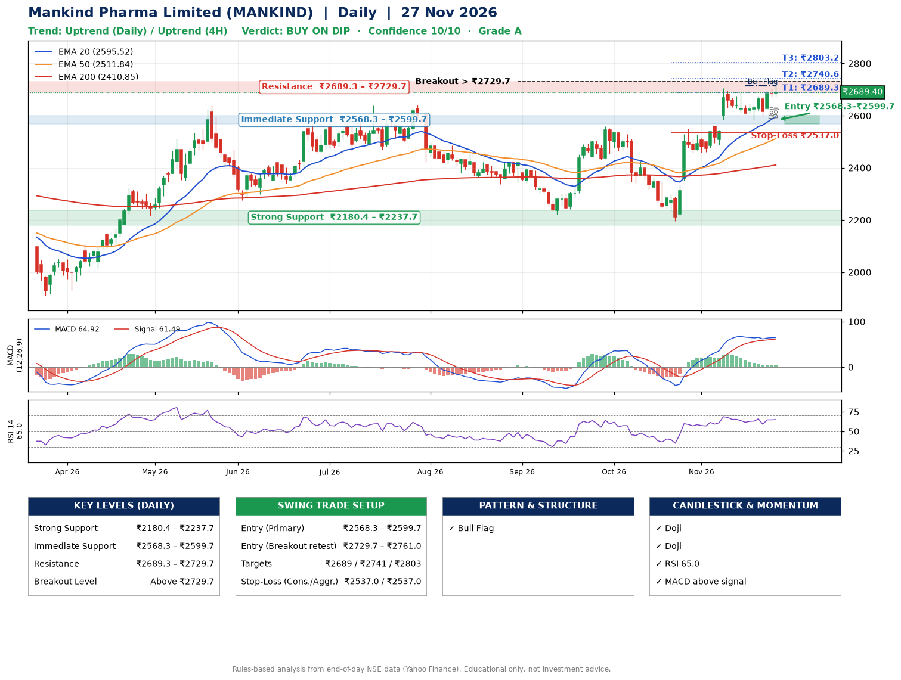

📌 **Mankind Pharma Limited (MANKIND) – Multi-Timeframe Technical Analysis (Daily + 4H Combined)**
_Data up to 27 Nov 2026 · Close ₹2689.40_

**📍 Daily Timeframe Trend**
- Trend: **Uptrend** (higher highs and higher lows)
- Recent swing highs: ₹2559.0, ₹2549.0, ₹2705.0 · swing lows: ₹2222.0, ₹2196.1, ₹2584.0
- EMAs: EMA20 ₹2595.5, EMA50 ₹2511.8, EMA200 ₹2410.9; bullish stack (EMA20 > EMA50 > EMA200); price above EMA20, EMA50, EMA200
- MACD 64.92 above signal 61.49 (above zero); histogram falling
- RSI(14) 65.0; no divergence on the last two swings

**📍 4-Hour Timeframe Trend**
- Structure: **Uptrend** (higher highs and higher lows)
- Pullback/support area: recent 4H swing lows ₹2585.4, ₹2604.0; EMA20 ₹2645.3
- EMA20/50: bullish stack (EMA20 > EMA50); price above EMA20, EMA50
- MACD 34.83 below signal 36.52 (above zero); histogram rising
- RSI(14) 65.3; Hidden bullish divergence

**📍 Pattern Detection (Both Timeframes)**
- Daily: **Bull Flag** – 19% pole then a tight 5% flag; trigger above ₹2714.0
- 4H: **Symmetrical Triangle** – converging swing highs and lows over the last ~60 sessions

**📍 Candlestick Patterns (last 3 daily candles)**
- **Doji** – 26 Nov: indecision; wait for the next candle to confirm direction
- **Doji** – 27 Nov: indecision; wait for the next candle to confirm direction

**📍 Price Action Key Levels (Daily Structure)**

| Zone | Price Level (₹) | Context |
|------|-----------------|---------|
| Strong Support | ₹2180.4 – ₹2237.7 | Cluster of earlier swing lows (demand) |
| Immediate Support | ₹2568.3 – ₹2599.7 | Nearest swing-low / wick area |
| Resistance | ₹2689.3 – ₹2729.7 | Nearest swing-high supply |
| Breakout Level | Above ₹2729.7 | Swing continuation trigger (52-week high ₹2714.0) |

**📍 Swing Trade Setup**

🟢 **Entry Zone**
- Primary: ₹2568.3 – ₹2599.7 (daily support / EMA20 area; enter on a bullish 4H candle)
- Alternate: ₹2729.7 – ₹2761.0 (breakout retest)

🎯 **Profit Targets**
- T1: ₹2689.3
- T2: ₹2740.6
- T3: ₹2803.2

🛑 **Stop-Loss**
- Conservative: below daily swing low (₹2537.0)
- Aggressive: below 4H structure (₹2537.0)
- Risk per share ≈ ₹62.6; reward:risk to T1 ≈ 1.7
- Time to T1: about 8 trading days (it rose this much within 60 trading days 75% of the time in the last 2 years)
- Time to T2: about 11 trading days (it rose this much within 60 trading days 61% of the time in the last 2 years)

**📌 Strategy Notes**
- Higher timeframe: daily trend is uptrend; only take longs while price holds above ₹2180.4.
- Entry timing: wait for a bullish 4H candle (engulfing/hammer) inside ₹2568.3 – ₹2599.7 rather than buying mid-range.
- EMA stacking: bullish stack (EMA20 > EMA50 > EMA200); price above EMA20, EMA50, EMA200.
- Breakout rule: a daily close above ₹2729.7 with volume above its 20-day average (≈509,368) opens T2/T3.
- Momentum: RSI 65 – elevated, prefer dips; no divergence on the last two swings.
- Exit discipline: move the stop to entry once T1 is hit; book partial profits at each target.

**STEP 2 — Marked Up Chart**

**✅ Trade Validation Checklist**
- Trend + momentum aligned: Yes · Price at entry zone: No
- Stop defined (₹2537.0) · Reward:risk ≥ 1.5 to T1: Yes

## 📌 Final Verdict

Recommendation: **🟡 BUY ON DIP**

Confidence: **10/10**

Trade Quality: **A**

Reason:
• Daily uptrend (higher highs and higher lows)
• EMAs stacked bullishly

Next Action:
• Wait for a pullback to ₹2568.3–₹2599.7

_Rules-based analysis from end-of-day data. Educational only, not investment advice. Never place orders without your own confirmation._