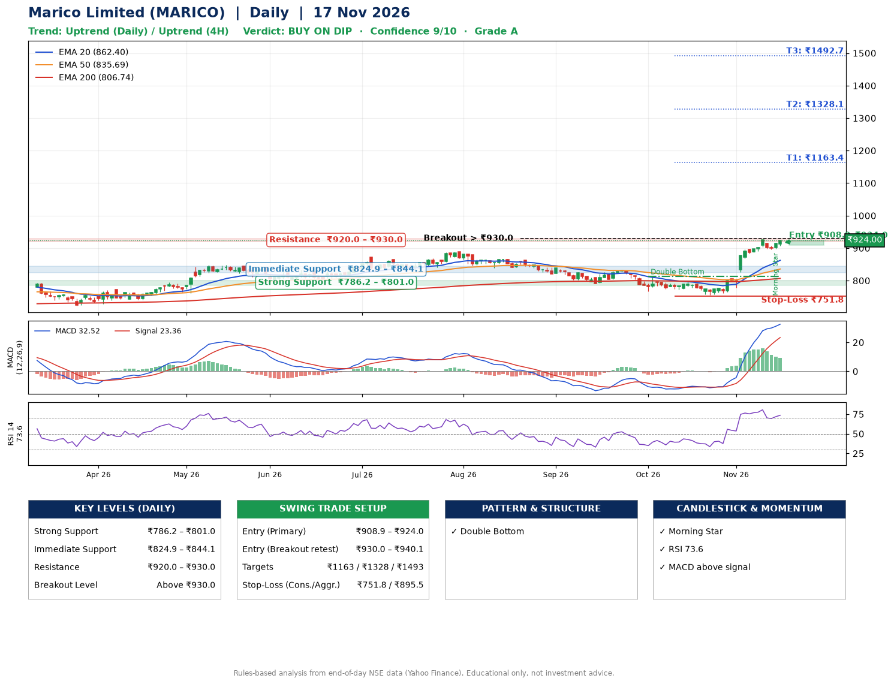

📌 **Marico Limited (MARICO) – Multi-Timeframe Technical Analysis (Daily + 4H Combined)**
_Data up to 17 Nov 2026 · Close ₹924.00_

**📍 Daily Timeframe Trend**
- Trend: **Uptrend** (price above rising EMAs)
- Recent swing highs: ₹867.3, ₹833.2, ₹797.0 · swing lows: ₹791.2, ₹766.2, ₹756.8
- EMAs: EMA20 ₹862.4, EMA50 ₹835.7, EMA200 ₹806.7; bullish stack (EMA20 > EMA50 > EMA200); price above EMA20, EMA50, EMA200
- MACD 32.52 above signal 23.36 (above zero); histogram falling
- RSI(14) 73.6; no divergence on the last two swings

**📍 4-Hour Timeframe Trend**
- Structure: **Uptrend** (higher highs and higher lows)
- Pullback/support area: recent 4H swing lows ₹778.6, ₹896.8; EMA20 ₹892.4
- EMA20/50: bullish stack (EMA20 > EMA50); price above EMA20, EMA50
- MACD 22.20 below signal 25.65 (above zero); histogram falling
- RSI(14) 62.3; no divergence

**📍 Pattern Detection (Both Timeframes)**
- Daily: **Double Bottom** – bottoms near ₹766.2/₹756.8, neckline ₹814.0, confirmed (closed above neckline)
- 4H: **Bull Flag** – 17% pole then a tight 3% flag; trigger above ₹924.0

**📍 Candlestick Patterns (last 3 daily candles)**
- **Morning Star** – 16 Nov: three-candle bullish reversal

**📍 Price Action Key Levels (Daily Structure)**

| Zone | Price Level (₹) | Context |
|------|-----------------|---------|
| Strong Support | ₹786.2 – ₹801.0 | Cluster of earlier swing lows (demand) |
| Immediate Support | ₹824.9 – ₹844.1 | Nearest swing-low / wick area |
| Resistance | ₹920.0 – ₹930.0 | Nearest swing-high supply |
| Breakout Level | Above ₹930.0 | Swing continuation trigger (52-week high ₹925.0) |

**📍 Swing Trade Setup**

🟢 **Entry Zone**
- Primary: ₹908.9 – ₹924.0 (daily support / EMA20 area; enter on a bullish 4H candle)
- Alternate: ₹930.0 – ₹940.1 (breakout retest)

🎯 **Profit Targets**
- T1: ₹1163.4
- T2: ₹1328.1
- T3: ₹1492.7

🛑 **Stop-Loss**
- Conservative: below daily swing low (₹751.8)
- Aggressive: below 4H structure (₹895.5)
- Risk per share ≈ ₹164.6; reward:risk to T1 ≈ 1.5
- Time to T1: it never rose this much within 60 trading days in the price history
- Time to T2: it never rose this much within 60 trading days in the price history

**📌 Strategy Notes**
- Higher timeframe: daily trend is uptrend; only take longs while price holds above ₹786.2.
- Entry timing: wait for a bullish 4H candle (engulfing/hammer) inside ₹908.9 – ₹924.0 rather than buying mid-range.
- EMA stacking: bullish stack (EMA20 > EMA50 > EMA200); price above EMA20, EMA50, EMA200.
- Breakout rule: a daily close above ₹930.0 with volume above its 20-day average (≈2,829,014) opens T2/T3.
- Momentum: RSI 74 – elevated, prefer dips; no divergence on the last two swings.
- Exit discipline: move the stop to entry once T1 is hit; book partial profits at each target.

**STEP 2 — Marked Up Chart**

**✅ Trade Validation Checklist**
- Trend + momentum aligned: Yes · Price at entry zone: Yes
- Stop defined (₹751.8) · Reward:risk ≥ 1.5 to T1: No

## 📌 Final Verdict

Recommendation: **🟡 BUY ON DIP**

Confidence: **9/10**

Trade Quality: **A**

Reason:
• Daily uptrend (price above rising EMAs)
• EMAs stacked bullishly

Next Action:
• Wait for a pullback to ₹908.9–₹924.0, or a breakout above ₹930.0

_Rules-based analysis from end-of-day data. Educational only, not investment advice. Never place orders without your own confirmation._