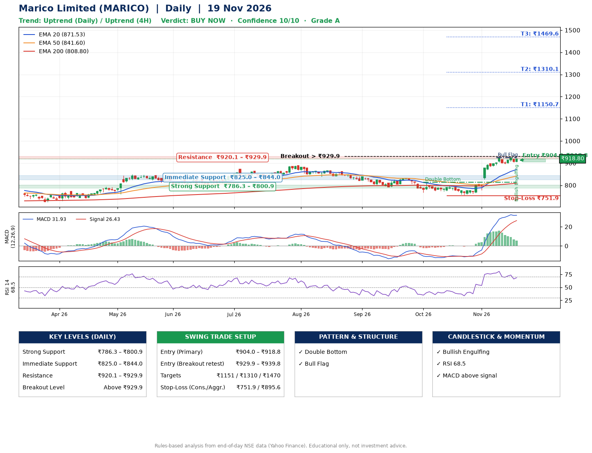

📌 **Marico Limited (MARICO) – Multi-Timeframe Technical Analysis (Daily + 4H Combined)**
_Data up to 19 Nov 2026 · Close ₹918.80_

**📍 Daily Timeframe Trend**
- Trend: **Uptrend** (price above rising EMAs)
- Recent swing highs: ₹833.2, ₹797.0, ₹925.0 · swing lows: ₹791.2, ₹766.2, ₹756.8
- EMAs: EMA20 ₹871.5, EMA50 ₹841.6, EMA200 ₹808.8; bullish stack (EMA20 > EMA50 > EMA200); price above EMA20, EMA50, EMA200
- MACD 31.93 above signal 26.43 (above zero); histogram falling
- RSI(14) 68.5; no divergence on the last two swings

**📍 4-Hour Timeframe Trend**
- Structure: **Uptrend** (price above rising EMAs)
- Pullback/support area: recent 4H swing lows ₹778.6, ₹896.8; EMA20 ₹896.9
- EMA20/50: bullish stack (EMA20 > EMA50); price above EMA20, EMA50
- MACD 20.82 below signal 24.01 (above zero); histogram rising
- RSI(14) 66.6; no divergence

**📍 Pattern Detection (Both Timeframes)**
- Daily: **Double Bottom** – bottoms near ₹766.2/₹756.8, neckline ₹814.0, confirmed (closed above neckline)
- Daily: **Bull Flag** – 16% pole then a tight 4% flag; trigger above ₹925.0
- 4H: **Bull Flag** – 17% pole then a tight 3% flag; trigger above ₹924.0

**📍 Candlestick Patterns (last 3 daily candles)**
- **Bullish Engulfing** – 19 Nov: buyers fully reversed the prior red candle

**📍 Price Action Key Levels (Daily Structure)**

| Zone | Price Level (₹) | Context |
|------|-----------------|---------|
| Strong Support | ₹786.3 – ₹800.9 | Cluster of earlier swing lows (demand) |
| Immediate Support | ₹825.0 – ₹844.0 | Nearest swing-low / wick area |
| Resistance | ₹920.1 – ₹929.9 | Nearest swing-high supply |
| Breakout Level | Above ₹929.9 | Swing continuation trigger (52-week high ₹925.0) |

**📍 Swing Trade Setup**

🟢 **Entry Zone**
- Primary: ₹904.0 – ₹918.8 (daily support / EMA20 area; enter on a bullish 4H candle)
- Alternate: ₹929.9 – ₹939.8 (breakout retest)

🎯 **Profit Targets**
- T1: ₹1150.7
- T2: ₹1310.1
- T3: ₹1469.6

🛑 **Stop-Loss**
- Conservative: below daily swing low (₹751.9)
- Aggressive: below 4H structure (₹895.6)
- Risk per share ≈ ₹159.5; reward:risk to T1 ≈ 1.5
- Time to T1: it never rose this much within 60 trading days in the price history
- Time to T2: it never rose this much within 60 trading days in the price history

**📌 Strategy Notes**
- Higher timeframe: daily trend is uptrend; only take longs while price holds above ₹786.3.
- Entry timing: wait for a bullish 4H candle (engulfing/hammer) inside ₹904.0 – ₹918.8 rather than buying mid-range.
- EMA stacking: bullish stack (EMA20 > EMA50 > EMA200); price above EMA20, EMA50, EMA200.
- Breakout rule: a daily close above ₹929.9 with volume above its 20-day average (≈2,857,785) opens T2/T3.
- Momentum: RSI 68 – elevated, prefer dips; no divergence on the last two swings.
- Exit discipline: move the stop to entry once T1 is hit; book partial profits at each target.

**STEP 2 — Marked Up Chart**

**✅ Trade Validation Checklist**
- Trend + momentum aligned: Yes · Price at entry zone: Yes
- Stop defined (₹751.9) · Reward:risk ≥ 1.5 to T1: Yes

## 📌 Final Verdict

Recommendation: **🟢 BUY NOW**

Confidence: **10/10**

Trade Quality: **A**

Reason:
• Daily uptrend (price above rising EMAs)
• EMAs stacked bullishly

Next Action:
• Buy now within the entry zone, with the stop-loss in place

_Rules-based analysis from end-of-day data. Educational only, not investment advice. Never place orders without your own confirmation._