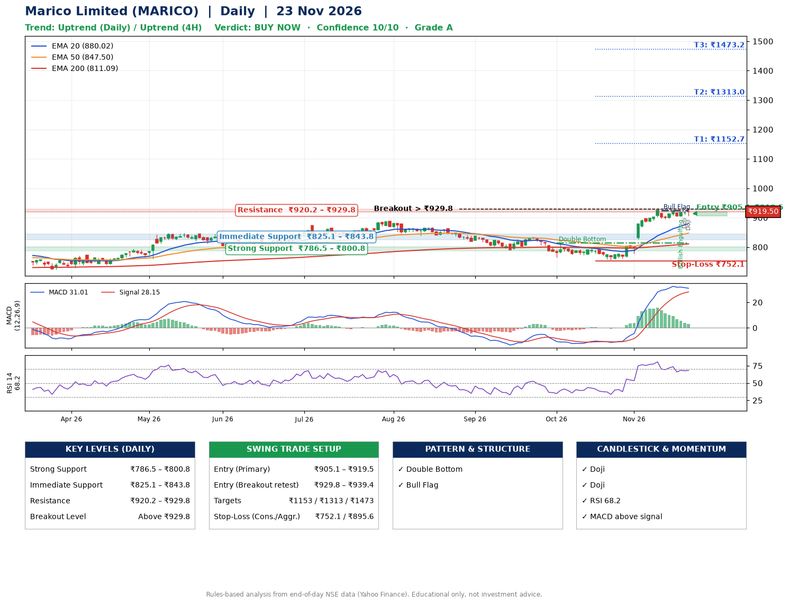

📌 **Marico Limited (MARICO) – Multi-Timeframe Technical Analysis (Daily + 4H Combined)**
_Data up to 23 Nov 2026 · Close ₹919.50_

**📍 Daily Timeframe Trend**
- Trend: **Uptrend** (price above rising EMAs)
- Recent swing highs: ₹833.2, ₹797.0, ₹925.0 · swing lows: ₹791.2, ₹766.2, ₹756.8
- EMAs: EMA20 ₹880.0, EMA50 ₹847.5, EMA200 ₹811.1; bullish stack (EMA20 > EMA50 > EMA200); price above EMA20, EMA50, EMA200
- MACD 31.01 above signal 28.15 (above zero); histogram falling
- RSI(14) 68.2; no divergence on the last two swings

**📍 4-Hour Timeframe Trend**
- Structure: **Uptrend** (higher highs and higher lows)
- Pullback/support area: recent 4H swing lows ₹778.6, ₹896.8; EMA20 ₹903.8
- EMA20/50: bullish stack (EMA20 > EMA50); price above EMA20, EMA50
- MACD 17.44 below signal 20.70 (above zero); histogram rising
- RSI(14) 66.2; Regular bearish divergence

**📍 Pattern Detection (Both Timeframes)**
- Daily: **Double Bottom** – bottoms near ₹766.2/₹756.8, neckline ₹814.0, confirmed (closed above neckline)
- Daily: **Bull Flag** – 20% pole then a tight 3% flag; trigger above ₹924.3
- 4H: **Ascending Triangle** – converging swing highs and lows over the last ~60 sessions
- 4H: **Bull Flag** – 16% pole then a tight 2% flag; trigger above ₹924.2

**📍 Candlestick Patterns (last 3 daily candles)**
- **Bullish Engulfing** – 19 Nov: buyers fully reversed the prior red candle
- **Doji** – 20 Nov: indecision; wait for the next candle to confirm direction
- **Doji** – 23 Nov: indecision; wait for the next candle to confirm direction

**📍 Price Action Key Levels (Daily Structure)**

| Zone | Price Level (₹) | Context |
|------|-----------------|---------|
| Strong Support | ₹786.5 – ₹800.8 | Cluster of earlier swing lows (demand) |
| Immediate Support | ₹825.1 – ₹843.8 | Nearest swing-low / wick area |
| Resistance | ₹920.2 – ₹929.8 | Nearest swing-high supply |
| Breakout Level | Above ₹929.8 | Swing continuation trigger (52-week high ₹925.0) |

**📍 Swing Trade Setup**

🟢 **Entry Zone**
- Primary: ₹905.1 – ₹919.5 (daily support / EMA20 area; enter on a bullish 4H candle)
- Alternate: ₹929.8 – ₹939.4 (breakout retest)

🎯 **Profit Targets**
- T1: ₹1152.7
- T2: ₹1313.0
- T3: ₹1473.2

🛑 **Stop-Loss**
- Conservative: below daily swing low (₹752.1)
- Aggressive: below 4H structure (₹895.6)
- Risk per share ≈ ₹160.3; reward:risk to T1 ≈ 1.5
- Time to T1: it never rose this much within 60 trading days in the price history
- Time to T2: it never rose this much within 60 trading days in the price history

**📌 Strategy Notes**
- Higher timeframe: daily trend is uptrend; only take longs while price holds above ₹786.5.
- Entry timing: wait for a bullish 4H candle (engulfing/hammer) inside ₹905.1 – ₹919.5 rather than buying mid-range.
- EMA stacking: bullish stack (EMA20 > EMA50 > EMA200); price above EMA20, EMA50, EMA200.
- Breakout rule: a daily close above ₹929.8 with volume above its 20-day average (≈2,900,188) opens T2/T3.
- Momentum: RSI 68 – elevated, prefer dips; no divergence on the last two swings.
- Exit discipline: move the stop to entry once T1 is hit; book partial profits at each target.

**STEP 2 — Marked Up Chart**

**✅ Trade Validation Checklist**
- Trend + momentum aligned: Yes · Price at entry zone: Yes
- Stop defined (₹752.1) · Reward:risk ≥ 1.5 to T1: Yes

## 📌 Final Verdict

Recommendation: **🟢 BUY NOW**

Confidence: **10/10**

Trade Quality: **A**

Reason:
• Daily uptrend (price above rising EMAs)
• EMAs stacked bullishly

Next Action:
• Buy now within the entry zone, with the stop-loss in place

_Rules-based analysis from end-of-day data. Educational only, not investment advice. Never place orders without your own confirmation._