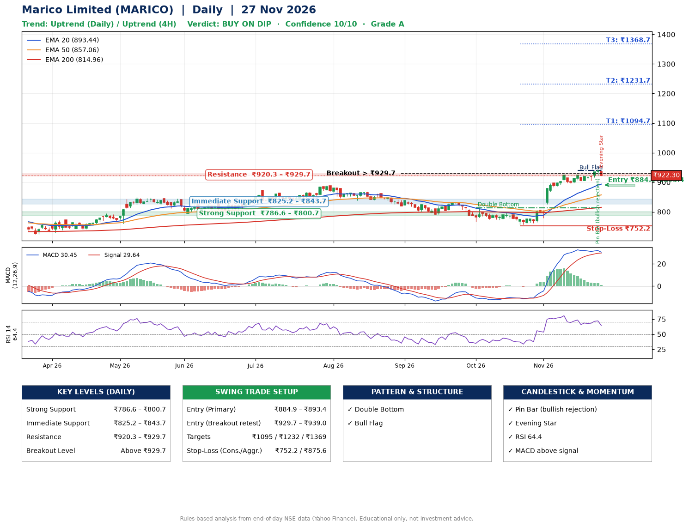

📌 **Marico Limited (MARICO) – Multi-Timeframe Technical Analysis (Daily + 4H Combined)**
_Data up to 27 Nov 2026 · Close ₹922.30_

**📍 Daily Timeframe Trend**
- Trend: **Uptrend** (price above rising EMAs)
- Recent swing highs: ₹833.2, ₹797.0, ₹925.0 · swing lows: ₹791.2, ₹766.2, ₹756.8
- EMAs: EMA20 ₹893.4, EMA50 ₹857.1, EMA200 ₹815.0; bullish stack (EMA20 > EMA50 > EMA200); price above EMA20, EMA50, EMA200
- MACD 30.45 above signal 29.64 (above zero); histogram falling
- RSI(14) 64.4; no divergence on the last two swings

**📍 4-Hour Timeframe Trend**
- Structure: **Uptrend** (higher highs and higher lows)
- Pullback/support area: recent 4H swing lows ₹896.8, ₹905.2; EMA20 ₹915.6
- EMA20/50: bullish stack (EMA20 > EMA50); price above EMA20, EMA50
- MACD 15.33 below signal 17.64 (above zero); histogram falling
- RSI(14) 59.4; Hidden bullish divergence; Regular bearish divergence

**📍 Pattern Detection (Both Timeframes)**
- Daily: **Double Bottom** – bottoms near ₹766.2/₹756.8, neckline ₹814.0, confirmed (closed above neckline)
- Daily: **Bull Flag** – 19% pole then a tight 4% flag; trigger above ₹939.1
- 4H: **Double Bottom** – bottoms near ₹896.8/₹905.2, neckline ₹924.2, forming
- 4H: **Ascending Triangle** – converging swing highs and lows over the last ~60 sessions

**📍 Candlestick Patterns (last 3 daily candles)**
- **Pin Bar (bullish rejection)** – 26 Nov: long lower wick shows dip-buying near ₹923.5
- **Evening Star** – 27 Nov: three-candle bearish reversal

**📍 Price Action Key Levels (Daily Structure)**

| Zone | Price Level (₹) | Context |
|------|-----------------|---------|
| Strong Support | ₹786.6 – ₹800.7 | Cluster of earlier swing lows (demand) |
| Immediate Support | ₹825.2 – ₹843.7 | Nearest swing-low / wick area |
| Resistance | ₹920.3 – ₹929.7 | Nearest swing-high supply |
| Breakout Level | Above ₹929.7 | Swing continuation trigger (52-week high ₹939.1) |

**📍 Swing Trade Setup**

🟢 **Entry Zone**
- Primary: ₹884.9 – ₹893.4 (daily support / EMA20 area; enter on a bullish 4H candle)
- Alternate: ₹929.7 – ₹939.0 (breakout retest)

🎯 **Profit Targets**
- T1: ₹1094.7
- T2: ₹1231.7
- T3: ₹1368.7

🛑 **Stop-Loss**
- Conservative: below daily swing low (₹752.2)
- Aggressive: below 4H structure (₹875.6)
- Risk per share ≈ ₹137.0; reward:risk to T1 ≈ 1.5
- Time to T1: about 35 trading days (it rose this much within 60 trading days 1% of the time in the last 2 years)
- Time to T2: it never rose this much within 60 trading days in the price history

**📌 Strategy Notes**
- Higher timeframe: daily trend is uptrend; only take longs while price holds above ₹786.6.
- Entry timing: wait for a bullish 4H candle (engulfing/hammer) inside ₹884.9 – ₹893.4 rather than buying mid-range.
- EMA stacking: bullish stack (EMA20 > EMA50 > EMA200); price above EMA20, EMA50, EMA200.
- Breakout rule: a daily close above ₹929.7 with volume above its 20-day average (≈2,983,677) opens T2/T3.
- Momentum: RSI 64 – room to run; no divergence on the last two swings.
- Exit discipline: move the stop to entry once T1 is hit; book partial profits at each target.

**STEP 2 — Marked Up Chart**

**✅ Trade Validation Checklist**
- Trend + momentum aligned: Yes · Price at entry zone: No
- Stop defined (₹752.2) · Reward:risk ≥ 1.5 to T1: Yes

## 📌 Final Verdict

Recommendation: **🟡 BUY ON DIP**

Confidence: **10/10**

Trade Quality: **A**

Reason:
• Daily uptrend (price above rising EMAs)
• EMAs stacked bullishly

Next Action:
• Wait for a pullback to ₹884.9–₹893.4

_Rules-based analysis from end-of-day data. Educational only, not investment advice. Never place orders without your own confirmation._