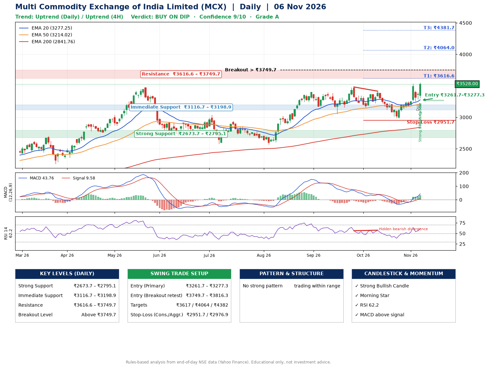

📌 **Multi Commodity Exchange of India Limited (MCX) – Multi-Timeframe Technical Analysis (Daily + 4H Combined)**
_Data up to 06 Nov 2026 · Close ₹3528.00_

**📍 Daily Timeframe Trend**
- Trend: **Uptrend** (price above rising EMAs)
- Recent swing highs: ₹3398.0, ₹3481.4, ₹3415.0 · swing lows: ₹3056.6, ₹3150.0, ₹2985.0
- EMAs: EMA20 ₹3277.3, EMA50 ₹3214.0, EMA200 ₹2841.8; bullish stack (EMA20 > EMA50 > EMA200); price above EMA20, EMA50, EMA200
- MACD 43.76 above signal 9.58 (above zero), fresh bullish crossover; histogram rising
- RSI(14) 62.2; Hidden bearish divergence

**📍 4-Hour Timeframe Trend**
- Structure: **Uptrend** (price above rising EMAs)
- Pullback/support area: recent 4H swing lows ₹3123.0, ₹2985.6; EMA20 ₹3316.2
- EMA20/50: bullish stack (EMA20 > EMA50); price above EMA20, EMA50
- MACD 68.43 above signal 40.77 (above zero); histogram rising
- RSI(14) 66.2; no divergence

**📍 Pattern Detection (Both Timeframes)**
- No strong pattern detected. Trading within range.

**📍 Candlestick Patterns (last 3 daily candles)**
- **Doji** – 05 Nov: indecision; wait for the next candle to confirm direction
- **Strong Bullish Candle** – 06 Nov: wide-range green candle, buyers in control
- **Morning Star** – 06 Nov: three-candle bullish reversal

**📍 Price Action Key Levels (Daily Structure)**

| Zone | Price Level (₹) | Context |
|------|-----------------|---------|
| Strong Support | ₹2673.7 – ₹2795.1 | Cluster of earlier swing lows (demand) |
| Immediate Support | ₹3116.7 – ₹3198.9 | Nearest swing-low / wick area |
| Resistance | ₹3616.6 – ₹3749.7 | Nearest swing-high supply |
| Breakout Level | Above ₹3749.7 | Swing continuation trigger (52-week high ₹3550.0) |

**📍 Swing Trade Setup**

🟢 **Entry Zone**
- Primary: ₹3261.7 – ₹3277.3 (daily support / EMA20 area; enter on a bullish 4H candle)
- Alternate: ₹3749.7 – ₹3816.3 (breakout retest)

🎯 **Profit Targets**
- T1: ₹3616.6
- T2: ₹4064.0
- T3: ₹4381.7

🛑 **Stop-Loss**
- Conservative: below daily swing low (₹2951.7)
- Aggressive: below 4H structure (₹2976.9)
- Risk per share ≈ ₹317.8; reward:risk to T1 ≈ 1.1

**📌 Strategy Notes**
- Higher timeframe: daily trend is uptrend; only take longs while price holds above ₹2673.7.
- Entry timing: wait for a bullish 4H candle (engulfing/hammer) inside ₹3261.7 – ₹3277.3 rather than buying mid-range.
- EMA stacking: bullish stack (EMA20 > EMA50 > EMA200); price above EMA20, EMA50, EMA200.
- Breakout rule: a daily close above ₹3749.7 with volume above its 20-day average (≈2,131,841) opens T2/T3.
- Momentum: RSI 62 – room to run; Hidden bearish divergence.
- Exit discipline: move the stop to entry once T1 is hit; book partial profits at each target.

**STEP 2 — Marked Up Chart**

**✅ Trade Validation Checklist**
- Trend + momentum aligned: Yes · Price at entry zone: No
- Stop defined (₹2951.7) · Reward:risk ≥ 1.5 to T1: No

## 📌 Final Verdict

Recommendation: **🟡 BUY ON DIP**

Confidence: **9/10**

Trade Quality: **A**

Reason:
• Daily uptrend (price above rising EMAs)
• EMAs stacked bullishly

Next Action:
• Wait for a pullback to ₹3261.7–₹3277.3

_Rules-based analysis from end-of-day data. Educational only, not investment advice. Never place orders without your own confirmation._