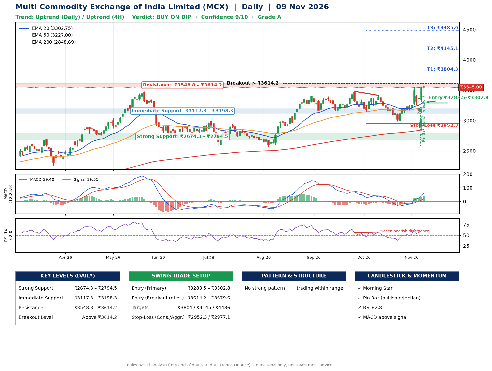

📌 **Multi Commodity Exchange of India Limited (MCX) – Multi-Timeframe Technical Analysis (Daily + 4H Combined)**
_Data up to 09 Nov 2026 · Close ₹3545.00_

**📍 Daily Timeframe Trend**
- Trend: **Uptrend** (price above rising EMAs)
- Recent swing highs: ₹3398.0, ₹3481.4, ₹3415.0 · swing lows: ₹3056.6, ₹3150.0, ₹2985.0
- EMAs: EMA20 ₹3302.8, EMA50 ₹3227.0, EMA200 ₹2848.7; bullish stack (EMA20 > EMA50 > EMA200); price above EMA20, EMA50, EMA200
- MACD 59.40 above signal 19.55 (above zero); histogram rising
- RSI(14) 62.8; Hidden bearish divergence

**📍 4-Hour Timeframe Trend**
- Structure: **Uptrend** (price above rising EMAs)
- Pullback/support area: recent 4H swing lows ₹3123.0, ₹2985.6; EMA20 ₹3353.5
- EMA20/50: bullish stack (EMA20 > EMA50); price above EMA20, EMA50
- MACD 81.16 above signal 54.14 (above zero); histogram rising
- RSI(14) 65.7; no divergence

**📍 Pattern Detection (Both Timeframes)**
- No strong pattern detected. Trading within range.

**📍 Candlestick Patterns (last 3 daily candles)**
- **Doji** – 05 Nov: indecision; wait for the next candle to confirm direction
- **Strong Bullish Candle** – 06 Nov: wide-range green candle, buyers in control
- **Morning Star** – 06 Nov: three-candle bullish reversal
- **Pin Bar (bullish rejection)** – 09 Nov: long lower wick shows dip-buying near ₹3481.3

**📍 Price Action Key Levels (Daily Structure)**

| Zone | Price Level (₹) | Context |
|------|-----------------|---------|
| Strong Support | ₹2674.3 – ₹2794.5 | Cluster of earlier swing lows (demand) |
| Immediate Support | ₹3117.3 – ₹3198.3 | Nearest swing-low / wick area |
| Resistance | ₹3548.8 – ₹3614.2 | Nearest swing-high supply |
| Breakout Level | Above ₹3614.2 | Swing continuation trigger (52-week high ₹3581.5) |

**📍 Swing Trade Setup**

🟢 **Entry Zone**
- Primary: ₹3283.5 – ₹3302.8 (daily support / EMA20 area; enter on a bullish 4H candle)
- Alternate: ₹3614.2 – ₹3679.6 (breakout retest)

🎯 **Profit Targets**
- T1: ₹3804.3
- T2: ₹4145.1
- T3: ₹4485.9

🛑 **Stop-Loss**
- Conservative: below daily swing low (₹2952.3)
- Aggressive: below 4H structure (₹2977.1)
- Risk per share ≈ ₹340.8; reward:risk to T1 ≈ 1.5

**📌 Strategy Notes**
- Higher timeframe: daily trend is uptrend; only take longs while price holds above ₹2674.3.
- Entry timing: wait for a bullish 4H candle (engulfing/hammer) inside ₹3283.5 – ₹3302.8 rather than buying mid-range.
- EMA stacking: bullish stack (EMA20 > EMA50 > EMA200); price above EMA20, EMA50, EMA200.
- Breakout rule: a daily close above ₹3614.2 with volume above its 20-day average (≈2,160,272) opens T2/T3.
- Momentum: RSI 63 – room to run; Hidden bearish divergence.
- Exit discipline: move the stop to entry once T1 is hit; book partial profits at each target.

**STEP 2 — Marked Up Chart**

**✅ Trade Validation Checklist**
- Trend + momentum aligned: Yes · Price at entry zone: No
- Stop defined (₹2952.3) · Reward:risk ≥ 1.5 to T1: Yes

## 📌 Final Verdict

Recommendation: **🟡 BUY ON DIP**

Confidence: **9/10**

Trade Quality: **A**

Reason:
• Daily uptrend (price above rising EMAs)
• EMAs stacked bullishly

Next Action:
• Wait for a pullback to ₹3283.5–₹3302.8

_Rules-based analysis from end-of-day data. Educational only, not investment advice. Never place orders without your own confirmation._