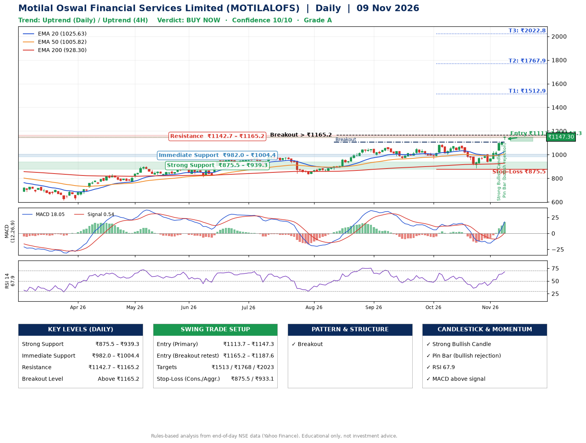

📌 **Motilal Oswal Financial Services Limited (MOTILALOFS) – Multi-Timeframe Technical Analysis (Daily + 4H Combined)**
_Data up to 09 Nov 2026 · Close ₹1147.30_

**📍 Daily Timeframe Trend**
- Trend: **Uptrend** (price above rising EMAs)
- Recent swing highs: ₹1058.0, ₹1090.2, ₹1074.1 · swing lows: ₹963.8, ₹965.0, ₹886.8
- EMAs: EMA20 ₹1025.6, EMA50 ₹1005.8, EMA200 ₹928.3; bullish stack (EMA20 > EMA50 > EMA200); price above EMA20, EMA50, EMA200
- MACD 18.05 above signal 0.54 (above zero), fresh bullish crossover; histogram rising
- RSI(14) 67.9; no divergence on the last two swings

**📍 4-Hour Timeframe Trend**
- Structure: **Uptrend** (higher highs and higher lows)
- Pullback/support area: recent 4H swing lows ₹887.0, ₹936.2; EMA20 ₹1044.1
- EMA20/50: bullish stack (EMA20 > EMA50); price above EMA20, EMA50
- MACD 33.90 above signal 15.68 (above zero); histogram rising
- RSI(14) 72.6; no divergence

**📍 Pattern Detection (Both Timeframes)**
- Daily: **Breakout** – closed above the 60-session high ₹1105.0 (volume not confirming yet)

**📍 Candlestick Patterns (last 3 daily candles)**
- **Strong Bullish Candle** – 05 Nov: wide-range green candle, buyers in control
- **Pin Bar (bullish rejection)** – 09 Nov: long lower wick shows dip-buying near ₹1127.2

**📍 Price Action Key Levels (Daily Structure)**

| Zone | Price Level (₹) | Context |
|------|-----------------|---------|
| Strong Support | ₹875.5 – ₹939.3 | Cluster of earlier swing lows (demand) |
| Immediate Support | ₹982.0 – ₹1004.4 | Nearest swing-low / wick area |
| Resistance | ₹1142.7 – ₹1165.2 | Nearest swing-high supply |
| Breakout Level | Above ₹1165.2 | Swing continuation trigger (52-week high ₹1153.9) |

**📍 Swing Trade Setup**

🟢 **Entry Zone**
- Primary: ₹1113.7 – ₹1147.3 (daily support / EMA20 area; enter on a bullish 4H candle)
- Alternate: ₹1165.2 – ₹1187.6 (breakout retest)

🎯 **Profit Targets**
- T1: ₹1512.9
- T2: ₹1767.9
- T3: ₹2022.8

🛑 **Stop-Loss**
- Conservative: below daily swing low (₹875.5)
- Aggressive: below 4H structure (₹933.1)
- Risk per share ≈ ₹254.9; reward:risk to T1 ≈ 1.5

**📌 Strategy Notes**
- Higher timeframe: daily trend is uptrend; only take longs while price holds above ₹875.5.
- Entry timing: wait for a bullish 4H candle (engulfing/hammer) inside ₹1113.7 – ₹1147.3 rather than buying mid-range.
- EMA stacking: bullish stack (EMA20 > EMA50 > EMA200); price above EMA20, EMA50, EMA200.
- Breakout rule: a daily close above ₹1165.2 with volume above its 20-day average (≈1,146,757) opens T2/T3.
- Momentum: RSI 68 – elevated, prefer dips; no divergence on the last two swings.
- Exit discipline: move the stop to entry once T1 is hit; book partial profits at each target.

**STEP 2 — Marked Up Chart**

**✅ Trade Validation Checklist**
- Trend + momentum aligned: Yes · Price at entry zone: Yes
- Stop defined (₹875.5) · Reward:risk ≥ 1.5 to T1: No

## 📌 Final Verdict

Recommendation: **🟢 BUY NOW**

Confidence: **10/10**

Trade Quality: **A**

Reason:
• Daily uptrend (price above rising EMAs)
• EMAs stacked bullishly

Next Action:
• Buy now within the entry zone, with the stop-loss in place

_Rules-based analysis from end-of-day data. Educational only, not investment advice. Never place orders without your own confirmation._