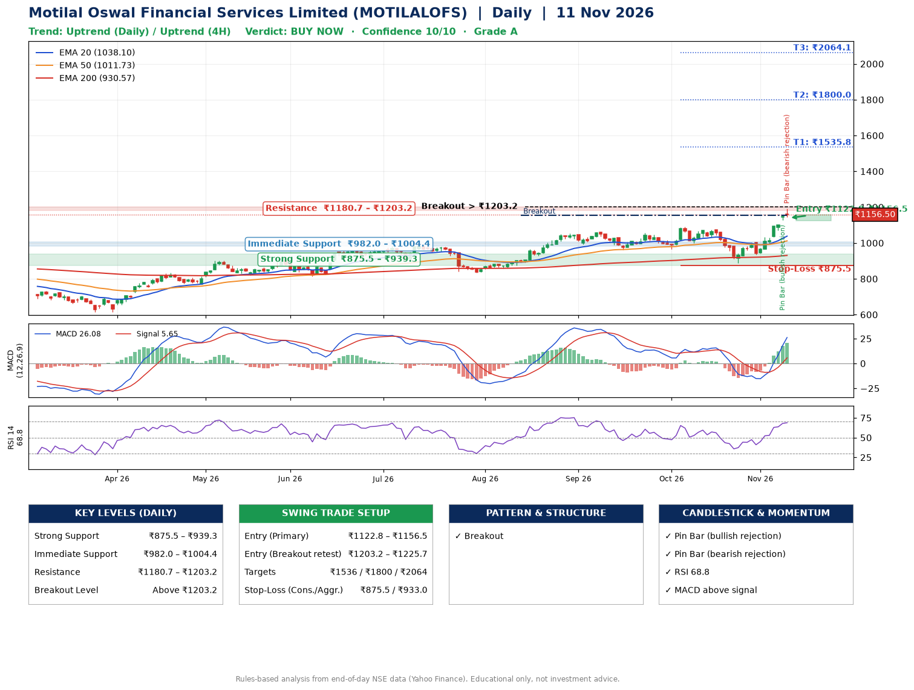

📌 **Motilal Oswal Financial Services Limited (MOTILALOFS) – Multi-Timeframe Technical Analysis (Daily + 4H Combined)**
_Data up to 11 Nov 2026 · Close ₹1156.50_

**📍 Daily Timeframe Trend**
- Trend: **Uptrend** (price above rising EMAs)
- Recent swing highs: ₹1058.0, ₹1090.2, ₹1074.1 · swing lows: ₹963.8, ₹965.0, ₹886.8
- EMAs: EMA20 ₹1038.1, EMA50 ₹1011.7, EMA200 ₹930.6; bullish stack (EMA20 > EMA50 > EMA200); price above EMA20, EMA50, EMA200
- MACD 26.08 above signal 5.65 (above zero), fresh bullish crossover; histogram rising
- RSI(14) 68.8; no divergence on the last two swings

**📍 4-Hour Timeframe Trend**
- Structure: **Uptrend** (higher highs and higher lows)
- Pullback/support area: recent 4H swing lows ₹887.0, ₹936.2; EMA20 ₹1066.2
- EMA20/50: bullish stack (EMA20 > EMA50); price above EMA20, EMA50
- MACD 42.70 above signal 24.97 (above zero); histogram falling
- RSI(14) 70.1; no divergence

**📍 Pattern Detection (Both Timeframes)**
- Daily: **Breakout** – closed above the 60-session high ₹1153.9 on strong volume

**📍 Candlestick Patterns (last 3 daily candles)**
- **Pin Bar (bullish rejection)** – 09 Nov: long lower wick shows dip-buying near ₹1127.2
- **Pin Bar (bearish rejection)** – 11 Nov: long upper wick shows selling near ₹1191.9

**📍 Price Action Key Levels (Daily Structure)**

| Zone | Price Level (₹) | Context |
|------|-----------------|---------|
| Strong Support | ₹875.5 – ₹939.3 | Cluster of earlier swing lows (demand) |
| Immediate Support | ₹982.0 – ₹1004.4 | Nearest swing-low / wick area |
| Resistance | ₹1180.7 – ₹1203.2 | Nearest swing-high supply |
| Breakout Level | Above ₹1203.2 | Swing continuation trigger (52-week high ₹1191.9) |

**📍 Swing Trade Setup**

🟢 **Entry Zone**
- Primary: ₹1122.8 – ₹1156.5 (daily support / EMA20 area; enter on a bullish 4H candle)
- Alternate: ₹1203.2 – ₹1225.7 (breakout retest)

🎯 **Profit Targets**
- T1: ₹1535.8
- T2: ₹1800.0
- T3: ₹2064.1

🛑 **Stop-Loss**
- Conservative: below daily swing low (₹875.5)
- Aggressive: below 4H structure (₹933.0)
- Risk per share ≈ ₹264.1; reward:risk to T1 ≈ 1.5

**📌 Strategy Notes**
- Higher timeframe: daily trend is uptrend; only take longs while price holds above ₹875.5.
- Entry timing: wait for a bullish 4H candle (engulfing/hammer) inside ₹1122.8 – ₹1156.5 rather than buying mid-range.
- EMA stacking: bullish stack (EMA20 > EMA50 > EMA200); price above EMA20, EMA50, EMA200.
- Breakout rule: a daily close above ₹1203.2 with volume above its 20-day average (≈1,212,165) opens T2/T3.
- Momentum: RSI 69 – elevated, prefer dips; no divergence on the last two swings.
- Exit discipline: move the stop to entry once T1 is hit; book partial profits at each target.

**STEP 2 — Marked Up Chart**

**✅ Trade Validation Checklist**
- Trend + momentum aligned: Yes · Price at entry zone: Yes
- Stop defined (₹875.5) · Reward:risk ≥ 1.5 to T1: No

## 📌 Final Verdict

Recommendation: **🟢 BUY NOW**

Confidence: **10/10**

Trade Quality: **A**

Reason:
• Daily uptrend (price above rising EMAs)
• EMAs stacked bullishly

Next Action:
• Buy now within the entry zone, with the stop-loss in place

_Rules-based analysis from end-of-day data. Educational only, not investment advice. Never place orders without your own confirmation._