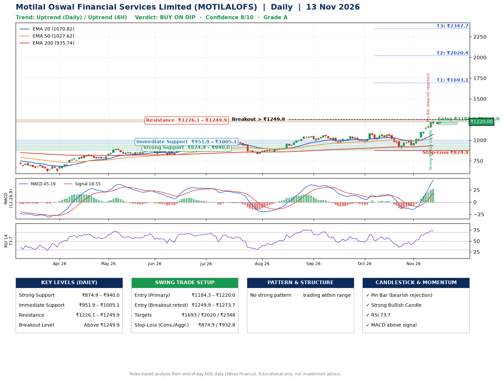

📌 **Motilal Oswal Financial Services Limited (MOTILALOFS) – Multi-Timeframe Technical Analysis (Daily + 4H Combined)**
_Data up to 13 Nov 2026 · Close ₹1220.00_

**📍 Daily Timeframe Trend**
- Trend: **Uptrend** (price above rising EMAs)
- Recent swing highs: ₹1058.0, ₹1090.2, ₹1074.1 · swing lows: ₹963.8, ₹965.0, ₹886.8
- EMAs: EMA20 ₹1070.8, EMA50 ₹1027.6, EMA200 ₹935.7; bullish stack (EMA20 > EMA50 > EMA200); price above EMA20, EMA50, EMA200
- MACD 45.19 above signal 18.55 (above zero); histogram rising
- RSI(14) 73.7; no divergence on the last two swings

**📍 4-Hour Timeframe Trend**
- Structure: **Uptrend** (higher highs and higher lows)
- Pullback/support area: recent 4H swing lows ₹887.0, ₹936.2; EMA20 ₹1116.2
- EMA20/50: bullish stack (EMA20 > EMA50); price above EMA20, EMA50
- MACD 58.43 above signal 42.94 (above zero); histogram falling
- RSI(14) 74.6; no divergence

**📍 Pattern Detection (Both Timeframes)**
- No strong pattern detected. Trading within range.

**📍 Candlestick Patterns (last 3 daily candles)**
- **Pin Bar (bearish rejection)** – 11 Nov: long upper wick shows selling near ₹1191.9
- **Strong Bullish Candle** – 12 Nov: wide-range green candle, buyers in control

**📍 Price Action Key Levels (Daily Structure)**

| Zone | Price Level (₹) | Context |
|------|-----------------|---------|
| Strong Support | ₹874.9 – ₹940.0 | Cluster of earlier swing lows (demand) |
| Immediate Support | ₹951.9 – ₹1005.1 | Nearest swing-low / wick area |
| Resistance | ₹1226.1 – ₹1249.9 | Nearest swing-high supply |
| Breakout Level | Above ₹1249.9 | Swing continuation trigger (52-week high ₹1238.0) |

**📍 Swing Trade Setup**

🟢 **Entry Zone**
- Primary: ₹1184.3 – ₹1220.0 (daily support / EMA20 area; enter on a bullish 4H candle)
- Alternate: ₹1249.9 – ₹1273.7 (breakout retest)

🎯 **Profit Targets**
- T1: ₹1693.1
- T2: ₹2020.4
- T3: ₹2347.7

🛑 **Stop-Loss**
- Conservative: below daily swing low (₹874.9)
- Aggressive: below 4H structure (₹932.8)
- Risk per share ≈ ₹327.3; reward:risk to T1 ≈ 1.5
- Time to T1: about 48 trading days (it rose this much within 60 trading days 11% of the time in the last 2 years)
- Time to T2: it never rose this much within 60 trading days in the price history

**📌 Strategy Notes**
- Higher timeframe: daily trend is uptrend; only take longs while price holds above ₹874.9.
- Entry timing: wait for a bullish 4H candle (engulfing/hammer) inside ₹1184.3 – ₹1220.0 rather than buying mid-range.
- EMA stacking: bullish stack (EMA20 > EMA50 > EMA200); price above EMA20, EMA50, EMA200.
- Breakout rule: a daily close above ₹1249.9 with volume above its 20-day average (≈1,470,729) opens T2/T3.
- Momentum: RSI 74 – elevated, prefer dips; no divergence on the last two swings.
- Exit discipline: move the stop to entry once T1 is hit; book partial profits at each target.

**STEP 2 — Marked Up Chart**

**✅ Trade Validation Checklist**
- Trend + momentum aligned: Yes · Price at entry zone: Yes
- Stop defined (₹874.9) · Reward:risk ≥ 1.5 to T1: No

## 📌 Final Verdict

Recommendation: **🟡 BUY ON DIP**

Confidence: **8/10**

Trade Quality: **A**

Reason:
• Daily uptrend (price above rising EMAs)
• EMAs stacked bullishly

Next Action:
• Wait for a pullback to ₹1184.3–₹1220.0, or a breakout above ₹1249.9

_Rules-based analysis from end-of-day data. Educational only, not investment advice. Never place orders without your own confirmation._