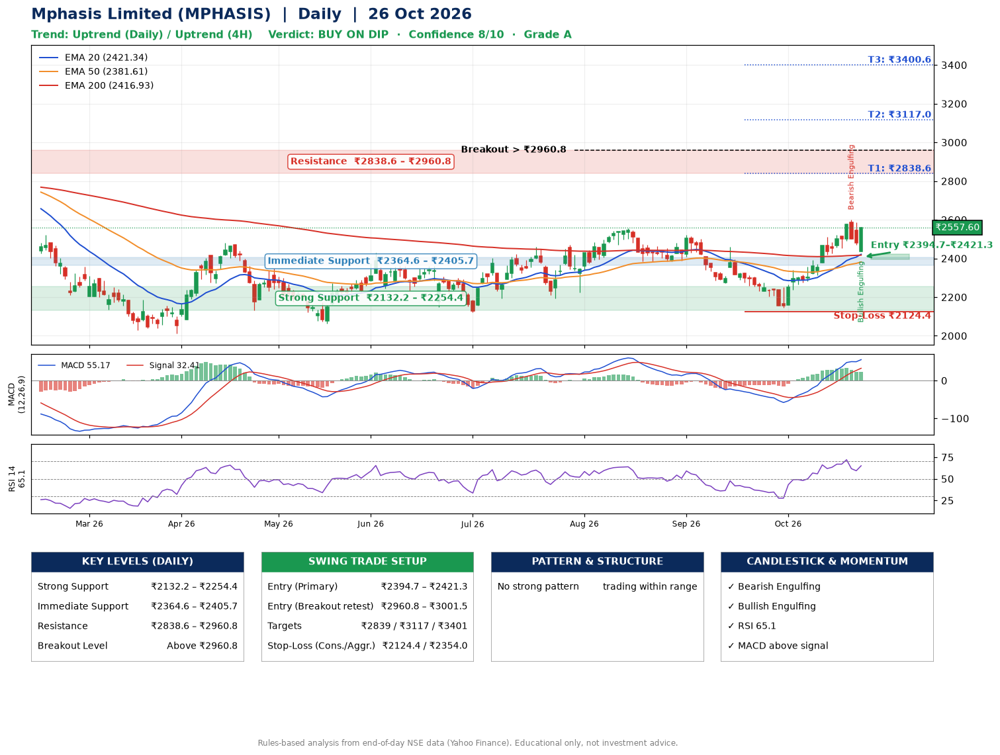

📌 **Mphasis Limited (MPHASIS) – Multi-Timeframe Technical Analysis (Daily + 4H Combined)**
_Data up to 26 Oct 2026 · Close ₹2557.60_

**📍 Daily Timeframe Trend**
- Trend: **Uptrend** (price above rising EMAs)
- Recent swing highs: ₹2556.9, ₹2523.0, ₹2461.1 · swing lows: ₹2385.0, ₹2385.3, ₹2144.8
- EMAs: EMA20 ₹2421.3, EMA50 ₹2381.6, EMA200 ₹2416.9; mixed / crossing; price above EMA20, EMA50, EMA200
- MACD 55.17 above signal 32.41 (above zero); histogram falling
- RSI(14) 65.1; no divergence on the last two swings

**📍 4-Hour Timeframe Trend**
- Structure: **Uptrend** (higher highs and higher lows)
- Pullback/support area: recent 4H swing lows ₹2145.0, ₹2425.8; EMA20 ₹2472.9
- EMA20/50: bullish stack (EMA20 > EMA50); price above EMA20, EMA50
- MACD 51.08 below signal 53.02 (above zero), fresh bearish crossover; histogram rising
- RSI(14) 66.0; Regular bearish divergence

**📍 Pattern Detection (Both Timeframes)**
- 4H: **Bull Flag** – 16% pole then a tight 7% flag; trigger above ₹2600.0

**📍 Candlestick Patterns (last 3 daily candles)**
- **Bearish Engulfing** – 22 Oct: sellers fully reversed the prior green candle
- **Bullish Engulfing** – 26 Oct: buyers fully reversed the prior red candle

**📍 Price Action Key Levels (Daily Structure)**

| Zone | Price Level (₹) | Context |
|------|-----------------|---------|
| Strong Support | ₹2132.2 – ₹2254.4 | Cluster of earlier swing lows (demand) |
| Immediate Support | ₹2364.6 – ₹2405.7 | Nearest swing-low / wick area |
| Resistance | ₹2838.6 – ₹2960.8 | Nearest swing-high supply |
| Breakout Level | Above ₹2960.8 | Swing continuation trigger (52-week high ₹2975.0) |

**📍 Swing Trade Setup**

🟢 **Entry Zone**
- Primary: ₹2394.7 – ₹2421.3 (daily support / EMA20 area; enter on a bullish 4H candle)
- Alternate: ₹2960.8 – ₹3001.5 (breakout retest)

🎯 **Profit Targets**
- T1: ₹2838.6
- T2: ₹3117.0
- T3: ₹3400.6

🛑 **Stop-Loss**
- Conservative: below daily swing low (₹2124.4)
- Aggressive: below 4H structure (₹2354.0)
- Risk per share ≈ ₹283.6; reward:risk to T1 ≈ 1.5

**📌 Strategy Notes**
- Higher timeframe: daily trend is uptrend; only take longs while price holds above ₹2132.2.
- Entry timing: wait for a bullish 4H candle (engulfing/hammer) inside ₹2394.7 – ₹2421.3 rather than buying mid-range.
- EMA stacking: mixed / crossing; price above EMA20, EMA50, EMA200.
- Breakout rule: a daily close above ₹2960.8 with volume above its 20-day average (≈704,709) opens T2/T3.
- Momentum: RSI 65 – elevated, prefer dips; no divergence on the last two swings.
- Exit discipline: move the stop to entry once T1 is hit; book partial profits at each target.

**STEP 2 — Marked Up Chart**

**✅ Trade Validation Checklist**
- Trend + momentum aligned: Yes · Price at entry zone: No
- Stop defined (₹2124.4) · Reward:risk ≥ 1.5 to T1: Yes

## 📌 Final Verdict

Recommendation: **🟡 BUY ON DIP**

Confidence: **8/10**

Trade Quality: **A**

Reason:
• Daily uptrend (price above rising EMAs)

Next Action:
• Wait for a pullback to ₹2394.7–₹2421.3

_Rules-based analysis from end-of-day data. Educational only, not investment advice. Never place orders without your own confirmation._