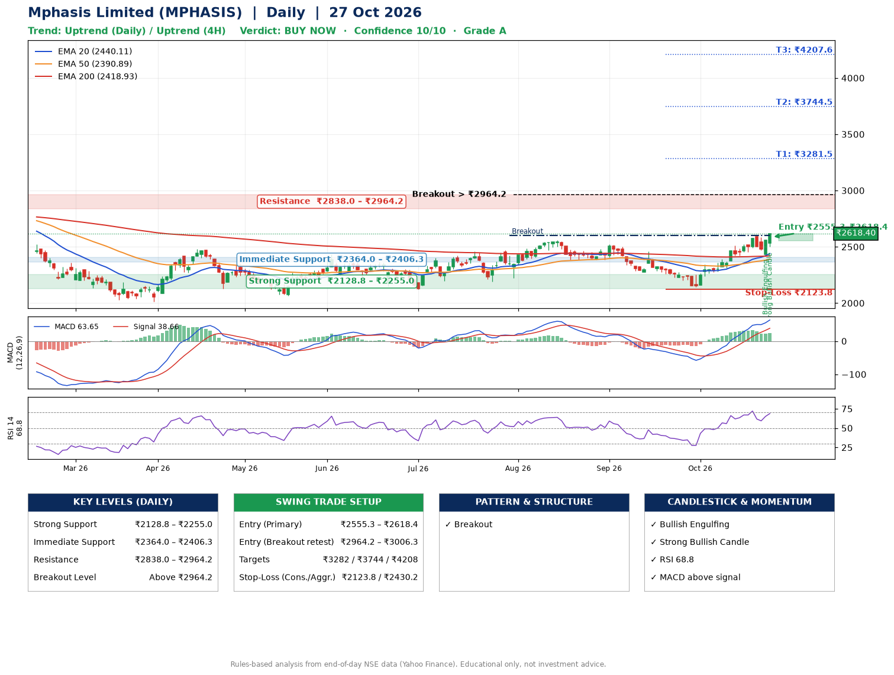

📌 **Mphasis Limited (MPHASIS) – Multi-Timeframe Technical Analysis (Daily + 4H Combined)**
_Data up to 27 Oct 2026 · Close ₹2618.40_

**📍 Daily Timeframe Trend**
- Trend: **Uptrend** (price above rising EMAs)
- Recent swing highs: ₹2556.9, ₹2523.0, ₹2461.1 · swing lows: ₹2385.0, ₹2385.3, ₹2144.8
- EMAs: EMA20 ₹2440.1, EMA50 ₹2390.9, EMA200 ₹2418.9; mixed / crossing; price above EMA20, EMA50, EMA200
- MACD 63.65 above signal 38.66 (above zero); histogram rising
- RSI(14) 68.8; no divergence on the last two swings

**📍 4-Hour Timeframe Trend**
- Structure: **Uptrend** (higher highs and higher lows)
- Pullback/support area: recent 4H swing lows ₹2425.8, ₹2435.8; EMA20 ₹2490.5
- EMA20/50: bullish stack (EMA20 > EMA50); price above EMA20, EMA50
- MACD 53.78 above signal 52.43 (above zero), fresh bullish crossover; histogram rising
- RSI(14) 68.1; Hidden bullish divergence; Regular bearish divergence

**📍 Pattern Detection (Both Timeframes)**
- Daily: **Breakout** – closed above the 60-session high ₹2601.4 (volume not confirming yet)
- 4H: **Double Bottom** – bottoms near ₹2425.8/₹2435.8, neckline ₹2600.0, confirmed (closed above neckline)

**📍 Candlestick Patterns (last 3 daily candles)**
- **Bullish Engulfing** – 26 Oct: buyers fully reversed the prior red candle
- **Strong Bullish Candle** – 27 Oct: wide-range green candle, buyers in control

**📍 Price Action Key Levels (Daily Structure)**

| Zone | Price Level (₹) | Context |
|------|-----------------|---------|
| Strong Support | ₹2128.8 – ₹2255.0 | Cluster of earlier swing lows (demand) |
| Immediate Support | ₹2364.0 – ₹2406.3 | Nearest swing-low / wick area |
| Resistance | ₹2838.0 – ₹2964.2 | Nearest swing-high supply |
| Breakout Level | Above ₹2964.2 | Swing continuation trigger (52-week high ₹2975.0) |

**📍 Swing Trade Setup**

🟢 **Entry Zone**
- Primary: ₹2555.3 – ₹2618.4 (daily support / EMA20 area; enter on a bullish 4H candle)
- Alternate: ₹2964.2 – ₹3006.3 (breakout retest)

🎯 **Profit Targets**
- T1: ₹3281.5
- T2: ₹3744.5
- T3: ₹4207.6

🛑 **Stop-Loss**
- Conservative: below daily swing low (₹2123.8)
- Aggressive: below 4H structure (₹2430.2)
- Risk per share ≈ ₹463.1; reward:risk to T1 ≈ 1.5

**📌 Strategy Notes**
- Higher timeframe: daily trend is uptrend; only take longs while price holds above ₹2128.8.
- Entry timing: wait for a bullish 4H candle (engulfing/hammer) inside ₹2555.3 – ₹2618.4 rather than buying mid-range.
- EMA stacking: mixed / crossing; price above EMA20, EMA50, EMA200.
- Breakout rule: a daily close above ₹2964.2 with volume above its 20-day average (≈717,981) opens T2/T3.
- Momentum: RSI 69 – elevated, prefer dips; no divergence on the last two swings.
- Exit discipline: move the stop to entry once T1 is hit; book partial profits at each target.

**STEP 2 — Marked Up Chart**

**✅ Trade Validation Checklist**
- Trend + momentum aligned: Yes · Price at entry zone: Yes
- Stop defined (₹2123.8) · Reward:risk ≥ 1.5 to T1: Yes

## 📌 Final Verdict

Recommendation: **🟢 BUY NOW**

Confidence: **10/10**

Trade Quality: **A**

Reason:
• Daily uptrend (price above rising EMAs)
• Breakout: closed above the 60-session high ₹2601.4 (volume not confirming yet)

Next Action:
• Buy now within the entry zone, with the stop-loss in place

_Rules-based analysis from end-of-day data. Educational only, not investment advice. Never place orders without your own confirmation._