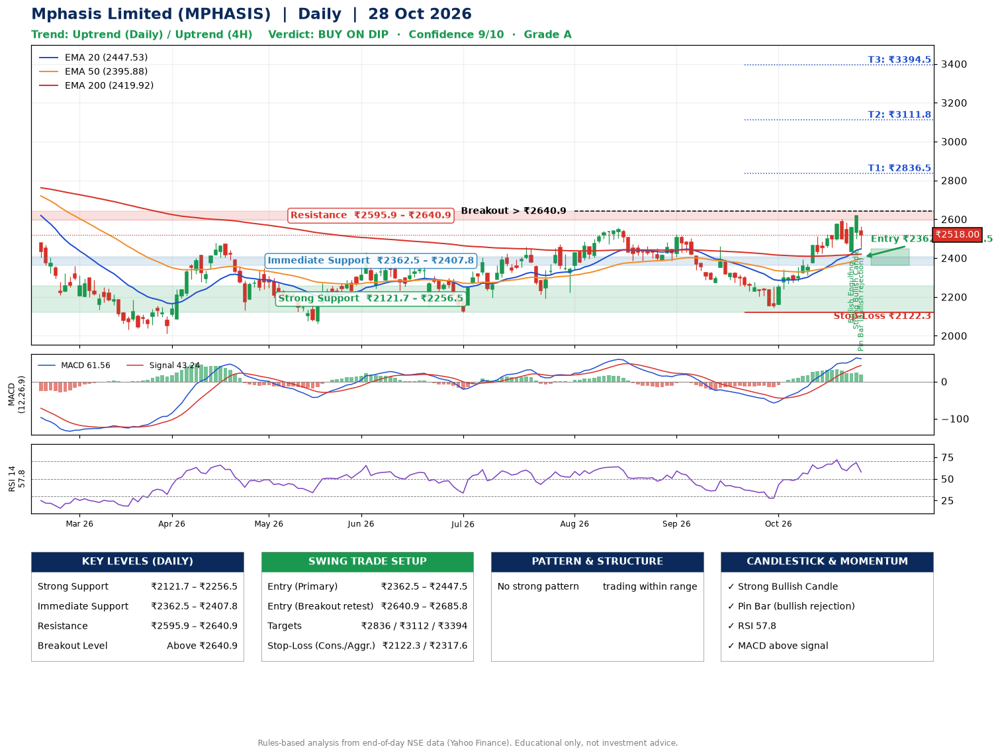

📌 **Mphasis Limited (MPHASIS) – Multi-Timeframe Technical Analysis (Daily + 4H Combined)**
_Data up to 28 Oct 2026 · Close ₹2518.00_

**📍 Daily Timeframe Trend**
- Trend: **Uptrend** (price above rising EMAs)
- Recent swing highs: ₹2556.9, ₹2523.0, ₹2461.1 · swing lows: ₹2385.0, ₹2385.3, ₹2144.8
- EMAs: EMA20 ₹2447.5, EMA50 ₹2395.9, EMA200 ₹2419.9; mixed / crossing; price above EMA20, EMA50, EMA200
- MACD 61.56 above signal 43.24 (above zero); histogram falling
- RSI(14) 57.8; no divergence on the last two swings

**📍 4-Hour Timeframe Trend**
- Structure: **Uptrend** (higher highs and higher lows)
- Pullback/support area: recent 4H swing lows ₹2425.8, ₹2435.8; EMA20 ₹2495.8
- EMA20/50: bullish stack (EMA20 > EMA50); price above EMA20, EMA50
- MACD 45.59 below signal 50.61 (above zero), fresh bullish crossover; histogram falling
- RSI(14) 55.0; Hidden bullish divergence; Regular bearish divergence

**📍 Pattern Detection (Both Timeframes)**
- 4H: **Double Bottom** – bottoms near ₹2425.8/₹2435.8, neckline ₹2600.0, forming

**📍 Candlestick Patterns (last 3 daily candles)**
- **Bullish Engulfing** – 26 Oct: buyers fully reversed the prior red candle
- **Strong Bullish Candle** – 27 Oct: wide-range green candle, buyers in control
- **Pin Bar (bullish rejection)** – 28 Oct: long lower wick shows dip-buying near ₹2455.2

**📍 Price Action Key Levels (Daily Structure)**

| Zone | Price Level (₹) | Context |
|------|-----------------|---------|
| Strong Support | ₹2121.7 – ₹2256.5 | Cluster of earlier swing lows (demand) |
| Immediate Support | ₹2362.5 – ₹2407.8 | Nearest swing-low / wick area |
| Resistance | ₹2595.9 – ₹2640.9 | Nearest swing-high supply |
| Breakout Level | Above ₹2640.9 | Swing continuation trigger (52-week high ₹2975.0) |

**📍 Swing Trade Setup**

🟢 **Entry Zone**
- Primary: ₹2362.5 – ₹2447.5 (daily support / EMA20 area; enter on a bullish 4H candle)
- Alternate: ₹2640.9 – ₹2685.8 (breakout retest)

🎯 **Profit Targets**
- T1: ₹2836.5
- T2: ₹3111.8
- T3: ₹3394.5

🛑 **Stop-Loss**
- Conservative: below daily swing low (₹2122.3)
- Aggressive: below 4H structure (₹2317.6)
- Risk per share ≈ ₹282.7; reward:risk to T1 ≈ 1.5

**📌 Strategy Notes**
- Higher timeframe: daily trend is uptrend; only take longs while price holds above ₹2121.7.
- Entry timing: wait for a bullish 4H candle (engulfing/hammer) inside ₹2362.5 – ₹2447.5 rather than buying mid-range.
- EMA stacking: mixed / crossing; price above EMA20, EMA50, EMA200.
- Breakout rule: a daily close above ₹2640.9 with volume above its 20-day average (≈727,438) opens T2/T3.
- Momentum: RSI 58 – room to run; no divergence on the last two swings.
- Exit discipline: move the stop to entry once T1 is hit; book partial profits at each target.

**STEP 2 — Marked Up Chart**

**✅ Trade Validation Checklist**
- Trend + momentum aligned: Yes · Price at entry zone: No
- Stop defined (₹2122.3) · Reward:risk ≥ 1.5 to T1: Yes

## 📌 Final Verdict

Recommendation: **🟡 BUY ON DIP**

Confidence: **9/10**

Trade Quality: **A**

Reason:
• Daily uptrend (price above rising EMAs)

Next Action:
• Wait for a pullback to ₹2362.5–₹2447.5, or a breakout above ₹2640.9

_Rules-based analysis from end-of-day data. Educational only, not investment advice. Never place orders without your own confirmation._