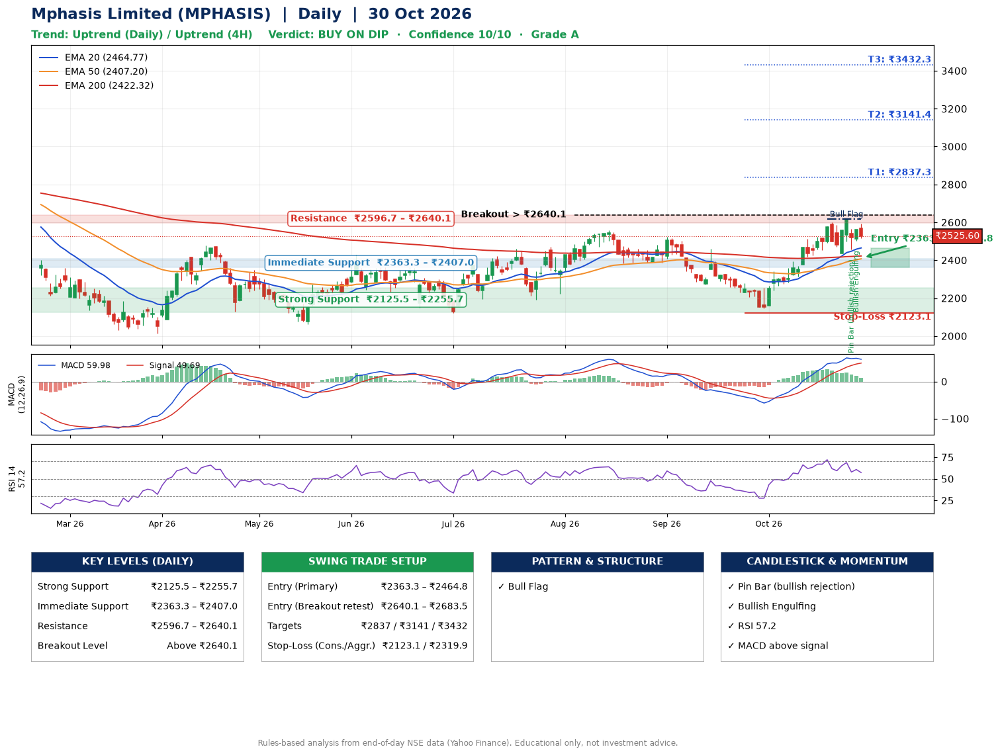

📌 **Mphasis Limited (MPHASIS) – Multi-Timeframe Technical Analysis (Daily + 4H Combined)**
_Data up to 30 Oct 2026 · Close ₹2525.60_

**📍 Daily Timeframe Trend**
- Trend: **Uptrend** (price above rising EMAs)
- Recent swing highs: ₹2556.9, ₹2523.0, ₹2461.1 · swing lows: ₹2385.0, ₹2385.3, ₹2144.8
- EMAs: EMA20 ₹2464.8, EMA50 ₹2407.2, EMA200 ₹2422.3; mixed / crossing; price above EMA20, EMA50, EMA200
- MACD 59.98 above signal 49.69 (above zero); histogram falling
- RSI(14) 57.2; no divergence on the last two swings

**📍 4-Hour Timeframe Trend**
- Structure: **Uptrend** (higher highs and higher lows)
- Pullback/support area: recent 4H swing lows ₹2435.8, ₹2455.3; EMA20 ₹2512.0
- EMA20/50: bullish stack (EMA20 > EMA50); price above EMA20, EMA50
- MACD 38.38 below signal 45.15 (above zero); histogram falling
- RSI(14) 54.2; Hidden bullish divergence

**📍 Pattern Detection (Both Timeframes)**
- Daily: **Bull Flag** – 16% pole then a tight 7% flag; trigger above ₹2618.4

**📍 Candlestick Patterns (last 3 daily candles)**
- **Pin Bar (bullish rejection)** – 28 Oct: long lower wick shows dip-buying near ₹2455.2
- **Bullish Engulfing** – 29 Oct: buyers fully reversed the prior red candle

**📍 Price Action Key Levels (Daily Structure)**

| Zone | Price Level (₹) | Context |
|------|-----------------|---------|
| Strong Support | ₹2125.5 – ₹2255.7 | Cluster of earlier swing lows (demand) |
| Immediate Support | ₹2363.3 – ₹2407.0 | Nearest swing-low / wick area |
| Resistance | ₹2596.7 – ₹2640.1 | Nearest swing-high supply |
| Breakout Level | Above ₹2640.1 | Swing continuation trigger (52-week high ₹2975.0) |

**📍 Swing Trade Setup**

🟢 **Entry Zone**
- Primary: ₹2363.3 – ₹2464.8 (daily support / EMA20 area; enter on a bullish 4H candle)
- Alternate: ₹2640.1 – ₹2683.5 (breakout retest)

🎯 **Profit Targets**
- T1: ₹2837.3
- T2: ₹3141.4
- T3: ₹3432.3

🛑 **Stop-Loss**
- Conservative: below daily swing low (₹2123.1)
- Aggressive: below 4H structure (₹2319.9)
- Risk per share ≈ ₹290.9; reward:risk to T1 ≈ 1.5

**📌 Strategy Notes**
- Higher timeframe: daily trend is uptrend; only take longs while price holds above ₹2125.5.
- Entry timing: wait for a bullish 4H candle (engulfing/hammer) inside ₹2363.3 – ₹2464.8 rather than buying mid-range.
- EMA stacking: mixed / crossing; price above EMA20, EMA50, EMA200.
- Breakout rule: a daily close above ₹2640.1 with volume above its 20-day average (≈732,996) opens T2/T3.
- Momentum: RSI 57 – room to run; no divergence on the last two swings.
- Exit discipline: move the stop to entry once T1 is hit; book partial profits at each target.

**STEP 2 — Marked Up Chart**

**✅ Trade Validation Checklist**
- Trend + momentum aligned: Yes · Price at entry zone: No
- Stop defined (₹2123.1) · Reward:risk ≥ 1.5 to T1: No

## 📌 Final Verdict

Recommendation: **🟡 BUY ON DIP**

Confidence: **10/10**

Trade Quality: **A**

Reason:
• Daily uptrend (price above rising EMAs)
• Bull Flag: 16% pole then a tight 7% flag; trigger above ₹2618.4

Next Action:
• Wait for a pullback to ₹2363.3–₹2464.8, or a breakout above ₹2640.1

_Rules-based analysis from end-of-day data. Educational only, not investment advice. Never place orders without your own confirmation._