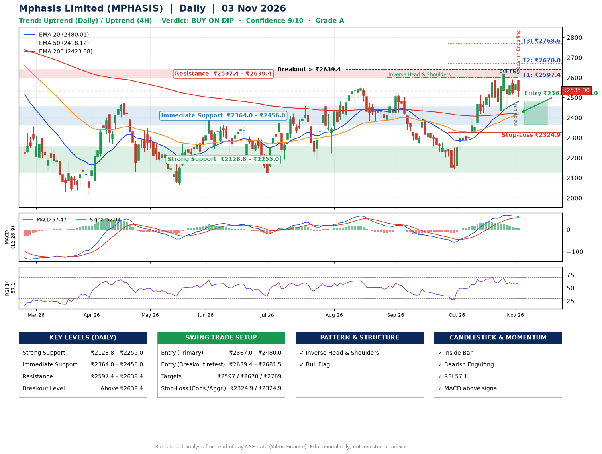

📌 **Mphasis Limited (MPHASIS) – Multi-Timeframe Technical Analysis (Daily + 4H Combined)**
_Data up to 03 Nov 2026 · Close ₹2535.30_

**📍 Daily Timeframe Trend**
- Trend: **Uptrend** (higher highs and higher lows)
- Recent swing highs: ₹2523.0, ₹2461.1, ₹2618.4 · swing lows: ₹2385.3, ₹2144.8, ₹2435.0
- EMAs: EMA20 ₹2480.0, EMA50 ₹2418.1, EMA200 ₹2423.9; mixed / crossing; price above EMA20, EMA50, EMA200
- MACD 57.47 above signal 52.94 (above zero); histogram falling
- RSI(14) 57.1; no divergence on the last two swings

**📍 4-Hour Timeframe Trend**
- Structure: **Uptrend** (price above rising EMAs)
- Pullback/support area: recent 4H swing lows ₹2435.8, ₹2455.3; EMA20 ₹2522.1
- EMA20/50: bullish stack (EMA20 > EMA50); price above EMA20, EMA50
- MACD 30.02 below signal 38.05 (above zero); histogram falling
- RSI(14) 54.2; Hidden bullish divergence

**📍 Pattern Detection (Both Timeframes)**
- Daily: **Inverse Head & Shoulders** – head ₹2144.8, neckline ₹2601.4
- Daily: **Bull Flag** – 16% pole then a tight 7% flag; trigger above ₹2618.4

**📍 Candlestick Patterns (last 3 daily candles)**
- **Inside Bar** – 02 Nov: compression inside the prior range ₹2516.6–₹2591.3
- **Bearish Engulfing** – 03 Nov: sellers fully reversed the prior green candle

**📍 Price Action Key Levels (Daily Structure)**

| Zone | Price Level (₹) | Context |
|------|-----------------|---------|
| Strong Support | ₹2128.8 – ₹2255.0 | Cluster of earlier swing lows (demand) |
| Immediate Support | ₹2364.0 – ₹2456.0 | Nearest swing-low / wick area |
| Resistance | ₹2597.4 – ₹2639.4 | Nearest swing-high supply |
| Breakout Level | Above ₹2639.4 | Swing continuation trigger (52-week high ₹2975.0) |

**📍 Swing Trade Setup**

🟢 **Entry Zone**
- Primary: ₹2367.0 – ₹2480.0 (daily support / EMA20 area; enter on a bullish 4H candle)
- Alternate: ₹2639.4 – ₹2681.5 (breakout retest)

🎯 **Profit Targets**
- T1: ₹2597.4
- T2: ₹2670.0
- T3: ₹2768.6

🛑 **Stop-Loss**
- Conservative: below daily swing low (₹2324.9)
- Aggressive: below 4H structure (₹2324.9)
- Risk per share ≈ ₹98.6; reward:risk to T1 ≈ 1.8

**📌 Strategy Notes**
- Higher timeframe: daily trend is uptrend; only take longs while price holds above ₹2128.8.
- Entry timing: wait for a bullish 4H candle (engulfing/hammer) inside ₹2367.0 – ₹2480.0 rather than buying mid-range.
- EMA stacking: mixed / crossing; price above EMA20, EMA50, EMA200.
- Breakout rule: a daily close above ₹2639.4 with volume above its 20-day average (≈673,065) opens T2/T3.
- Momentum: RSI 57 – room to run; no divergence on the last two swings.
- Exit discipline: move the stop to entry once T1 is hit; book partial profits at each target.

**STEP 2 — Marked Up Chart**

**✅ Trade Validation Checklist**
- Trend + momentum aligned: Yes · Price at entry zone: No
- Stop defined (₹2324.9) · Reward:risk ≥ 1.5 to T1: Yes

## 📌 Final Verdict

Recommendation: **🟡 BUY ON DIP**

Confidence: **9/10**

Trade Quality: **A**

Reason:
• Daily uptrend (higher highs and higher lows)
• Inverse Head & Shoulders: head ₹2144.8, neckline ₹2601.4

Next Action:
• Wait for a pullback to ₹2367.0–₹2480.0, or a breakout above ₹2639.4

_Rules-based analysis from end-of-day data. Educational only, not investment advice. Never place orders without your own confirmation._