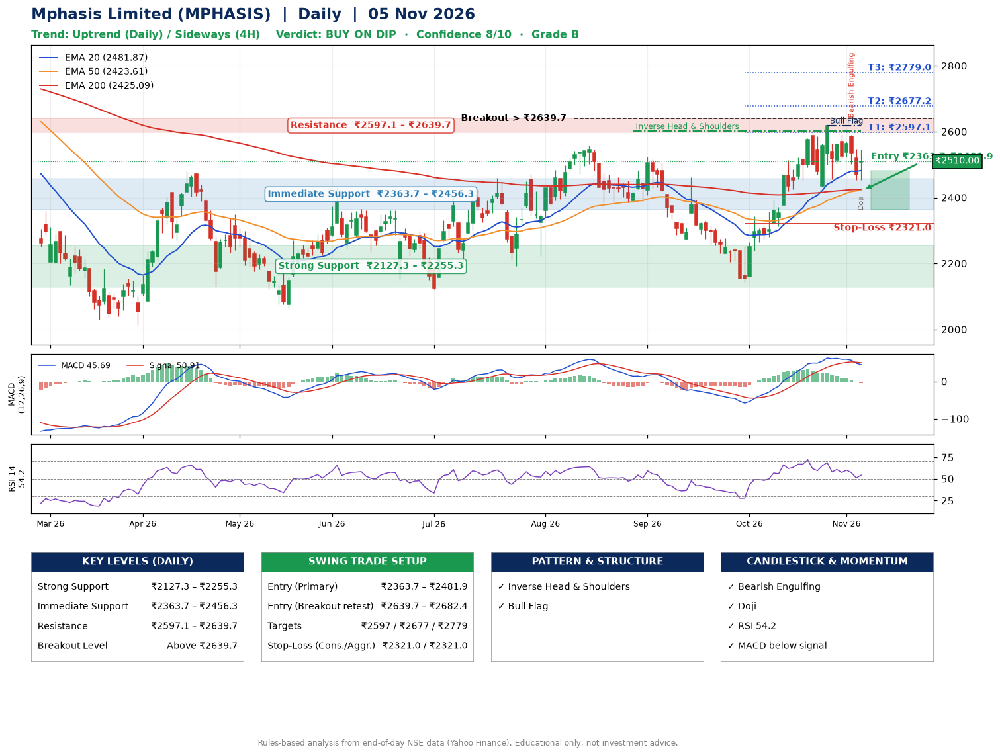

📌 **Mphasis Limited (MPHASIS) – Multi-Timeframe Technical Analysis (Daily + 4H Combined)**
_Data up to 05 Nov 2026 · Close ₹2510.00_

**📍 Daily Timeframe Trend**
- Trend: **Uptrend** (higher highs and higher lows)
- Recent swing highs: ₹2523.0, ₹2461.1, ₹2618.4 · swing lows: ₹2385.3, ₹2144.8, ₹2435.0
- EMAs: EMA20 ₹2481.9, EMA50 ₹2423.6, EMA200 ₹2425.1; mixed / crossing; price above EMA20, EMA50, EMA200
- MACD 45.69 below signal 50.91 (above zero), fresh bearish crossover; histogram falling
- RSI(14) 54.2; no divergence on the last two swings

**📍 4-Hour Timeframe Trend**
- Structure: **Sideways** (mixed swing structure)
- Pullback/support area: recent 4H swing lows ₹2435.8, ₹2455.3; EMA20 ₹2513.7
- EMA20/50: bullish stack (EMA20 > EMA50); price above EMA50
- MACD 13.81 below signal 25.31 (above zero); histogram rising
- RSI(14) 51.0; Hidden bullish divergence

**📍 Pattern Detection (Both Timeframes)**
- Daily: **Inverse Head & Shoulders** – head ₹2144.8, neckline ₹2601.4
- Daily: **Bull Flag** – 19% pole then a tight 7% flag; trigger above ₹2618.4
- 4H: **Descending Triangle** – converging swing highs and lows over the last ~60 sessions

**📍 Candlestick Patterns (last 3 daily candles)**
- **Bearish Engulfing** – 03 Nov: sellers fully reversed the prior green candle
- **Doji** – 05 Nov: indecision; wait for the next candle to confirm direction

**📍 Price Action Key Levels (Daily Structure)**

| Zone | Price Level (₹) | Context |
|------|-----------------|---------|
| Strong Support | ₹2127.3 – ₹2255.3 | Cluster of earlier swing lows (demand) |
| Immediate Support | ₹2363.7 – ₹2456.3 | Nearest swing-low / wick area |
| Resistance | ₹2597.1 – ₹2639.7 | Nearest swing-high supply |
| Breakout Level | Above ₹2639.7 | Swing continuation trigger (52-week high ₹2975.0) |

**📍 Swing Trade Setup**

🟢 **Entry Zone**
- Primary: ₹2363.7 – ₹2481.9 (daily support / EMA20 area; enter on a bullish 4H candle)
- Alternate: ₹2639.7 – ₹2682.4 (breakout retest)

🎯 **Profit Targets**
- T1: ₹2597.1
- T2: ₹2677.2
- T3: ₹2779.0

🛑 **Stop-Loss**
- Conservative: below daily swing low (₹2321.0)
- Aggressive: below 4H structure (₹2321.0)
- Risk per share ≈ ₹101.8; reward:risk to T1 ≈ 1.7

**📌 Strategy Notes**
- Higher timeframe: daily trend is uptrend; only take longs while price holds above ₹2127.3.
- Entry timing: wait for a bullish 4H candle (engulfing/hammer) inside ₹2363.7 – ₹2481.9 rather than buying mid-range.
- EMA stacking: mixed / crossing; price above EMA20, EMA50, EMA200.
- Breakout rule: a daily close above ₹2639.7 with volume above its 20-day average (≈698,551) opens T2/T3.
- Momentum: RSI 54 – room to run; no divergence on the last two swings.
- Exit discipline: move the stop to entry once T1 is hit; book partial profits at each target.

**STEP 2 — Marked Up Chart**

**✅ Trade Validation Checklist**
- Trend + momentum aligned: No · Price at entry zone: No
- Stop defined (₹2321.0) · Reward:risk ≥ 1.5 to T1: Yes

## 📌 Final Verdict

Recommendation: **🟡 BUY ON DIP**

Confidence: **8/10**

Trade Quality: **B**

Reason:
• Daily uptrend (higher highs and higher lows)
• Inverse Head & Shoulders: head ₹2144.8, neckline ₹2601.4

Next Action:
• Wait for a pullback to ₹2363.7–₹2481.9, or a breakout above ₹2639.7

_Rules-based analysis from end-of-day data. Educational only, not investment advice. Never place orders without your own confirmation._