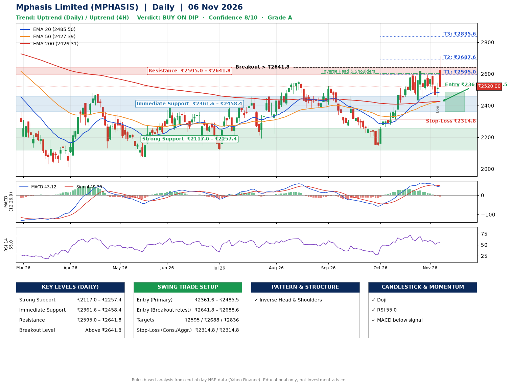

📌 **Mphasis Limited (MPHASIS) – Multi-Timeframe Technical Analysis (Daily + 4H Combined)**
_Data up to 06 Nov 2026 · Close ₹2520.00_

**📍 Daily Timeframe Trend**
- Trend: **Uptrend** (higher highs and higher lows)
- Recent swing highs: ₹2523.0, ₹2461.1, ₹2618.4 · swing lows: ₹2385.3, ₹2144.8, ₹2435.0
- EMAs: EMA20 ₹2485.5, EMA50 ₹2427.4, EMA200 ₹2426.3; bullish stack (EMA20 > EMA50 > EMA200); price above EMA20, EMA50, EMA200
- MACD 43.12 below signal 49.35 (above zero), fresh bearish crossover; histogram falling
- RSI(14) 55.0; no divergence on the last two swings

**📍 4-Hour Timeframe Trend**
- Structure: **Uptrend** (price above rising EMAs)
- Pullback/support area: recent 4H swing lows ₹2455.3, ₹2453.3; EMA20 ₹2517.2
- EMA20/50: bullish stack (EMA20 > EMA50); price above EMA20, EMA50
- MACD 13.74 below signal 21.36 (above zero); histogram rising
- RSI(14) 51.7; no divergence

**📍 Pattern Detection (Both Timeframes)**
- Daily: **Inverse Head & Shoulders** – head ₹2144.8, neckline ₹2601.4
- 4H: **Double Bottom** – bottoms near ₹2455.3/₹2453.3, neckline ₹2590.7, forming
- 4H: **Descending Triangle** – converging swing highs and lows over the last ~60 sessions

**📍 Candlestick Patterns (last 3 daily candles)**
- **Doji** – 05 Nov: indecision; wait for the next candle to confirm direction

**📍 Price Action Key Levels (Daily Structure)**

| Zone | Price Level (₹) | Context |
|------|-----------------|---------|
| Strong Support | ₹2117.0 – ₹2257.4 | Cluster of earlier swing lows (demand) |
| Immediate Support | ₹2361.6 – ₹2458.4 | Nearest swing-low / wick area |
| Resistance | ₹2595.0 – ₹2641.8 | Nearest swing-high supply |
| Breakout Level | Above ₹2641.8 | Swing continuation trigger (52-week high ₹2975.0) |

**📍 Swing Trade Setup**

🟢 **Entry Zone**
- Primary: ₹2361.6 – ₹2485.5 (daily support / EMA20 area; enter on a bullish 4H candle)
- Alternate: ₹2641.8 – ₹2688.6 (breakout retest)

🎯 **Profit Targets**
- T1: ₹2595.0
- T2: ₹2687.6
- T3: ₹2835.6

🛑 **Stop-Loss**
- Conservative: below daily swing low (₹2314.8)
- Aggressive: below 4H structure (₹2314.8)
- Risk per share ≈ ₹108.8; reward:risk to T1 ≈ 1.6

**📌 Strategy Notes**
- Higher timeframe: daily trend is uptrend; only take longs while price holds above ₹2117.0.
- Entry timing: wait for a bullish 4H candle (engulfing/hammer) inside ₹2361.6 – ₹2485.5 rather than buying mid-range.
- EMA stacking: bullish stack (EMA20 > EMA50 > EMA200); price above EMA20, EMA50, EMA200.
- Breakout rule: a daily close above ₹2641.8 with volume above its 20-day average (≈880,875) opens T2/T3.
- Momentum: RSI 55 – room to run; no divergence on the last two swings.
- Exit discipline: move the stop to entry once T1 is hit; book partial profits at each target.

**STEP 2 — Marked Up Chart**

**✅ Trade Validation Checklist**
- Trend + momentum aligned: No · Price at entry zone: No
- Stop defined (₹2314.8) · Reward:risk ≥ 1.5 to T1: Yes

## 📌 Final Verdict

Recommendation: **🟡 BUY ON DIP**

Confidence: **8/10**

Trade Quality: **A**

Reason:
• Daily uptrend (higher highs and higher lows)
• EMAs stacked bullishly

Next Action:
• Wait for a pullback to ₹2361.6–₹2485.5, or a breakout above ₹2641.8

_Rules-based analysis from end-of-day data. Educational only, not investment advice. Never place orders without your own confirmation._