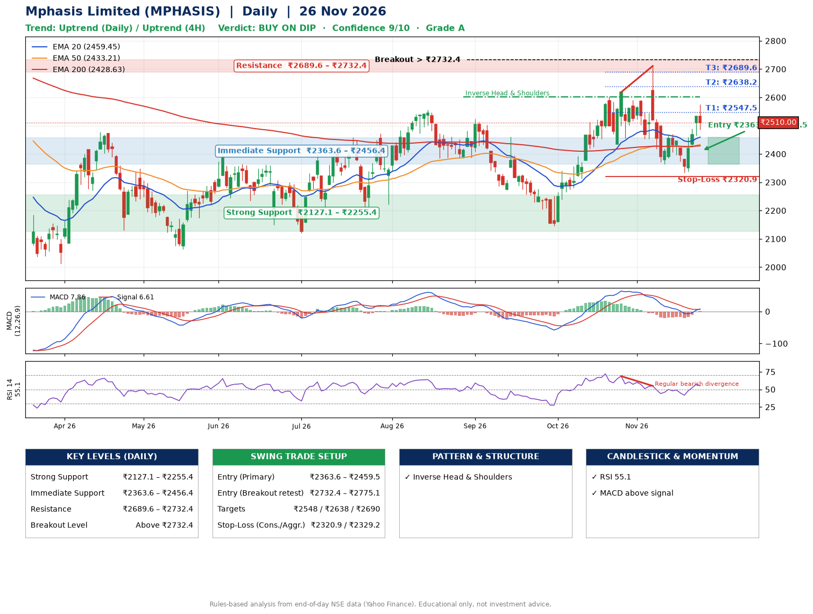

📌 **Mphasis Limited (MPHASIS) – Multi-Timeframe Technical Analysis (Daily + 4H Combined)**
_Data up to 26 Nov 2026 · Close ₹2510.00_

**📍 Daily Timeframe Trend**
- Trend: **Uptrend** (higher highs and higher lows)
- Recent swing highs: ₹2461.1, ₹2618.4, ₹2711.0 · swing lows: ₹2385.3, ₹2144.8, ₹2435.0
- EMAs: EMA20 ₹2459.5, EMA50 ₹2433.2, EMA200 ₹2428.6; bullish stack (EMA20 > EMA50 > EMA200); price above EMA20, EMA50, EMA200
- MACD 7.86 above signal 6.61 (above zero), fresh bullish crossover; histogram rising
- RSI(14) 55.1; Regular bearish divergence

**📍 4-Hour Timeframe Trend**
- Structure: **Uptrend** (price above rising EMAs)
- Pullback/support area: recent 4H swing lows ₹2370.3, ₹2334.4; EMA20 ₹2458.6
- EMA20/50: bullish stack (EMA20 > EMA50); price above EMA20, EMA50
- MACD 10.00 above signal -5.14 (above zero); histogram falling
- RSI(14) 56.5; no divergence

**📍 Pattern Detection (Both Timeframes)**
- Daily: **Inverse Head & Shoulders** – head ₹2144.8, neckline ₹2601.4
- 4H: **Double Bottom** – bottoms near ₹2370.3/₹2334.4, neckline ₹2465.3, confirmed (closed above neckline)
- 4H: **Head & Shoulders** – head ₹2709.9, neckline ₹2370.3

**📍 Candlestick Patterns (last 3 daily candles)**
- No notable candlestick signal in the last 3 sessions.

**📍 Price Action Key Levels (Daily Structure)**

| Zone | Price Level (₹) | Context |
|------|-----------------|---------|
| Strong Support | ₹2127.1 – ₹2255.4 | Cluster of earlier swing lows (demand) |
| Immediate Support | ₹2363.6 – ₹2456.4 | Nearest swing-low / wick area |
| Resistance | ₹2689.6 – ₹2732.4 | Nearest swing-high supply |
| Breakout Level | Above ₹2732.4 | Swing continuation trigger (52-week high ₹2975.0) |

**📍 Swing Trade Setup**

🟢 **Entry Zone**
- Primary: ₹2363.6 – ₹2459.5 (daily support / EMA20 area; enter on a bullish 4H candle)
- Alternate: ₹2732.4 – ₹2775.1 (breakout retest)

🎯 **Profit Targets**
- T1: ₹2547.5
- T2: ₹2638.2
- T3: ₹2689.6

🛑 **Stop-Loss**
- Conservative: below daily swing low (₹2320.9)
- Aggressive: below 4H structure (₹2329.2)
- Risk per share ≈ ₹90.7; reward:risk to T1 ≈ 1.5
- Time to T1: about 11 trading days (it rose this much within 60 trading days 73% of the time in the last 2 years)
- Time to T2: about 18 trading days (it rose this much within 60 trading days 44% of the time in the last 2 years)

**📌 Strategy Notes**
- Higher timeframe: daily trend is uptrend; only take longs while price holds above ₹2127.1.
- Entry timing: wait for a bullish 4H candle (engulfing/hammer) inside ₹2363.6 – ₹2459.5 rather than buying mid-range.
- EMA stacking: bullish stack (EMA20 > EMA50 > EMA200); price above EMA20, EMA50, EMA200.
- Breakout rule: a daily close above ₹2732.4 with volume above its 20-day average (≈790,858) opens T2/T3.
- Momentum: RSI 55 – room to run; Regular bearish divergence.
- Exit discipline: move the stop to entry once T1 is hit; book partial profits at each target.

**STEP 2 — Marked Up Chart**

**✅ Trade Validation Checklist**
- Trend + momentum aligned: Yes · Price at entry zone: No
- Stop defined (₹2320.9) · Reward:risk ≥ 1.5 to T1: No

## 📌 Final Verdict

Recommendation: **🟡 BUY ON DIP**

Confidence: **9/10**

Trade Quality: **A**

Reason:
• Daily uptrend (higher highs and higher lows)
• EMAs stacked bullishly

Next Action:
• Wait for a pullback to ₹2363.6–₹2459.5, or a breakout above ₹2732.4

_Rules-based analysis from end-of-day data. Educational only, not investment advice. Never place orders without your own confirmation._