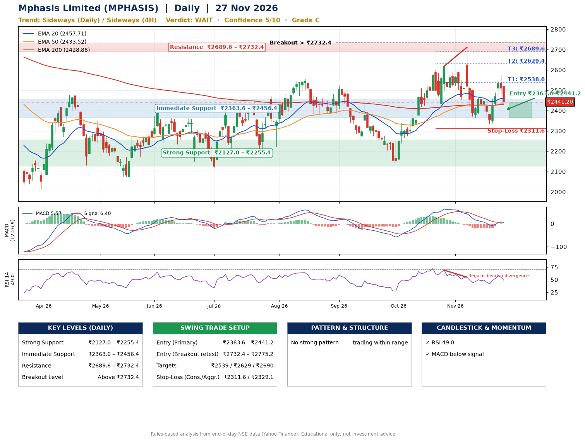

📌 **Mphasis Limited (MPHASIS) – Multi-Timeframe Technical Analysis (Daily + 4H Combined)**
_Data up to 27 Nov 2026 · Close ₹2441.20_

**📍 Daily Timeframe Trend**
- Trend: **Sideways** (mixed swing structure)
- Recent swing highs: ₹2461.1, ₹2618.4, ₹2711.0 · swing lows: ₹2144.8, ₹2435.0, ₹2333.0
- EMAs: EMA20 ₹2457.7, EMA50 ₹2433.5, EMA200 ₹2428.9; bullish stack (EMA20 > EMA50 > EMA200); price above EMA50, EMA200
- MACD 5.57 below signal 6.40 (above zero), fresh bullish crossover; histogram falling
- RSI(14) 49.0; Regular bearish divergence

**📍 4-Hour Timeframe Trend**
- Structure: **Sideways** (mixed swing structure)
- Pullback/support area: recent 4H swing lows ₹2370.3, ₹2334.4; EMA20 ₹2457.1
- EMA20/50: bullish stack (EMA20 > EMA50); price below all EMAs
- MACD 6.02 above signal -0.69 (above zero); histogram falling
- RSI(14) 48.1; no divergence

**📍 Pattern Detection (Both Timeframes)**
- 4H: **Double Bottom** – bottoms near ₹2370.3/₹2334.4, neckline ₹2465.3, forming

**📍 Candlestick Patterns (last 3 daily candles)**
- No notable candlestick signal in the last 3 sessions.

**📍 Price Action Key Levels (Daily Structure)**

| Zone | Price Level (₹) | Context |
|------|-----------------|---------|
| Strong Support | ₹2127.0 – ₹2255.4 | Cluster of earlier swing lows (demand) |
| Immediate Support | ₹2363.6 – ₹2456.4 | Nearest swing-low / wick area |
| Resistance | ₹2689.6 – ₹2732.4 | Nearest swing-high supply |
| Breakout Level | Above ₹2732.4 | Swing continuation trigger (52-week high ₹2975.0) |

**📍 Swing Trade Setup**

🟢 **Entry Zone**
- Primary: ₹2363.6 – ₹2441.2 (daily support / EMA20 area; enter on a bullish 4H candle)
- Alternate: ₹2732.4 – ₹2775.2 (breakout retest)

🎯 **Profit Targets**
- T1: ₹2538.6
- T2: ₹2629.4
- T3: ₹2689.6

🛑 **Stop-Loss**
- Conservative: below daily swing low (₹2311.6)
- Aggressive: below 4H structure (₹2329.1)
- Risk per share ≈ ₹90.8; reward:risk to T1 ≈ 1.5
- Time to T1: about 11 trading days (it rose this much within 60 trading days 72% of the time in the last 2 years)
- Time to T2: about 18 trading days (it rose this much within 60 trading days 44% of the time in the last 2 years)

**📌 Strategy Notes**
- Higher timeframe: daily trend is sideways; only take longs while price holds above ₹2127.0.
- Entry timing: wait for a bullish 4H candle (engulfing/hammer) inside ₹2363.6 – ₹2441.2 rather than buying mid-range.
- EMA stacking: bullish stack (EMA20 > EMA50 > EMA200); price above EMA50, EMA200.
- Breakout rule: a daily close above ₹2732.4 with volume above its 20-day average (≈798,066) opens T2/T3.
- Momentum: RSI 49 – room to run; Regular bearish divergence.
- Exit discipline: move the stop to entry once T1 is hit; book partial profits at each target.

**STEP 2 — Marked Up Chart**

**✅ Trade Validation Checklist**
- Trend + momentum aligned: No · Price at entry zone: Yes
- Stop defined (₹2311.6) · Reward:risk ≥ 1.5 to T1: Yes

## 📌 Final Verdict

Recommendation: **🟠 WAIT**

Confidence: **5/10**

Trade Quality: **C**

Reason:
• EMAs stacked bullishly

Next Action:
• Wait for a breakout above ₹2732.4

_Rules-based analysis from end-of-day data. Educational only, not investment advice. Never place orders without your own confirmation._