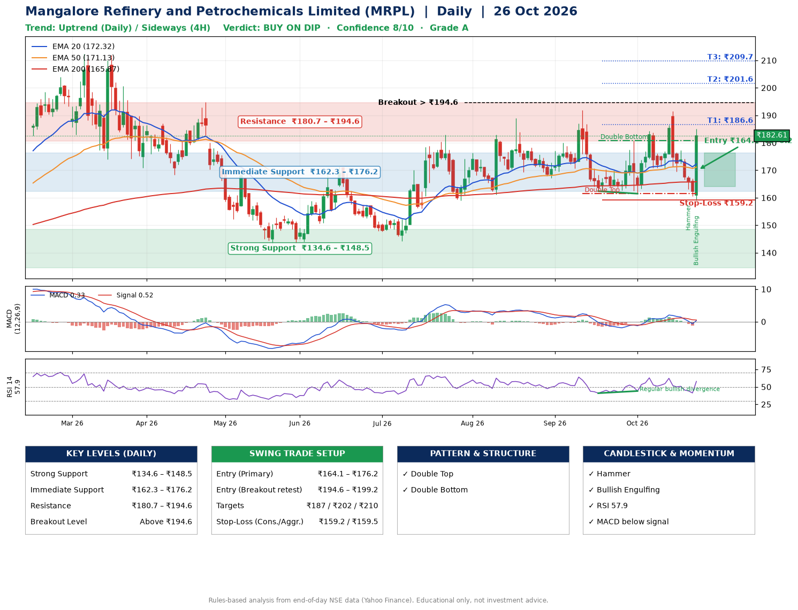

📌 **Mangalore Refinery and Petrochemicals Limited (MRPL) – Multi-Timeframe Technical Analysis (Daily + 4H Combined)**
_Data up to 26 Oct 2026 · Close ₹182.61_

**📍 Daily Timeframe Trend**
- Trend: **Uptrend** (price above rising EMAs)
- Recent swing highs: ₹189.0, ₹191.9, ₹191.5 · swing lows: ₹167.1, ₹162.4, ₹161.5
- EMAs: EMA20 ₹172.3, EMA50 ₹171.1, EMA200 ₹165.9; bullish stack (EMA20 > EMA50 > EMA200); price above EMA20, EMA50, EMA200
- MACD 0.33 below signal 0.52 (above zero), fresh bearish crossover; histogram rising
- RSI(14) 57.9; Regular bullish divergence

**📍 4-Hour Timeframe Trend**
- Structure: **Sideways** (mixed swing structure)
- Pullback/support area: recent 4H swing lows ₹170.6, ₹169.6; EMA20 ₹172.1
- EMA20/50: bullish stack (EMA20 > EMA50); price above EMA20, EMA50
- MACD -0.06 above signal -0.70 (below zero), fresh bullish crossover; histogram rising
- RSI(14) 61.4; Regular bearish divergence

**📍 Pattern Detection (Both Timeframes)**
- Daily: **Double Top** – tops near ₹191.9/₹191.5, neckline ₹161.5, forming
- Daily: **Double Bottom** – bottoms near ₹162.4/₹161.5, neckline ₹180.8, confirmed (closed above neckline)

**📍 Candlestick Patterns (last 3 daily candles)**
- **Hammer** – 22 Oct: long lower wick shows dip-buying near ₹163.1
- **Bullish Engulfing** – 26 Oct: buyers fully reversed the prior red candle

**📍 Price Action Key Levels (Daily Structure)**

| Zone | Price Level (₹) | Context |
|------|-----------------|---------|
| Strong Support | ₹134.6 – ₹148.5 | Cluster of earlier swing lows (demand) |
| Immediate Support | ₹162.3 – ₹176.2 | Nearest swing-low / wick area |
| Resistance | ₹180.7 – ₹194.6 | Nearest swing-high supply |
| Breakout Level | Above ₹194.6 | Swing continuation trigger (52-week high ₹212.3) |

**📍 Swing Trade Setup**

🟢 **Entry Zone**
- Primary: ₹164.1 – ₹176.2 (daily support / EMA20 area; enter on a bullish 4H candle)
- Alternate: ₹194.6 – ₹199.2 (breakout retest)

🎯 **Profit Targets**
- T1: ₹186.6
- T2: ₹201.6
- T3: ₹209.7

🛑 **Stop-Loss**
- Conservative: below daily swing low (₹159.2)
- Aggressive: below 4H structure (₹159.5)
- Risk per share ≈ ₹11.0; reward:risk to T1 ≈ 1.5

**📌 Strategy Notes**
- Higher timeframe: daily trend is uptrend; only take longs while price holds above ₹134.6.
- Entry timing: wait for a bullish 4H candle (engulfing/hammer) inside ₹164.1 – ₹176.2 rather than buying mid-range.
- EMA stacking: bullish stack (EMA20 > EMA50 > EMA200); price above EMA20, EMA50, EMA200.
- Breakout rule: a daily close above ₹194.6 with volume above its 20-day average (≈19,625,451) opens T2/T3.
- Momentum: RSI 58 – room to run; Regular bullish divergence.
- Exit discipline: move the stop to entry once T1 is hit; book partial profits at each target.

**STEP 2 — Marked Up Chart**

**✅ Trade Validation Checklist**
- Trend + momentum aligned: No · Price at entry zone: No
- Stop defined (₹159.2) · Reward:risk ≥ 1.5 to T1: No

## 📌 Final Verdict

Recommendation: **🟡 BUY ON DIP**

Confidence: **8/10**

Trade Quality: **A**

Reason:
• Daily uptrend (price above rising EMAs)
• EMAs stacked bullishly

Next Action:
• Wait for a pullback to ₹164.1–₹176.2

_Rules-based analysis from end-of-day data. Educational only, not investment advice. Never place orders without your own confirmation._