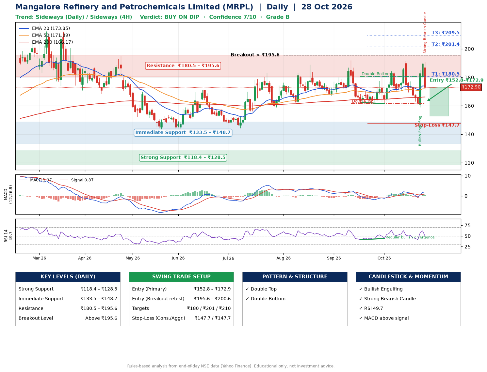

📌 **Mangalore Refinery and Petrochemicals Limited (MRPL) – Multi-Timeframe Technical Analysis (Daily + 4H Combined)**
_Data up to 28 Oct 2026 · Close ₹172.90_

**📍 Daily Timeframe Trend**
- Trend: **Sideways** (mixed swing structure)
- Recent swing highs: ₹189.0, ₹191.9, ₹191.5 · swing lows: ₹167.1, ₹162.4, ₹161.5
- EMAs: EMA20 ₹173.8, EMA50 ₹171.9, EMA200 ₹166.2; bullish stack (EMA20 > EMA50 > EMA200); price above EMA50, EMA200
- MACD 1.37 above signal 0.87 (above zero), fresh bullish crossover; histogram falling
- RSI(14) 49.7; Regular bullish divergence

**📍 4-Hour Timeframe Trend**
- Structure: **Sideways** (mixed swing structure)
- Pullback/support area: recent 4H swing lows ₹169.6, ₹159.2; EMA20 ₹174.7
- EMA20/50: bullish stack (EMA20 > EMA50); price below all EMAs
- MACD 1.42 above signal 0.70 (above zero), fresh bullish crossover; histogram falling
- RSI(14) 48.7; Regular bullish divergence; Regular bearish divergence

**📍 Pattern Detection (Both Timeframes)**
- Daily: **Double Top** – tops near ₹191.9/₹191.5, neckline ₹161.5, forming
- Daily: **Double Bottom** – bottoms near ₹162.4/₹161.5, neckline ₹180.8, forming

**📍 Candlestick Patterns (last 3 daily candles)**
- **Bullish Engulfing** – 26 Oct: buyers fully reversed the prior red candle
- **Strong Bearish Candle** – 28 Oct: wide-range red candle, sellers in control

**📍 Price Action Key Levels (Daily Structure)**

| Zone | Price Level (₹) | Context |
|------|-----------------|---------|
| Strong Support | ₹118.4 – ₹128.5 | Cluster of earlier swing lows (demand) |
| Immediate Support | ₹133.5 – ₹148.7 | Nearest swing-low / wick area |
| Resistance | ₹180.5 – ₹195.6 | Nearest swing-high supply |
| Breakout Level | Above ₹195.6 | Swing continuation trigger (52-week high ₹212.3) |

**📍 Swing Trade Setup**

🟢 **Entry Zone**
- Primary: ₹152.8 – ₹172.9 (daily support / EMA20 area; enter on a bullish 4H candle)
- Alternate: ₹195.6 – ₹200.6 (breakout retest)

🎯 **Profit Targets**
- T1: ₹180.5
- T2: ₹201.4
- T3: ₹209.5

🛑 **Stop-Loss**
- Conservative: below daily swing low (₹147.7)
- Aggressive: below 4H structure (₹147.7)
- Risk per share ≈ ₹15.1; reward:risk to T1 ≈ 1.2

**📌 Strategy Notes**
- Higher timeframe: daily trend is sideways; only take longs while price holds above ₹118.4.
- Entry timing: wait for a bullish 4H candle (engulfing/hammer) inside ₹152.8 – ₹172.9 rather than buying mid-range.
- EMA stacking: bullish stack (EMA20 > EMA50 > EMA200); price above EMA50, EMA200.
- Breakout rule: a daily close above ₹195.6 with volume above its 20-day average (≈21,311,363) opens T2/T3.
- Momentum: RSI 50 – room to run; Regular bullish divergence.
- Exit discipline: move the stop to entry once T1 is hit; book partial profits at each target.

**STEP 2 — Marked Up Chart**

**✅ Trade Validation Checklist**
- Trend + momentum aligned: No · Price at entry zone: Yes
- Stop defined (₹147.7) · Reward:risk ≥ 1.5 to T1: No

## 📌 Final Verdict

Recommendation: **🟡 BUY ON DIP**

Confidence: **7/10**

Trade Quality: **B**

Reason:
• EMAs stacked bullishly
• Double Top: tops near ₹191.9/₹191.5, neckline ₹161.5, forming

Next Action:
• Wait for a pullback to ₹152.8–₹172.9, or a breakout above ₹195.6

_Rules-based analysis from end-of-day data. Educational only, not investment advice. Never place orders without your own confirmation._